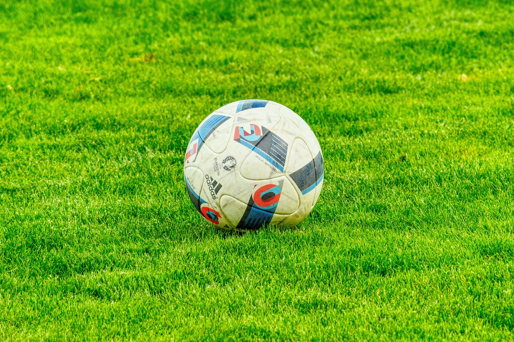
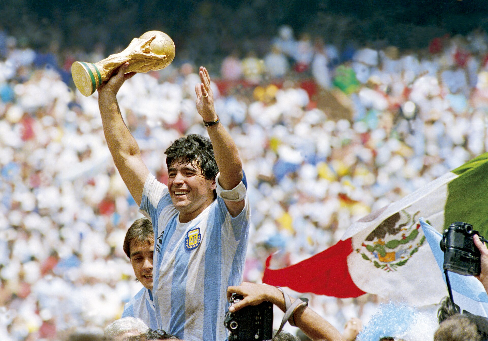
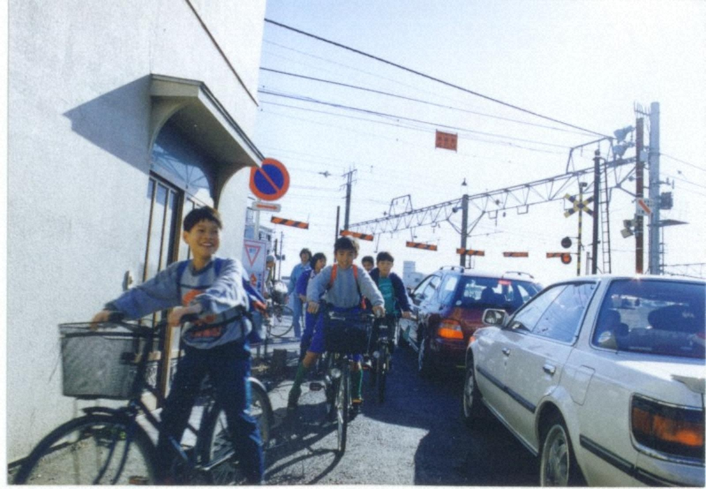

29年前の今日、1997年11月16日。サッカー日本代表がアジア予選のプレーオフでイラン代表を破り、悲願のワールドカップ初出場を決めました。深夜のテレビ画面に釘付けとなった日本中が歓喜に沸き、日本のサッカー史が大きく塗り替えられた瞬間でした。

## 「ドーハの悲劇」から4年、監督交代の激震を越えて

日本のサッカーファンにとって、1993年10月28日は忘れられない日でした。1994年アメリカ大会のアジア最終予選、勝てば初出場が決まるイラク戦のロスタイムに同点ゴールを許し、本大会への切符を土壇場で逃した「ドーハの悲劇」です。その無念を晴らすべく臨んだのが、1998年フランス大会に向けた予選でした。本大会の出場枠が24から32へと拡大されたこの大会で、日本は何としても出場を果たさなければならない重圧を背負っていました。日本サッカー協会も選手たちへの報酬やボーナスとして、前回の倍額となる4億円の予算を計上し、総力を挙げてバックアップしていました。しかしアジア最終予選の戦いは険しく、チームは序盤から勝ち点を落として苦境に立たされます。日本サッカー協会は予選の途中で加茂周監督を解任するという異例の決断を下しました。コーチから急遽昇格し、指揮官に就任したのが岡田武史監督でした。背水の陣で立て直しを図った岡田ジャパンはグループ2位に滑り込み、アジア第3代表決定戦へと駒を進めたのです。

## 灼熱のジョホールバル、アジア第3代表を懸けた激突

1997年11月16日、決戦の舞台となったのは中立地であるマレーシアのジョホールバルでした。対戦相手は、もうひとつのグループで2位となった西アジアの雄、イラン代表です。勝ったチームがフランスへの直接切符を手にし、敗れたチームはオセアニア代表オーストラリアとの大陸間プレーオフに回らなければならないという、絶対に負けられない一発勝負でした。試合は立ち上がりから一進一退の攻防が続きました。前半に日本が先制点を奪うものの、後半に入るとイランの強力な攻撃陣に連続ゴールを許し、1対2と逆転されてしまいます。敗色濃厚な重苦しい空気が漂う中、日本は諦めずに攻め続け、試合終盤に同点ゴールを決めて2対2の振り出しに戻しました。90分で決着はつかず、試合はどちらか一方が得点した瞬間に試合が終了するゴールデンゴール方式の延長戦へと突入しました。

*当日の写真ではありません · 事件当時の写真ではありません · イメージ写真 — 写真: derJani / Pixabay Content License*

## 延長戦の歓喜、岡野雅行が叩き込んだ劇的ゴール

延長戦のピッチには、極度の緊張と疲労が充満していました。ひとつのミスが命取りになる張り詰めた空気の中、岡田監督は切り札として快速フォワードの岡野雅行選手を投入します。日本は積極的に攻撃を仕掛け、何度も相手ゴール前へと迫りましたが、決定的なシュートを決めきれない時間帯が続きました。そして迎えた延長後半、ついに歴史が動きます。味方選手が放ったロングシュートを相手ゴールキーパーが弾いたその瞬間、ゴール前へと猛然と走り込んできたのが岡野選手でした。こぼれ球に反応した岡野選手が体ごと押し込み、ゴールネットを揺らしたのです。その瞬間、主審の笛が鳴り響き、日本の勝利が確定しました。ピッチに崩れ落ちて抱き合う選手たちとベンチのスタッフ。マレーシアの夜空に響き渡った叫びは、のちに「ジョホールバルの歓喜」として日本のスポーツ史に深く刻まれることになりました。

*Diego Maradona holding the FIFA World Cup trophy after beating West Germany in the final — 写真: Unknown authorUnknown author / Public domain*

## 初出場から8大会連続出場、世界へ刻み続ける足跡

敗れたイランもその後、大陸間プレーオフでオーストラリアを下してフランス大会への切符を手にしました。そして本大会に初出場した日本代表は、グループリーグで3戦全敗という世界の高い壁を経験することになります。しかし、ジョホールバルでこじ開けた世界の扉は、日本サッカーの景色を完全に変えました。1998年の初出場以来、日本代表は2002年の日韓大会、2006年ドイツ大会、2010年南アフリカ大会、2014年ブラジル大会、2018年ロシア大会、2022年カタール大会、そして2026年の北中米大会まで、実に8大会連続でワールドカップ出場を果たしています。初出場から8大会連続での出場という記録は、全ての大会に出場しているブラジルに次ぐ世界歴代2位の偉業です。さらにノックアウトステージ進出回数5回はアジア勢最多であり、国際舞台でのフェアプレー精神も高く評価されています。あのジョホールバルの歓喜の夜から、日本の世界への挑戦は今も途切れることなく続いています。

### 当時の写真

*混合う大踏切⑦ — 写真: chigamu / CC BY (Japan Search)*

### 参考資料

- <https://ja.wikipedia.org/wiki/%E3%82%B5%E3%83%83%E3%82%AB%E3%83%BC%E6%97%A5%E6%9C%AC%E4%BB%A3%E8%A1%A8>
- <https://commons.wikimedia.org/wiki/File:Johor_Bahru_1997.jpg>
- <https://pixabay.com/photos/football-grass-ball-green-grass-2778583/>
- <https://commons.wikimedia.org/wiki/File:Diego_Maradona_holding_the_FIFA_World_Cup_trophy_after_beating_West_Germany_in_the_final.jpg>
- <https://jmapps.ne.jp/chigasaki_history/det.html?data_id=554>
