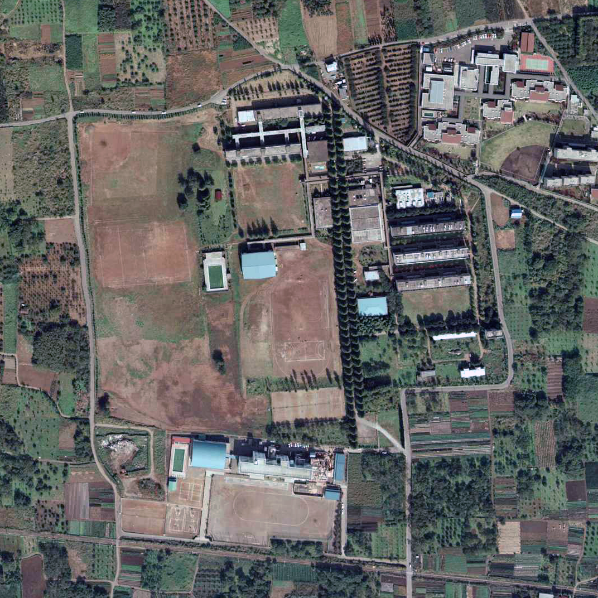
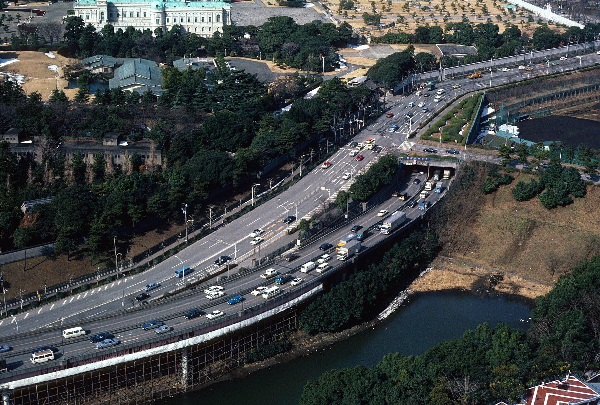
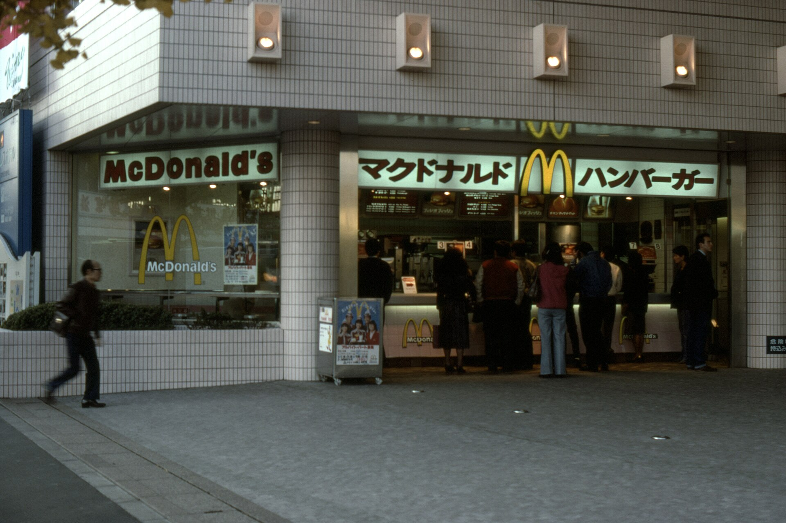

42年前の今日、1984年（昭和59年）11月16日。東京都世田谷区で地下の電話ケーブルが炎上し、街の通信機能が突然失われました。固定電話はもちろん、110番や119番の緊急通報、都市銀行のオンライン網までもが巻き込まれ、都市機能の脆弱性を白日のもとに晒した大事故でした。

## 地下洞道で起きた火災と17時間の延焼

1984年11月16日の金曜日、午前11時50分頃のことでした。東京都世田谷区太子堂4丁目にある日本電信電話公社（電電公社）世田谷電報電話局の近く、地下に張り巡らされた「洞道（とうどう）」と呼ばれる専用トンネル内で火災が発生しました。当時、世田谷電話局と三宿交差点付近の間で電話回線の増設工事が行われていました。ケーブルを保護する鉛管をトーチランプで溶かす作業の最中、炎がポリエチレン製のケーブル被覆や敷物として使われていたウエスに燃え移ったことが原因とみられています。

現場付近には、1束2,400回線を含む直径6センチの加入者ケーブル52本と、中継ケーブル35本の計87本ものケーブルが束ねられていました。洞道内部は鉄筋コンクリート造りで低電圧しか流れていなかったため火災は想定されておらず、プラスチック被覆の激しい燃焼と大量の煙により消火活動は難航しました。作業員2名が一時行方不明となりましたが無事救出され、死傷者こそ出なかったものの、火が完全に消し止められたのは発生から17時間近くが経過した翌17日午前4時37分のことでした。

## 失われた緊急通報と街のパニック

火災による影響は甚大でした。世田谷電話局管内の加入電話約8万9千回線をはじめ、管内の公衆電話や警察専用電話が完全に沈黙しました。さらに近隣の狛江、成城、砧、弦巻の各電話局管内でも電話が非常にかかりにくくなり、日常生活の連絡手段が一挙に断たれました。

最も深刻だったのは、119番や110番といった緊急通報がつながらなくなったことです。東京消防庁は火災の早期発見のために昔ながらの火の見櫓を活用し、「東京消防庁アマチュア無線クラブ」が救急や出火通報に備えて待機態勢を敷きました。事件や事故に遭った市民は電話をあきらめ、自ら直接交番へと足を運んで出動を要請せざるを得ませんでした。また、玉川通りでは車両通行量を感知して点滅間隔を自動調整する信号機の制御が停止し、復旧まで等間隔での点滅に切り替えられるなど、街のインフラ各所に影響が波及しました。

*Akikawa high school 1984 — 写真: 国土地理院 / Attribution*

## 全国243支店を揺るがした銀行オンラインの停止

この事故が「高度情報化社会の災害」として日本中に衝撃を与えた最大の要因は、金融機関のオンラインシステム停止でした。世田谷区池尻にコンピュータ事務集中センターを構えていた三菱銀行（現・三菱UFJ銀行）の通信回線が切断され、全国243の全支店でオンラインが不通となったのです。また、世田谷区三軒茶屋に事務センターを置いていた大和銀行（現・りそな銀行）でも、東京都、神奈川県、千葉県、埼玉県の61支店で窓口の預金受付やATMでの引き出しができなくなりました。

さらに第一勧業銀行（現・みずほ銀行）や山種証券（現・SMBC日興証券）の一部支店、世田谷区や狛江市内の郵便局窓口でも業務に支障が出ました。自衛隊中央病院、国立小児病院、国立第二病院といった地域の医療機関、さらには世田谷区役所や警察署、消防署などの公的機関までもが通信遮断に巻き込まれました。三菱銀行の各支店では、過去の手作業訓練の経験を活かし、行員たちがそろばんと伝票を使った手計算で急場をしのぎ、預金者の対応にあたりました。

*1984-03-25 Minato, Tokyo — 写真: David Wipf / CC BY 2.0*

## 「伝言飛脚」400人と2万3千人の突貫復旧

前代未聞の事態に対し、電電公社や行政は総力を挙げた対策を展開しました。電電公社は被災地域に臨時公衆電話を特設したほか、地域外からかかってきた電話の伝言をメモに書き起こし、自転車などで被災地内の受取人へ届ける「伝言飛脚」400人を動員しました。電話が通じないため電報の需要も急増し、弦巻電話局では通常の土曜日に400通から500通ほどだった電報の取扱数が、翌17日には4,400通へと跳ね上がりました。郵政省も世田谷区や目黒区宛ての通常郵便物を速達扱いとする特別措置を講じました。

地下洞道内では、狛江や成城など周辺局を結ぶ中継ケーブル6,400回線中4,000回線が被害を受けており、接続し直さなければならない箇所は130万箇所にも及びました。復旧作業にはのべ2万3千人の作業員が投入され、機動隊員300人、パトカー28台、消防車51台が出動。三菱銀行はマイクロ波中継車を現場近くに手配して17日朝に仮復旧を取りつけ、20日にはオンラインを完全復旧させました。同日夜9時には世田谷電話局隣接の加入電話398回線が本復旧を果たしました。

*JP Tokyo McDonalds 1984 15 CE Family Coll (51930237401) — 写真: David Pirmann / CC BY 2.0*

## 9日目の完全復旧宣言と現代に残された教訓

11月25日、電電公社総裁の真藤恒は「11月24日午後9時50分までに全加入者を対象としたテスト作業を完了した」と発表し、発生から9日目にしてようやく完全復旧宣言が出されました。直接の工事経費だけでも3億3,500万円に達する大作業でした。

この事故は、情報通信網のバックアップ体制の不備という重い課題を浮き彫りにしました。当時、重要施設であっても電話局回線を二重に引く「二重帰属」が認められておらず、センターが1箇所トラブルに見舞われると全国規模で機能停止に陥る脆さがありました。この甚大な被害を教訓として、通信ケーブルの難燃化、地下洞道内への防火壁設置、作業管理の厳格化、そして重要回線の二重化といった安全対策が一気に加速することになりました。私たちが当たり前のように利用している強固な通信ネットワークの礎には、42年前の世田谷で起きたこの都市型災害の教訓が刻まれています。

### 参考資料

- <https://ja.wikipedia.org/wiki/%E4%B8%96%E7%94%B0%E8%B0%B7%E5%B1%80%E3%82%B1%E3%83%BC%E3%83%96%E3%83%AB%E7%81%AB%E7%81%BD>
- <https://commons.wikimedia.org/wiki/File:%E7%AB%B9%E3%81%AE%E5%AD%90%E6%97%8F%E9%9B%86%E5%90%88%E5%86%99%E7%9C%9F.jpg>
- <https://commons.wikimedia.org/wiki/File:Akikawa_high_school_1984.png>
- <https://commons.wikimedia.org/wiki/File:1984-03-25_Minato,_Tokyo.jpg>
- <https://commons.wikimedia.org/wiki/File:JP_Tokyo_McDonalds_1984_15_CE_Family_Coll_(51930237401).jpg>
