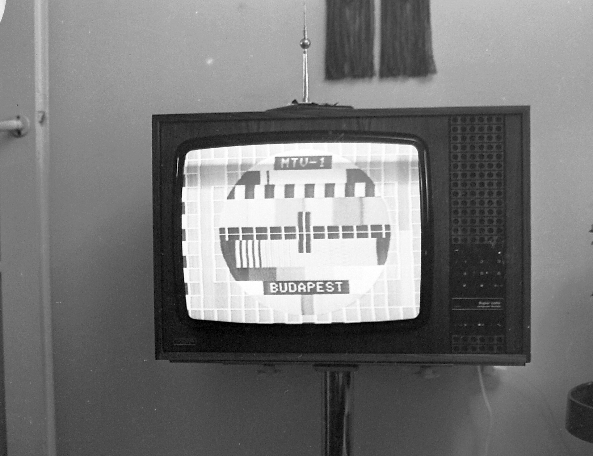

1987年（昭和62年）11月16日。フジテレビ系列の月曜夜8時枠で、新たな冠番組『志村けんのだいじょうぶだぁ』のレギュラー放送が始まりました。ザ・ドリフターズで一世を風靡した志村けんさんが単独主演を務め、お茶の間に新たなコントブームを巻き起こした伝説のバラエティ番組です。

## ドリフから単独冠番組へ、番組誕生の背景

『志村けんのだいじょうぶだぁ』は、志村けんさんがザ・ドリフターズから離れて主演した2本目の冠レギュラー番組でした。日本テレビ系で放送されていた『志村けんの失礼しまぁーす!』から主要スタッフを引き継ぎ、ロケーション撮影をなくしてスタジオコントに特化した番組として企画されました。番組タイトルの由来は、TBS系『加トちゃんケンちゃんごきげんテレビ』内のコメディドラマ「探偵物語」で志村さんが演じていた「だいじょうぶだぁ教」から取られたものです。所属事務所であるイザワオフィスの単独制作として、志村さんのコントへの強い情熱が注ぎ込まれました。

## 芸人を排した異色の顔ぶれ「だいじょうぶだぁファミリー」

この番組の大きな特徴は、メインの志村さん以外に本業のお笑い芸人がレギュラーにいなかった点にあります。志村さんの相棒として司会に抜擢されたのは、ドゥーワップグループ「ラッツ&スター」（旧シャネルズ）のメンバーとして活躍していた田代まさしさんでした。田代さんはステージで披露していたアメリカのコメディアン、ジェリー・ルイスの物真似を志村さんに見出され、本格的にお笑いの才能を開花させていました。さらに司会陣には第3回ホリプロタレントスカウトキャラバングランプリのアイドル・松本典子さんが加わり、レギュラーには女優の石野陽子（現・いしのようこ）さんやミュージシャンの桑野信義さん、伊藤智恵理さんらが名を連ねました。俳優やアイドル、歌手といった異分野の人材が集まり、志村さんの緻密な指導のもとでコントを演じる独自のスタイルが確立されたのです。

*当日の写真ではありません · 事件当時の写真ではありません · イメージ写真 — 写真: StockSnap / Pixabay Content License*

## 計算し尽くされた構成、志村けんのコント哲学

番組は54分の放送枠の中で、前後半の2つのパートに明確に分けられていました。前半にはコントを集中的に詰め込み、後半にはルーレットマンが登場するクイズやゲームといったお遊びコーナーを配置する構成でした。これは「1時間すべてコントを流すと視聴者に飽きられる」という志村さんの長年の経験に基づく考えによるものでした。同時に、「一番見せたいものを先に流す」という意向から、メインであるコントを番組前半に集中させました。番組の制作現場では毎週水曜日に徹底したネタの打ち合わせが行われ、妥協のない笑い作りが続けられていました。

*当日の写真ではありません · 事件当時の写真ではありません · イメージ写真 — 写真: funnytools / Pixabay Content License*

## 初回から誕生した「変なおじさん」と「じいさんばあさん」

1987年11月16日の第1回放送から、のちに志村さんの代名詞となる名物キャラクターが次々と誕生しました。その筆頭が「変なおじさん」です。独特のメイクと奇妙な踊り、唐突に現れては周囲を混乱に陥れるこのキャラクターは、番組を象徴する存在へと育っていきました。もう一つの柱となったのが、志村さんがお婆さん、田代さんがお爺さん、松本典子さんが孫娘ののりこを演じる「ご存知!じいさんばあさん」でした。コタツに入った3人が他愛のない世間話をする中で、お婆さんが隙あらばダジャレや小ボケ、替え歌を挟み、お爺さんが鋭くツッコミを入れ続けるお決まりの展開でした。

*VIDEOTON Super Color (TS 3301...5313) televíziókészülék Fortepan 8949 — 写真: FOTO:Fortepan — ID 8949: Adományozó/Donor: MHSZ. / CC BY-SA 3.0*

## お約束のギャグと合言葉「ダッフンダ!」の熱狂

「じいさんばあさん」コントでは、フォーリーブスの「ブルドッグ」や山口百恵さんの「プレイバックPart2」、ピンク・レディーの「UFO」など、往年のヒット曲のフレーズを用いたギャグが満載でした。そしてコントの最後には、3人がコタツの前に並び、お笑い三人組の替え歌に合わせて「アハハ、ウフフ、エーヘヘのオーホホでダッフンダ! ぼくらの合言葉はダッフンダ!」と歌い踊り、「それでは皆さんまた来週、バイ!」と締めるのが定番となりました。この「ダッフンダ!」は瞬く間に全国の子どもたちや大人の間に広まり、学校や職場で誰もが真似をする社会現象となったのです。

## 数々の名作コントと劇場公演への展開

番組からはほかにも数多くの名物コーナーが生まれました。1989年に始まった志村さんと石野陽子さんによる「けん&陽子 夫婦の会話」では、翌朝5時起きをめぐる軽妙な掛け合いや「早見優、北天佑、醤油、ラー油、アイラブユー」の仲直りのリズムが親しまれました。また田代さんと桑野さんによるヤクザコンビ、マンションから標的を狙う殺し屋コンビ、柄本明さんをゲストに迎えたレンタルビデオ店のコントなど、設定の細部にまでこだわったコントが毎週披露されました。人気はテレビ画面にとどまらず、「だいじょうぶだぁファミリー」として下北沢の本多劇場や吉祥寺の前進座、池袋のサンシャイン劇場で計4回の舞台公演が行われるほどでした。

## レギュラー終了後も30年以上愛され続けた笑い

レギュラー放送は1993年（平成5年）9月27日まで約6年間にわたって続き、月曜夜8時の看板番組として親しまれました。レギュラー終了後も番組の精神は受け継がれ、2007年からは単発のスペシャル番組として年3〜4回のペースで放送が再開されました。志村けんさんが2020年3月に亡くなるまで、30年以上にわたりフジテレビ系列でコント番組が継続された原点が、まさに1987年11月16日の第1回放送でした。時代が平成から令和へと移り変わっても、あのコタツを囲んだ笑い声と「ダッフンダ!」のフレーズは、多くの人々の記憶の中で色あせることなく生き続けています。

### 参考資料

- <https://ja.wikipedia.org/wiki/%E5%BF%97%E6%9D%91%E3%81%91%E3%82%93>
- <https://pixabay.com/photos/tv-television-retro-classic-old-1844964/>
- <https://pixabay.com/photos/tv-television-vintage-oldschool-2619649/>
- <https://pixabay.com/photos/television-developing-countries-899265/>
- <https://commons.wikimedia.org/wiki/File:VIDEOTON_Super_Color_(TS_3301...5313)_telev%C3%ADzi%C3%B3k%C3%A9sz%C3%BCl%C3%A9k_Fortepan_8949.jpg>
