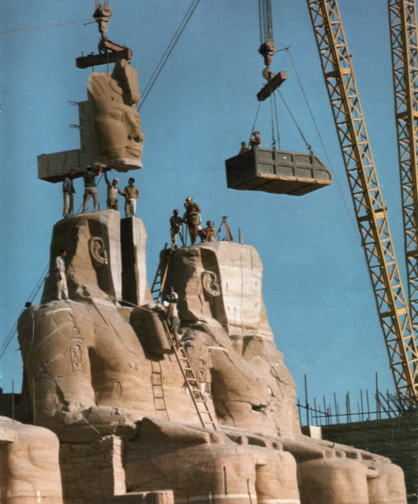
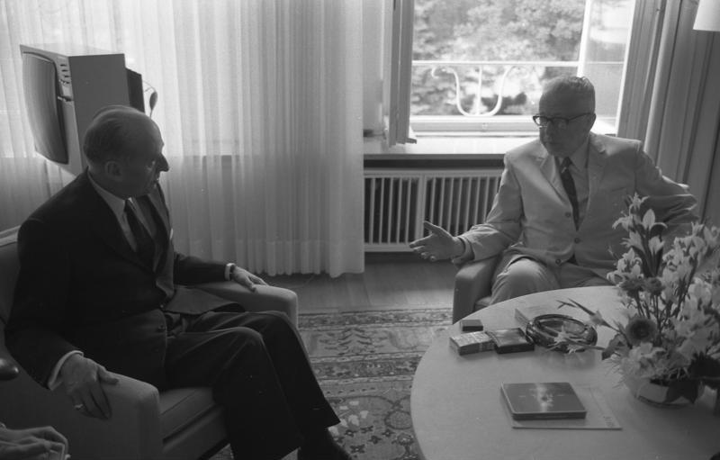
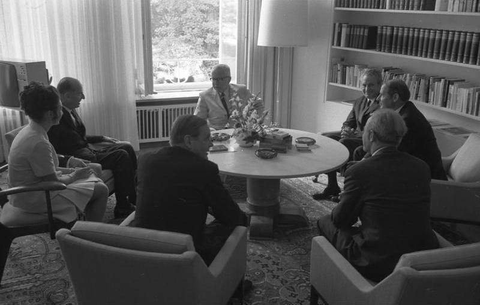

54年前の今日、1972年11月16日。フランス・パリで開催されていた国際連合教育科学文化機関（ユネスコ）の第17回総会において、「世界の文化遺産及び自然遺産の保護に関する条約」（通称・世界遺産条約）が正式に採択されました。人類にとって「顕著な普遍的価値」を持つ文化財や大自然を、一国の財産にとどめず、国際社会全体で守り抜くための画期的な枠組みがここに誕生しました。

## ナイル川のダム計画とヌビア遺跡水没の危機

世界遺産制度が形作られる最大の契機となったのは、1950年代にエジプトで持ち上がったアスワン・ハイ・ダムの建設計画でした。ナイル川の治水と近代化のために計画されたこの巨大ダムは、完成すれば広大な人造湖を作り出し、紀元前に建てられた壮大なアブ・シンベル神殿をはじめとする数々のヌビア遺跡を水没させる危機を招くことになったのです。

エジプト大統領の要請を受けたユネスコは、1960年から大規模な国際救済キャンペーンを開始しました。冷戦下という複雑な国際情勢のなか、フランス文化大臣アンドレ・マルローの演説などが国際世論を動かし、世界50か国から約4000万ドルの資金が集まりました。このとき日本からも政府の1万ドルと朝日新聞社による27万ドル、計28万ドルの寄付が寄せられました。遺跡を解体して高台へと移築するこの事業の成功は、人類共通の文化財を国境を越えて守るという強い国際連帯の先例となったのです。

## 自然保護構想との融合――二つの潮流がひとつに

一方、文化財の保護とは別に、かけがえのない大自然を守ろうという国際的な枠組み作りも進行していました。世界で初めて国立公園制度（イエローストーン国立公園）を創設したアメリカ合衆国では、1965年のホワイトハウス国際協力協議会において「世界遺産トラスト」構想が提唱されました。優れた自然環境を全人類の現在と未来のために保護しようという試みです。

1971年にはアメリカのリチャード・ニクソン大統領が環境に関する教書でこの理念の具現化を訴え、国際自然保護連合（IUCN）を中心に自然遺産保護の条約草案が作られました。ユネスコ事務局長ルネ・マウらの働きかけもあり、歴史的な建造物や遺跡を守る文化保護の流れと、国立公園に代表される自然保護の流れという二つの構想が一つに統合されることになりました。

*1967年の資料 — 写真: "Per-Olow" - Per-Olow Anderson (1921-1989) / Public domain*

## 1972年11月16日、パリ総会での採択と日本の議長

1972年10月17日から11月21日までパリのユネスコ本部で開催された第17回総会において、一本化された条約案が審議されました。そして11月16日、「世界の文化遺産及び自然遺産の保護に関する条約」が正式に採択されました。この歴史的な総会で議長を務めていたのは、日本の外交官であった萩原徹氏でした。萩原議長とルネ・マウ事務局長による署名を経て、条約は国際社会の共通ルールとして成立しました。

採択された条約は全38条で構成され、締約国自らが国内の遺産を保護・保存する義務を負うこと、顕著な普遍的価値を持つ遺産を掲載する「世界遺産リスト」や「危機にさらされている世界遺産リスト」を作成すること、さらに保全に困難を抱える国を支えるための「世界遺産基金」を設立することなどが明確に盛り込まれました。

*事件当時の写真ではありません · 1970年 — 写真: Jens Gathmann / CC BY-SA 3.0 de*

## 発効への歩みと日本の条約締約

条約採択の翌年である1973年、アメリカ合衆国が世界で最初にこの条約を批准しました。その後、1975年9月に批准国が20か国に達し、規定に基づいて同年12月17日に正式に発効を迎えました。1977年には締約国が40か国を超え、1978年には最初の世界遺産リストへの登録が決定されるなど、事業は急速に国際社会へ定着していきました。

日本は国内での法整備や世界遺産基金への分担金拠出に関する議論の調整を経て、1992年6月30日に125番目の締約国として受諾書を寄託し、同年9月30日に日本国内でも条約が発効しました。翌1993年には、姫路城や法隆寺地域の仏教建造物、屋久島、白神山地が日本で最初の世界遺産に登録されることになります。

*事件当時の写真ではありません · 1970年 — 写真: Jens Gathmann / CC BY-SA 3.0 de*

## 未来へと引き継がれる普遍的な価値

世界遺産条約は、国際協力におけるもっとも成功した条約の一つと呼ばれています。現在では世界196か国が締約国として名を連ね、登録された世界遺産の数も1000件を大きく超えています。紛争や開発、過度な観光などによって危機に直面する遺産も少なくありませんが、定期的な保全状況の報告や専門機関による現地調査など、厳格な保護管理体制が維持されています。

54年前のあの日、パリの地で採択された条約は、国家や民族の枠組みを越え、「全人類の宝」を後世へと伝える確固たる道筋を築きました。私たちが世界各地や日本国内で目にする美しい景観や尊い史跡の背後には、この日結ばれた国際社会の強い誓いと責任が、今も息づいています。

### 参考資料

- <https://ja.wikipedia.org/wiki/%E4%B8%96%E7%95%8C%E9%81%BA%E7%94%A3%E6%9D%A1%E7%B4%84>
- <https://commons.wikimedia.org/wiki/File:Adoption_of_the_World_Heritage_Convention_in_1972_at_UNESCO.jpg>
- <https://commons.wikimedia.org/wiki/File:Abusimbel.jpg>
- <https://commons.wikimedia.org/wiki/File:Bundesarchiv_B_145_Bild-F031964-0007,_Bonn,_Bundespr%C3%A4sident_mit_UNESCO-Generalsekret%C3%A4r.jpg>
- <https://commons.wikimedia.org/wiki/File:Bundesarchiv_B_145_Bild-F031964-0009,_Bonn,_Bundespr%C3%A4sident_mit_UNESCO-Generalsekret%C3%A4r.jpg>
