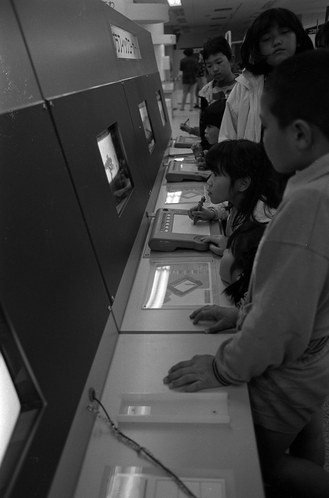
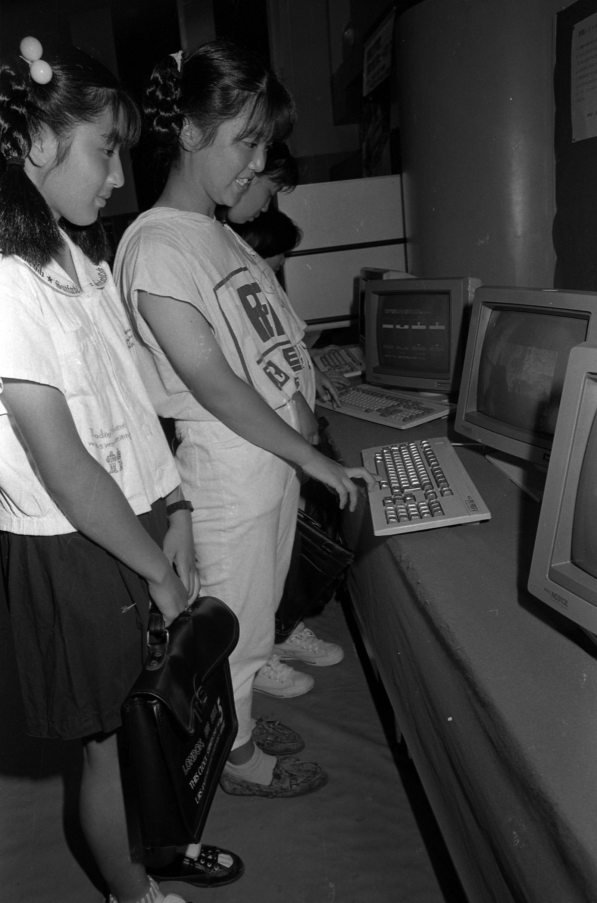
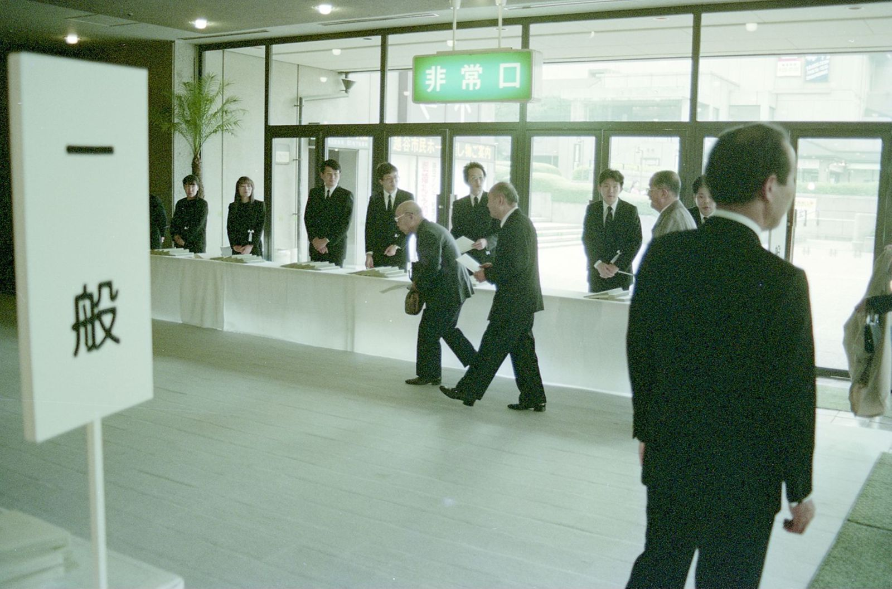

33年前の今日、1993年11月16日。ソニー株式会社と株式会社ソニー・ミュージックエンタテインメントの合弁によって、家庭用ゲーム機事業を手がける新会社「株式会社ソニー・コンピュータエンタテインメント（SCE）」が設立されました。家電大手のソニーが本格的にゲーム市場へ乗り出したこの日は、世界のエンタテインメント産業を大きく塗り替える第一歩となりました。

## 任天堂との決裂から始まった独自の挑戦

ソニーのゲーム事業進出は、順風満帆な滑り出しだったわけではありませんでした。1990年代前半、ソニーは任天堂と共同で、CD-ROM対応型のスーパーファミコンを開発する計画を進めていました。しかし、契約締結後に任天堂側の中途破棄によって計画は決裂し、開発は白紙に戻ってしまいます。

大企業同士の提携解消という大きな挫折に見舞われながらも、ソニーの技術者たちは家庭用ゲーム市場への参入をあきらめませんでした。共同開発機のコードネームとして使われていた「PlayStation」の名をそのまま引き継ぎ、自社単独でゲームハードを開発するという前代未聞の挑戦を決意したのです。

## 1993年11月16日、新会社SCEの船出

こうして1993年11月16日、ソニー本体の技術力と、音楽ビジネスで流通やソフト制作のノウハウを持っていたソニー・ミュージックエンタテインメント（SME）の力を結集し、ソニー・コンピュータエンタテインメントが設立されました。初代社長には小澤敏雄が、副社長には丸山茂雄が就任しました。

当時の家庭用ゲーム機市場は、任天堂が圧倒的なシェアを誇っていた時代です。家電メーカーや異業種からの新規参入が成功することは極めて難しいと見られていた中での船出でした。しかし、設立された新会社は、最先端の技術を詰め込んだ全く新しいゲーム機の完成に向けて急ピッチで準備を進めていきました。

*児童館 コスモスコンピュータ導入 — 写真: ndl / CC BY (Japan Search)*

## 初代プレイステーションの発売と3D映像の衝撃

会社設立から約1年後の1994年12月3日、ついに初代「PlayStation（プレイステーション）」が日本国内で発売されました。当時としては極めて先進的だった3次元（3D）コンピュータグラフィックスのリアルタイム描画技術を搭載し、従来の2Dドット絵中心だった家庭用ゲームの常識を覆しました。

大容量のCD-ROM媒体を採用したことで、臨場感あふれる映像と重厚な音響演出が可能となり、大人向けの本格的なゲーム作品が次々と登場しました。灰色の一体型ハードから次世代の映像が映し出された瞬間、日本のゲームファンや家電業界に大きな衝撃が走りました。

*児童館コスモス 夏休み特別イベント「地球を守る科学技術」 — 写真: ndl / CC BY (Japan Search)*

## クリエイター支援と世界展開の加速

ソニー・コンピュータエンタテインメントはハードの性能だけでなく、ソフトを制作するクリエイターの発掘や世界展開にも素早く着手しました。1994年5月にはアメリカに現地法人を設立し、翌1995年1月にはヨーロッパにも進出を果たしました。

さらに1995年秋には、新しい才能を募るクリエイター支援企画「ゲームやろうぜ!」を開始するなど、多様なゲームソフトが生まれる土壌を整えました。音楽業界の手法を取り入れた受発注システムやソフト流通の刷新も功を奏し、国内外の多くのゲーム会社がプレイステーション陣営に参入することになりました。

*平成元年11月13日大塚伴鹿氏市葬（カラー） — 写真: ndl / CC BY (Japan Search)*

## PS2からPS5へ、受け継がれる技術と看板

初代機の成功にとどまらず、1999年には久夛良木健が社長に就任し、2000年3月4日にはDVD再生機能を標準搭載した「PlayStation 2」を発売して世界的な大ヒットを記録しました。その後も携帯型ゲーム機のPSPや、PlayStation 3、PlayStation 4と世代を重ね、2020年にはPlayStation 5が登場しています。

会社組織も時代の変化に合わせて再編が進められ、2016年4月1日にはネットワーク部門と統合して「ソニー・インタラクティブエンタテインメント（SIE）」へと社名を改めました。現在では本社機能をカリフォルニア州サンマテオに移管し、世界規模のエンタテインメント企業として成長を続けています。

## あの日始まった挑戦の軌跡

すべては、1993年11月16日に設立された小さな合弁会社から始まりました。任天堂との計画決裂という逆境から生まれた決断が、日本の技術とカルチャーを世界中のリビングルームに届ける原動力となったのです。

今では世界中の何億人もの人々がオンラインでつながり、リアルタイムでゲームを楽しむ時代になりました。四角い灰色の初代機をテレビのブラウン管につなぎ、ディスクの読み込み音を聞きながら新しい冒険の始まりを待ったあの日。33年前の今日踏み出された第一歩は、家庭の娯楽風景を根底から変える歴史的な転換点でした。

### 参考資料

- <https://ja.wikipedia.org/wiki/11%E6%9C%8816%E6%97%A5>
- <https://adeac.jp/koshigaya-city-digital-archives/catalog/mp233091-200020>
- <https://adeac.jp/koshigaya-city-digital-archives/catalog/mp234845-200020>
- <https://adeac.jp/koshigaya-city-digital-archives/catalog/mp237517-200020>
- <https://adeac.jp/koshigaya-city-digital-archives/catalog/mp234643-200020>
