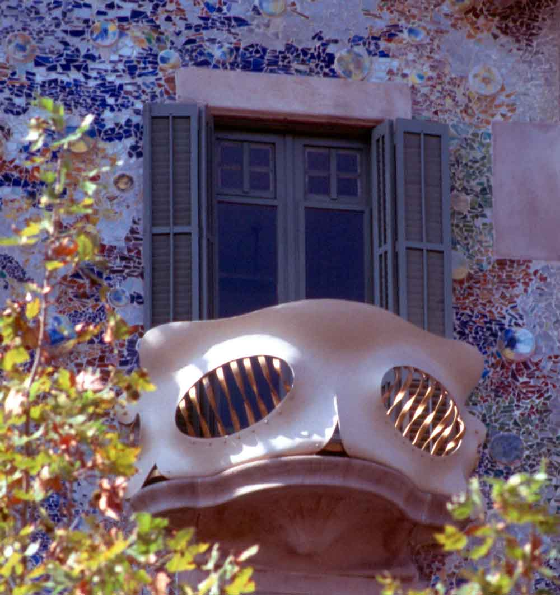

25年前の今日、2001年11月16日。マイクロソフトのパソコン用基本ソフト「Windows XP」の日本語版が日本国内で発売されました。それまで多くの家庭やオフィスで起きていた画面のフリーズやエラーを劇的に減らし、パソコンを誰もが安心して使える道具へと変えた歴史的な節目でした。

## 文字入力の時代からWindows 95の熱狂へ

1975年4月4日にビル・ゲイツとポール・アレンによって創業されたマイクロソフトは、当初MS-DOSなどの文字入出力を中心としたシステムを提供していました。当時のパソコンは同時に一つの作業しかできないシングルタスクが当たり前で、操作には専門知識が必要でした。

状況を一変させたのが1995年秋に登場したWindows 95でした。美しいグラフィック画面とマウスによる直感的な操作、そしてインターネット接続機能を標準で備え、世界的な大ヒットを記録しました。当時の日本国内ではパソコン本体が平均24万円台と高価だったにもかかわらず爆発的な売れ行きを見せ、この年は「パソコン普及元年」や「インターネット普及元年」と呼ばれました。

## 利用者たちを悩ませ続けた青いエラー画面

家庭やオフィスに急速に浸透したWindows 95やその後継製品でしたが、大きな弱点を抱えていました。土台に従来のMS-DOSの古い仕組みを残していたため、複数の作業を同時に行うとシステムリソースの限界やメモリの競合が起きやすかったのです。

その結果として頻発したのが、画面全体が真っ青になり操作を一切受け付けなくなる「ブルースクリーン」と呼ばれる現象でした。作業途中の大切な文書やデータが突然消えてしまい、泣く泣くパソコンを再起動せざるを得ない事態に、世界中の多くのユーザーが頭を抱えていました。

*2001年の資料 — 写真: gundam2345 / CC BY 3.0*

## ビジネス用の頑丈な骨格を家庭用へ統合

この根本的な問題を解決するため、マイクロソフトは基本ソフトの設計そのものを刷新する決断を下しました。同社は1993年のWindows NT 3.1以来、企業のサーバーや業務用ワークステーション向けに、高い信頼性と安定性を誇る「NT系」と呼ばれるシステムを展開していました。

そして2001年、この頑丈なNT系のマイクロカーネル設計を、初めて一般消費者向けの製品に全面的に採用したのがWindows XPでした。従来のMS-DOSに依存した古い構造と完全に決別し、業務用と家庭用のシステムを一本化することに成功したのです。

*事件当時の写真ではありません · 2001年 — 写真: Danny Choo from Tokyo, Japan / CC BY-SA 2.0*

## 2001年11月16日、日本語版が日本に上陸

2001年11月16日、待望のWindows XP日本語版が日本国内で発売を迎えました。丸みを帯びた親しみやすいデザインや青と緑を基調とした鮮やかなデスクトップ画面、そして何よりも突然停止しない圧倒的な安定性が、利用者に大きな安心感をもたらしました。

音楽データの取り扱いやデジタルカメラの写真整理、ブロードバンド時代を迎えた高速インターネットへの接続など、マルチメディア機能も大幅に強化されました。パソコンは一部の愛好家や専門家のものではなく、日々の生活を豊かに楽しむ家電のような身近な存在へと進化を遂げたのです。

*事件当時の写真ではありません · 2001年 — 写真: Gerd A.T. Müller / CC BY-SA 3.0*

## 後継製品が登場しても愛され続けた理由

Windows XPはその優れた安定性と完成度の高さから、消費者の絶大な支持を獲得しました。2006年に次世代の基本ソフトであるWindows Vistaが発売された後も、XPを使い続けるユーザーが世界中で多数を占めました。

2009年10月には、インターネット上で使用されるパソコンの市場シェアにおいてWindows全体が約90パーセントを占めるに至ります。その中心にいたのは、長年にわたって社会の基盤を支え続けたXPでした。ウェブサイトの閲覧シェアにおいても、2015年にWindows 10が登場する頃までその影響力が語り継がれるほどの長寿製品となりました。

## 現代のWindows 11へ受け継がれた遺産

現在、パソコンの基本ソフトは最新のWindows 11へと引き継がれ、ビジネスや教育、家庭のあらゆる場面で軽快に動作しています。私たちが今日、当たり前のようにフリーズを気にせず複数の作業をこなし、動画配信や資料作成を行える環境は、XPの時代に確立された確かな土台の上に成り立っています。

あの青い画面に一喜一憂し、新しくなったデスクトップに胸を躍らせた2001年のあの日。パソコンが私たちの暮らしの真ん中へと腰を据えた時代の記憶は、四半世紀が経過した今も鮮やかに残っています。

### 参考資料

- <https://ja.wikipedia.org/wiki/11%E6%9C%8816%E6%97%A5>
- <https://commons.wikimedia.org/wiki/File:Chuo-Sobu_201_set_6_Akihabara_20010504.jpg>
- <https://commons.wikimedia.org/wiki/File:%E7%A7%8B%E8%91%89%E5%8E%9F_(%E6%9D%B1%E4%BA%AC%E9%83%BD%E5%8D%83%E4%BB%A3%E7%94%B0%E5%8C%BA)_-_panoramio.jpg>
- <https://commons.wikimedia.org/wiki/File:Akihabara_Station_Electronic_Town_entrance_south_street_circa_June_2001_(by_Danny_Choo).jpg>
- <https://commons.wikimedia.org/wiki/File:Barcelona_Balkon_20010907.jpg>
