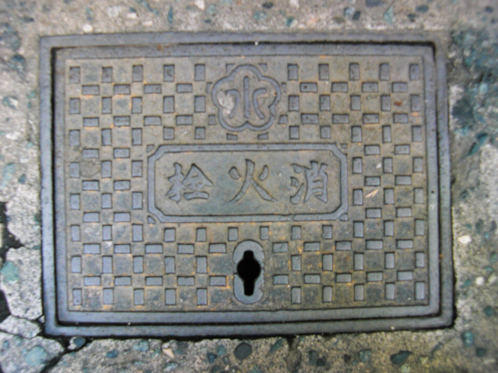
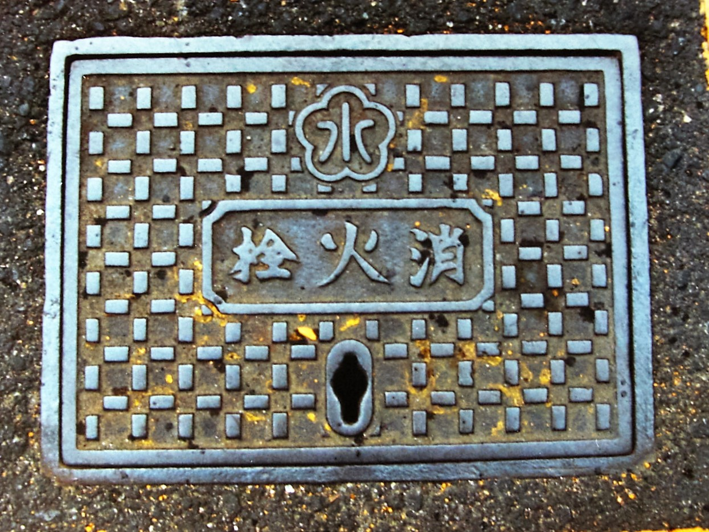
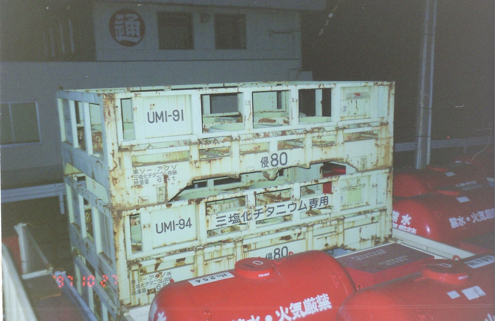

29年前の今日、1997年11月17日。北海道を代表する大手都市銀行、北海道拓殖銀行が経営破綻しました。戦後日本の金融行政において「大手銀行は絶対に潰れない」と信じられていた護送船団方式の神話が崩壊した瞬間でした。

## 「道民銀行」として絶大な信頼を集めた拓銀の歴史

北海道拓殖銀行は、1900年（明治33年）に北海道の開拓事業に資本を供給するための特殊銀行として設立されました。札幌市中央区に本店を構え、長く北海道の農業や産業振興を支えてきました。

戦後の1950年に民間銀行として再出発し、1955年には都市銀行の仲間入りを果たします。道内の大多数の企業や家庭が口座を持ち、「拓銀と取引がある」こと自体が企業経営者の大きなステータスでした。

地元では親しみを込めて「拓銀さん」と呼ばれ、ヒグマをモチーフにしたキャラクター「たくちゃん」や、後に採用されたサンリオの「みんなのたあ坊」など、ノベルティグッズも道民の日常生活に広く浸透していました。

## 都銀最小の焦りとバブル期の過剰融資

盤石に見えた拓銀でしたが、全国に13行あった都市銀行の中では最も規模が小さい銀行でした。バブル景気が過熱する1980年代後半、三大都市圏で収益を伸ばす大手都銀や上位地方銀行に追いつこうと、焦りを募らせていきます。

1989年に策定された「たくぎん21世紀ビジョン」などを背景に、拓銀は不動産開発支援や企業育成を掲げた積極的な拡大路線へと舵を切りました。担保不動産の評価額を大幅に超えるような高率の融資を次々と実行していきました。

しかし、拓銀の不動産融資への本格参入は他行より出遅れていたため、すでに他行が担保を設定している土地に劣後順位で担保を設定せざるを得ないなど、最初から極めて高い回収リスクを背負い込むことになりました。

*Fire.hydrant.cover.in.odawara.city — 写真: 栗原 岳 / CC BY-SA 4.0*

## 総合開発部の暴走と膨らみ続ける不良債権

融資拡大の旗振り役となったのが、行内に新設された「総合開発部」でした。渉外を担当する部隊に対して審査を担当する人員は極端に少なく、審査機能は麻痺状態に陥っていました。

バブル経済が崩壊を始めても融資のブレーキは踏まれませんでした。カブトデコムやソフィアといった不動産・リゾート関連企業への融資は数千億円規模にまで膨張し、巨額の不良債権へと姿を変えていきました。

拓銀は損失をすぐに表面化させず、傘下のペーパーカンパニーを経由させた迂回融資によって不良債権を飛ばすなど、延命工作を重ねました。しかし、1995年3月期決算では設立以来95年で初となる赤字に転落し、財務の悪化は隠しきれなくなっていきました。

*Fire.hydrant.cover.in.odawara.city.2 — 写真: 栗原 岳 / CC BY-SA 4.0*

## 広がる不安、取り付け騒ぎから資金ショートへ

1997年に入ると、拓銀の経営危機は急速に表面化します。1月下旬には外資系証券からの空売りなどを浴び、株価が18年ぶりに200円を割り込みました。大口の機関投資家や企業が預金を解約する動きが強まります。

さらに同年3月、日曜日のテレビ報道番組で実質的な破綻状態にあると報じられると、動揺は小口の一般預金者にも波及しました。翌日の月曜日だけで10億円以上の預金が引き出される取り付け騒ぎが発生します。

大蔵省の管理下で他行との合併による救済策などが模索されたものの交渉はまとまらず、拓銀への市場の信用は完全に失われました。短期金融市場からの資金調達が極めて困難となり、日々の資金繰りはついに限界を迎えました。

*UM1-91----① 【東ソー・アクゾ】Containers of Japan Rail — 写真: Gazouya-japan / CC BY-SA 4.0*

## 1997年11月17日、自力再建の断念

1997年11月17日早朝、北海道拓殖銀行は臨時取締役会を開き、自力再建の断念と業務継続のための営業譲渡を決定しました。戦後日本の金融史において、都市銀行の経営破綻は初めての出来事でした。

道内の支店窓口には朝から預金を引き出そうとする人々が長い列を作り、全国ニュースでもその混乱ぶりが大きく報じられました。政府と日本銀行は日銀特融を実施して預金の全額保護を表明し、連鎖的な金融パニックの鎮静化に追われました。

その後、道内の営業基盤は第二地方銀行であった北洋銀行へ、道外の店舗網や資産は中央信託銀行（現・三井住友信託銀行）へと引き継がれました。拓銀は1999年に法人解散し、2006年に清算が結了しました。

## メガバンク再編の号砲となった歴史的転換点

拓銀の破綻は、それまで日本経済を支えてきた「護送船団方式」の終焉を告げる象徴的な事件となりました。この破綻を皮切りに、直後には山一證券の自主廃業、翌1998年には日本長期信用銀行や日本債券信用銀行の破綻が続き、日本は深刻な金融危機へと突入していきました。

かつて13行を数えた都市銀行は、その後の大規模な合併と再編を経て、現在のメガバンク体制へと集約されていくことになります。

都市銀行の経営破綻という事態は、2026年現在に至るまで拓銀が唯一の事例です。親しまれた「拓銀さん」の消滅は、日本の金融界のみならず、地域経済と大手銀行のあり方に今も重い教訓を投げかけています。

### 参考資料

- <https://ja.wikipedia.org/wiki/11%E6%9C%8817%E6%97%A5>
- <https://commons.wikimedia.org/wiki/File:Fujieda.st.brick.house.jpg>
- <https://commons.wikimedia.org/wiki/File:Fire.hydrant.cover.in.odawara.city.jpg>
- <https://commons.wikimedia.org/wiki/File:Fire.hydrant.cover.in.odawara.city.2.jpg>
- <https://commons.wikimedia.org/wiki/File:UM1-91----%E2%91%A0_%E3%80%90%E6%9D%B1%E3%82%BD%E3%83%BC%E3%83%BB%E3%82%A2%E3%82%AF%E3%82%BE%E3%80%91Containers_of_Japan_Rail.jpg>
