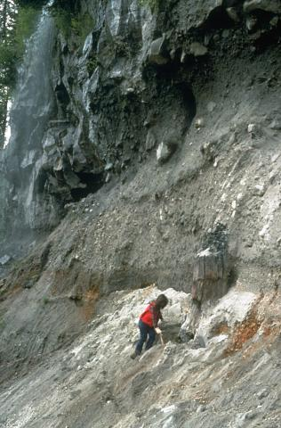
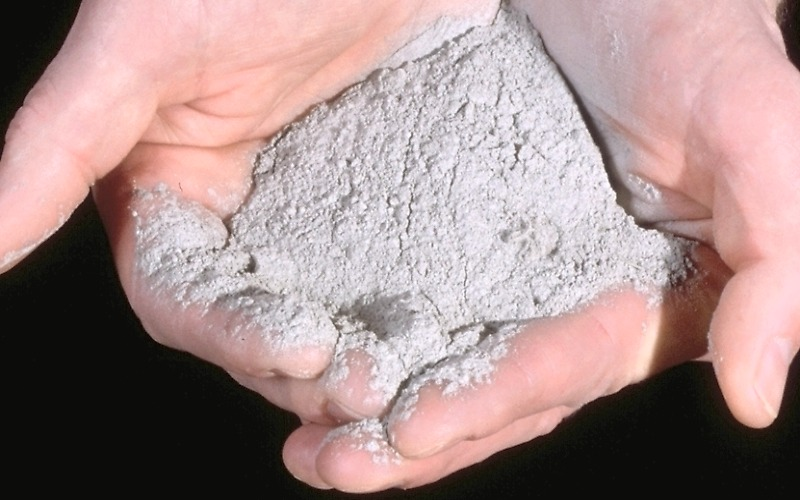
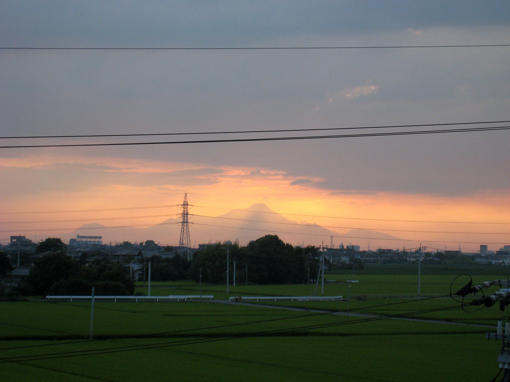

36年前の今日、1990年11月17日。長崎県の島原半島にそびえる雲仙普賢岳の山頂部で水蒸気爆発が発生し、198年ぶりに噴火しました。江戸時代の寛政噴火以来、約2世紀にわたり静寂を保っていた火山の目覚めは、やがて平成史に残る大規模な火山災害へと発展していくことになります。

## 198年の沈黙を破った噴火

雲仙岳が前回噴火したのは、江戸時代の1792年（寛政4年）のことでした。この時は普賢岳からの溶岩流出に続いて眉山が山体崩壊を起こし、発生した津波によって対岸の肥後国（現在の熊本県）を含め約1万5000人もの犠牲者を出しました。「島原大変肥後迷惑」として日本史上最悪の火山災害として知られるこの災禍から約200年、山は静けさを保ち続けていました。

しかし、実際には1968年頃から火山活動の兆候が確認されており、1984年には橘湾でマグマの供給を示唆する群発地震が発生していました。そして1990年11月17日、普賢岳山頂部の神社脇の2か所から熱水と白煙が吹き上がり、ついに198年ぶりの噴火活動が幕を開けました。

## 溶岩ドームの出現と火砕流の猛威

噴火は同年12月に一時小康状態となり、道路の通行止めも解除されたため、活動はそのまま終息に向かうかと思われました。しかし翌1991年2月12日に再噴火すると、4月にかけて活動が拡大していきました。

5月15日には降り積もった火山灰による最初の土石流が発生し、5月20日には地獄跡火口から粘性の高い溶岩が姿を現しました。溶岩は流れ出さずに盛り上がり、直径約40メートルの溶岩ドームを形成。絶え間なく供給されるマグマに押し出されたドームは自重で崩落を繰り返し、高温の火山ガスと岩塊が一体となって時速100キロメートルもの猛スピードで山肌を駆け下る「火砕流」を頻発させるようになったのです。

*Meager ash-fall and pyroclastic flow deposits — 写真: Willie Scott / Public domain*

## 1991年6月3日、未曾有の大火砕流被害

火砕流の頻発に伴い、島原市などは水無川流域の上木場地区などに災害対策基本法に基づく避難勧告を発令しました。しかし、火砕流の様子を撮影しようとした報道関係者や、住民への警戒・避難誘導にあたっていた地元消防団員、警察官らが避難勧告地域の境界付近にとどまっていました。

そして1991年6月3日午後4時8分、山頂の溶岩ドームが崩落し、過去最大規模の火砕流が発生しました。猛烈な熱風と黒煙を伴う熱雲は避難勧告地域を越えて押し寄せ、報道陣や消防団員ら43人が死亡・行方不明となる痛ましい惨事となりました。その後、1993年6月の火砕流でも1人が犠牲となり、一連の噴火災害による死者・行方不明者は計44人に達しました。

*Volcanic ash 30410914-076 large — 写真: David E. Wieprecht / Public domain*

## 国内初、居住地域への警戒区域設定

大火砕流の直後となる1991年6月7日、島原市などは災害対策基本法第63条に基づき、溶岩ドーム周辺および火砕流の流下地域に「警戒区域」を設定しました。従来の避難勧告とは異なり、罰則を伴って立ち入りを禁止し、強制退去を命じるこの措置が、人が居住する地域に対して適用されたのは日本の防災史上初めてのことでした。

警戒区域の設定により住民の命は守られたものの、農地や商店、工場に立ち入ることができなくなった住民は長期間にわたり深刻な経済的打撃を受けました。その後、1000億円規模の災害対策基金や200億円を超える義援金が寄せられ、生活再建や事業支援が進められることとなりました。

*Mount Unzen smoking in the distance at sunset — 写真: JoshBerglund19 / CC BY 2.0*

## 平成新山の誕生と今に続く警戒

普賢岳の山頂から噴き出し続けた溶岩は幾重にも重なり、かつての主峰を超える巨大な溶岩ドームを築き上げました。1995年3月頃に噴火活動は沈静化し、1996年には噴火終息が宣言され、新たに形成された山体は「平成新山」と名付けられました。

平成新山は標高1483メートルを測り、現在も長崎県の最高峰となっています。2004年には国の天然記念物にも指定されました。しかし、終息宣言から四半世紀以上が経過した現在も、溶岩ドームが崩壊する危険性が完全には消えていないため、山頂周辺では今も警戒区域の指定が継続されています。自然の脅威と防災の教訓は、誕生した新しい山とともに今も生き続けています。

### 参考資料

- <https://ja.wikipedia.org/wiki/%E9%9B%B2%E4%BB%99%E5%B2%B3>
- <https://commons.wikimedia.org/wiki/File:Shimabara_railway_kiha20-2017.jpg>
- <https://commons.wikimedia.org/wiki/File:Meager_ash-fall_and_pyroclastic_flow_deposits.jpg>
- <https://commons.wikimedia.org/wiki/File:Volcanic_ash_30410914-076_large.jpg>
- <https://www.flickr.com/photos/79877212@N00/2838643923>
