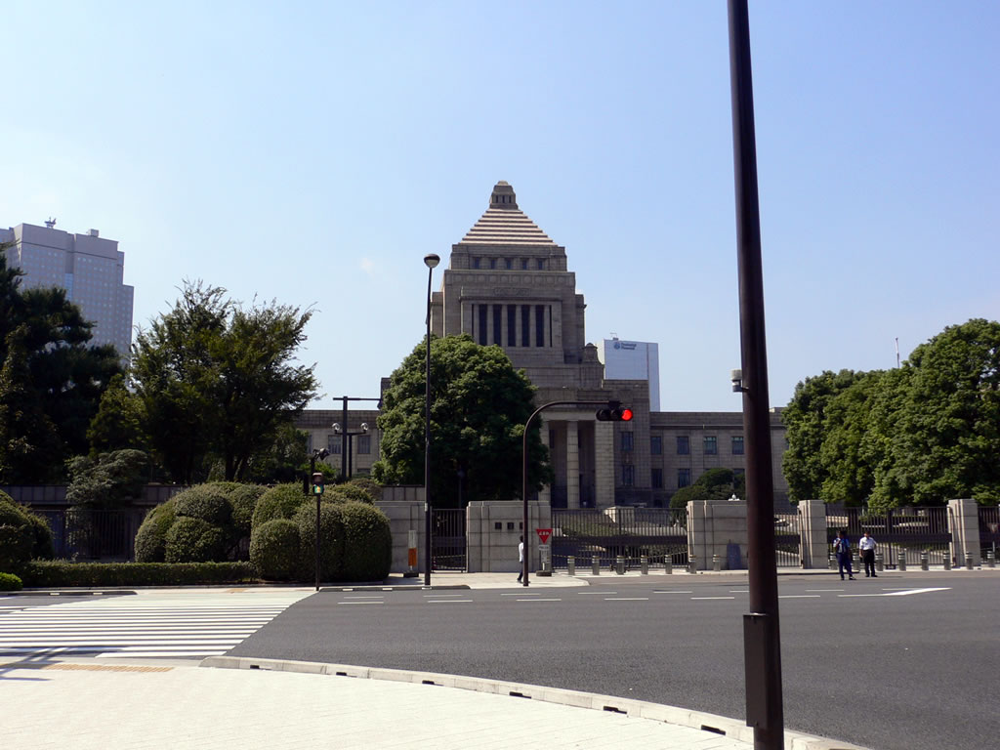
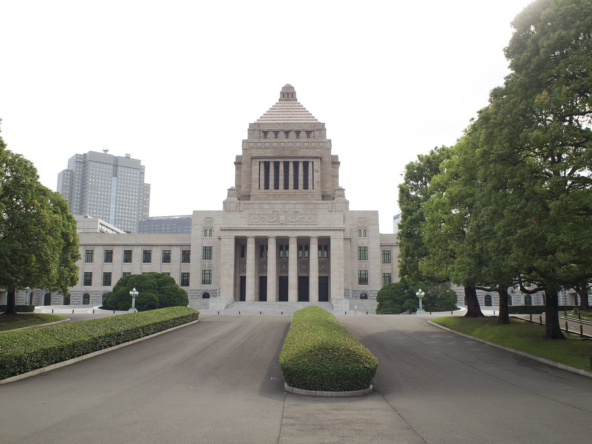
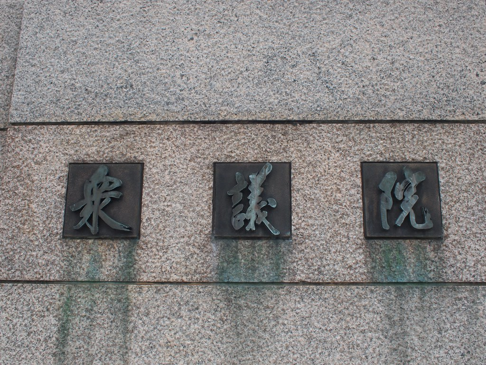

21年前の今日、2005年11月17日。国土交通省は、千葉県にあった建築設計事務所の元一級建築士によって、マンションやホテルの構造計算書が偽造されていたと公表しました。地震多発国である日本において、建築基準法で定められた耐震基準を満たさない建物が市場に供給されていた事実は、人命と財産を脅かす大事件として日本中を揺るがしました。

## 震度5強で倒壊の危機、衝撃の公表

2005年11月17日、国土交通省の記者会見で明かされた内容はあまりにも衝撃的でした。千葉県の建築士が地震に対する安全性の計算を記した構造計算書を改竄しており、対象となった建物は震度5強程度の揺れでも倒壊する恐れがあるというものでした。

報道各社は連日この問題をトップニュースで扱い、一部メディアでは「殺人マンション」という過激な言葉すら使われました。分譲マンションを生活の基盤として購入し、住宅ローンを抱えて暮らしていた住民たちは、何の前触れもなく突然の退去や耐震補強の判断を迫られることになりました。

## 見逃されたチェック機能と制度の隙間

偽造の端緒となったのは、2005年10月に施工予定だったマンション「グランドステージ北千住」の鉄筋量の異常に施工会社が気付いたことでした。外部の設計事務所が調査した結果、構造計算書の偽造が判明します。

本来であれば、建物を建設する前に行われる「建築確認」で見抜かれるべきものでした。しかし、1998年の建築基準法改正によって業務が民間に開放された「指定確認検査機関」の審査体制は脆弱で、大臣認定の計算ソフトを改竄した手口をチェックできずに通過させていました。効率化や行政の負担軽減を狙った民間開放が、重大な安全性の抜け穴を生んでいた実態が浮き彫りになったのです。

*The National Diet Building — 写真: https://www.flickr.com/photos/abex/ / CC BY-SA 2.0*

## 国会での証人喚問と責任の泥沼

11月24日に開かれた国土交通省の聴聞会で、元建築士は建設コストを下げるよう関係会社から圧力を受けたことを動機として語り、複数の物件で計算書を偽造した事実を認めました。

事態の深刻さを受け、衆議院国土交通委員会では開発会社であるヒューザーの社長や検査機関のイーホームズ社長、建設会社幹部らが参考人招致や証人喚問に呼ばれました。テレビカメラの前で繰り広げられた責任のなすり合いや怒号が飛び交う模様は連日中継され、国民の不信感と怒りを一層掻き立てました。

*National Diet Building (JAPAN) - 04 — 写真: beve4 / CC BY 2.0*

## 合同捜査本部の設置と司法の審判

警視庁は千葉県警、神奈川県警と合同捜査本部を立ち上げ、「耐震強度構造計算書偽装事件」として本格的な立件に乗り出しました。当初は組織的な犯行が疑われましたが、最終的には元建築士の個人犯罪と結論づけられました。

東京地方裁判所での公判において、元建築士には懲役5年、罰金180万円の実刑判決が下されました。また、偽装を知りながらマンションを引き渡したとして、ヒューザーの元社長らも詐欺罪などで起訴され、関係各社は破産や業務停止に追い込まれました。

*National Diet Building (JAPAN) - 15 — 写真: beve4 / CC BY 2.0*

## 法改正と今も残る建築確認の教訓

この事件を契機に、日本の建築確認制度は根本的な見直しを余儀なくされました。2006年には建築基準法が再改正され、一定規模以上の建物に対する構造計算適合性判定（ピアチェック）の義務付けなど、審査手続きの大幅な厳格化が導入されました。

一連の制度改定は設計や確認の長期化をもたらし、一時期は建設業界に混乱も生じさせましたが、建物の耐震性に対する信頼を回復するための不可欠なステップとなりました。住まいという当たり前の安全が根底から覆された2005年のあの日から20余年。現在も新しく建つ建築物は、あの苦い教訓を経て作られた厳しいチェック体制の下で安全が守られています。

### 参考資料

- <https://ja.wikipedia.org/wiki/11%E6%9C%8817%E6%97%A5>
- <https://commons.wikimedia.org/wiki/File:%E3%82%B0%E3%83%A9%E3%83%B3%E3%83%89%E3%82%B9%E3%83%86%E3%83%BC%E3%82%B8%E6%9D%B1%E5%90%91%E5%B3%B6-dsc32756pf.jpg>
- <https://commons.wikimedia.org/wiki/File:The_National_Diet_Building.jpg>
- <https://www.flickr.com/photos/26958633@N02/4727600054>
- <https://www.flickr.com/photos/26958633@N02/4726958841>
