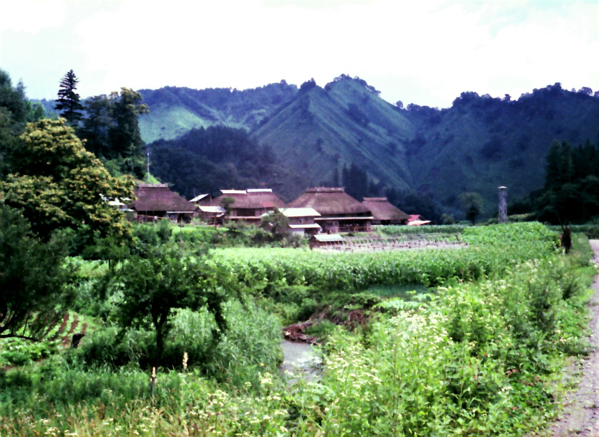

55年前の今日、1971年11月17日。衆議院の沖縄返還協定特別委員会で、自民党が沖縄返還協定の採決を強行しました。基地の存続をめぐり与野党が真っ向から対立する中での緊迫した採決劇は、戦後日本の歩みを象徴する歴史的一幕となりました。

## 切り離された沖縄と長年の復帰運動

1951年に署名され、1952年4月28日に発効したサンフランシスコ平和条約によって、日本は独立を回復した一方で、沖縄県（琉球諸島および大東諸島）はアメリカの施政権下に置かれることになりました。琉球政府や立法院が置かれたものの、最終的な決定権はアメリカ軍政が握り、日本本土との行き来にはパスポートが必要とされ、通貨にはドルが使われていました。

冷戦の激化に伴い、沖縄は東側諸国に対する抑止力として、またベトナム戦争の出撃・補給基地として軍事的重要性を取り込まれていきました。これに対し、沖縄では「島ぐるみ闘争」や1960年の沖縄県祖国復帰協議会の結成などを経て、祖国への復帰を求める住民運動が粘り強く続けられました。

## 日米首脳会談と「核抜き・本土並み」の合意

1969年、日本の佐藤栄作首相とアメリカのリチャード・ニクソン大統領による首脳会談が行われました。ベトナム戦争の終結を模索していたアメリカ側との間で、1972年に沖縄の施政権を日本へ返還することが合意されます。返還にあたっては「核抜き・本土並み」という基本方針が掲げられました。

そして1971年6月17日、東京とワシントンで協定の調印式が同時に行われ、愛知揆一外相とウィリアム・ロジャーズ国務長官が「琉球諸島及び大東諸島に関する日本国とアメリカ合衆国との間の協定」（沖縄返還協定）に署名しました。しかし、この協定は米軍基地を県内に維持したままでの返還を前提としたものであり、沖縄の公選行政主席であった屋良朝苗や多くの県民が求めていた「基地のない平和な島」という願いとは乖離していました。

*71-1423a Japan 1971 — 写真: wilford peloquin / CC BY 2.0*

## 1971年11月17日、騒然の委員会室

日本国内では、日本社会党や日本共産党などの野党が「安保条約の固定化につながる」として協定に激しく反発しました。さらに労働組合や学生運動による激しい反対デモが全国で展開され、国会審議は徹底抗戦の様相を呈していました。

会期末が近づく中、迎えた1971年11月17日の衆議院沖縄返還協定特別委員会。審議を打ち切って採決を進めようとする自民党に対し、野党議員が委員長席に詰め寄り、マイクを奪い合って怒号が飛び交う極度の混乱状態となりました。その騒然とした空気の中で自民党議員が一斉に起立し、委員長が可決を宣言する強行採決が行われたのです。わずか数分の出来事でした。

*71-1424 Japan 1971 — 写真: wilford peloquin / CC BY 2.0*

## 衆議院通過と1972年5月15日の本土復帰

委員会での強行採決ののち、協定は11月24日に衆議院本会議を通過し、参議院での審議を経て批准されました。返還にあたって日本政府は、アメリカ軍政下の民生用資産引き継ぎなどを含め、返還協定第7条に基づく特別支出金として総額3億2000万ドルをアメリカ側に支払うことになりました。

そして1972年5月15日、沖縄の施政権は27年ぶりにアメリカから日本へ返還されました。東京の日本武道館と那覇市民会館を結んで復帰記念式典が開催され、沖縄県庁や沖縄県警察の発足、道路交通の右側通行から左側通行への移行準備など、本土との一体化に向けた新たな歩みが始まったのです。

*71-1424a Japan 1971 — 写真: wilford peloquin / CC BY 2.0*

## 半世紀を経て今も残る基地問題

本土復帰から半世紀以上が経過した現在も、沖縄返還協定によって残された課題は続いています。在日米軍専用施設面積の約70パーセントが今なお沖縄県に集中しており、騒音や事故、事件への不安など、県民の基地負担は大きく残されたままです。

1971年11月17日の委員会採決は、祖国復帰という悲願の達成と、基地負担の固定化という重い宿題を背負う転換点となりました。激しい怒号の中で下されたあの決定は、いまなお日本の安全保障と地域のあり方に深い問いを投げかけ続けています。

### 参考資料

- <https://ja.wikipedia.org/wiki/%E6%B2%96%E7%B8%84%E8%BF%94%E9%82%84>
- <https://commons.wikimedia.org/wiki/File:71-1423_Japan_1971.jpg>
- <https://commons.wikimedia.org/wiki/File:71-1423a_Japan_1971.jpg>
- <https://commons.wikimedia.org/wiki/File:71-1424_Japan_1971.jpg>
- <https://commons.wikimedia.org/wiki/File:71-1424a_Japan_1971.jpg>
