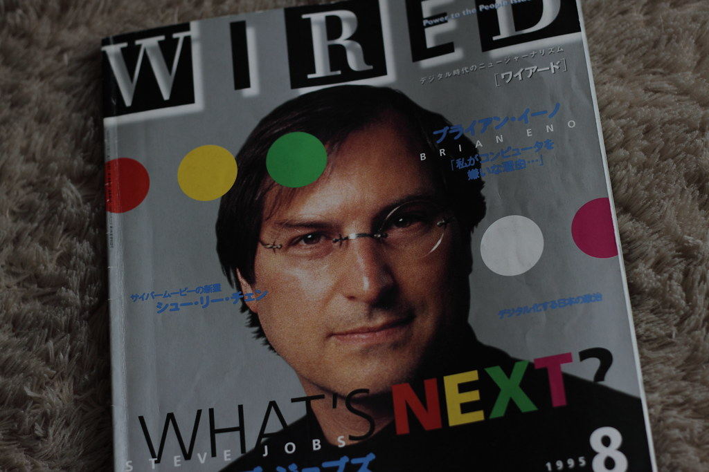
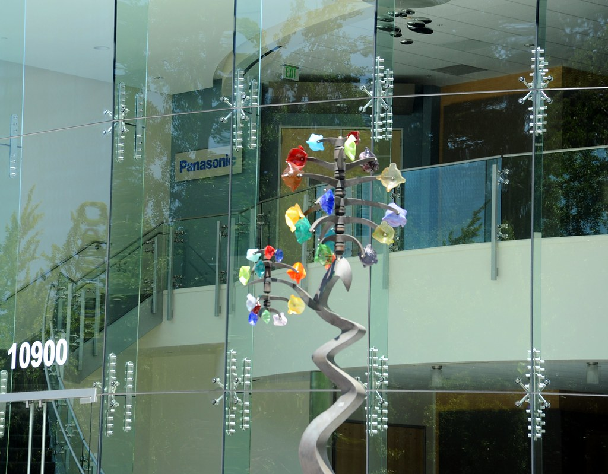

25年前の今日、2001年11月17日。アメリカのアップルが、携帯型デジタル音楽プレーヤー「アイポッド」を発売しました。音楽CDやミニディスクを持ち歩いて聴くのが当たり前だった時代に、何千曲もの楽曲をポケットに入れて持ち運ぶ新しい体験を切り開いた瞬間でした。

## CDとMDの時代に掲げられたデジタル構想

1990年代末から2000年代初頭にかけて、屋外で聴く音楽の主役はカセットテープからポータブルCDプレーヤーやMDプレーヤーへと移っていました。パソコンで音楽データを扱う技術も広がりつつあり、初期のMP3プレーヤーも市場に現れていましたが、当時のフラッシュメモリは容量が小さく、保存できる曲数はごくわずかに限られていました。

こうした状況の中で、アップルの創業者でありCEOを務めていたスティーブ・ジョブズは、パソコンを中心としてデジタル機器を結びつける「デジタル・ハブ構想」を推進していました。マック専用の楽曲管理ソフト「アイチューンズ」の利点を最大限に引き出し、ユーザーがためた膨大な音楽コレクションをそのまま外へ持ち出せる専用ハードウェアとして構想されたのが、アイポッドでした。

## 小型ハードディスクとホイールが起こした革新

2001年10月24日に発表され、この日発売を迎えた初代アイポッドには、当時の携帯音楽プレーヤーとしては珍しい1.8インチの小型ハードディスクドライブが内蔵されました。これにより、何千曲もの楽曲をまるごと端末に保存することが可能となりました。

操作部には中央の円形スクロールホイールが採用され、指先で回すだけで階層構造のメニューをたどり、膨大なライブラリから目当てのアーティストや曲をすばやく探し出せる仕組みが作られました。また、マックと接続するだけで登録曲やプレイリストを自動で同期する「オートシンク」機能を備え、高速接続規格のファイアワイアを通じて大容量データの送信と本体の充電を同時にこなす点も画期的でした。

*Steve Jobs 1955-2011 — 写真: segagman / CC BY 2.0*

## 発売当初から日本語表示に対応していた背景

初代アイポッドは、発売当初の対応言語が英語やフランス語などわずか4言語に絞られていましたが、その中には日本語がしっかりと含まれていました。モノクロ液晶画面に表示される日本語フォントには、当時のクラシックマックOSで親しまれていた「オオサカ」が採用されていました。

のちに画面がカラー化された際には「ヒラギノ角ゴシック」へと受け継がれていくことになります。日本の音響機器メーカーがCDやMDからの録音スタイルを中心とした機器を展開する中、パソコンと直結して音楽を丸ごと持ち歩くアイポッドの使い心地は、日本の愛好家たちの間でも強い注目を集めました。

*Steve Jobs (WIRED Japan - August,1995). — 写真: MIKI Yoshihito. (#mikiyoshihito) / CC BY 2.0*

## 多彩な派生機と音楽市場の地殻変動

初代アイポッドの成功を受け、アップルは次々と派生機種を展開しました。2004年には小型軽量化された「アイポッドミニ」が登場し、2005年にはさらに薄く小型化された「アイポッドナノ」や、液晶画面を省いてクリップで身につける安価な「アイポッドシャッフル」が加わりました。大容量の本体はのちに「アイポッドクラシック」と改称され、最大160ギガバイトの容量を持つモデルまで進化しました。

さらに、ウィンドウズパソコンへの対応や「アイチューンズストア」による音楽のダウンロード販売の開始によって、音楽の流通形態そのものが大きく変わっていきました。CDショップへ行かずにネット上で曲を購入し、端末に入れて持ち歩くスタイルが世界中で定着していったのです。

*Kinetic Art for the wind, Panasonic Venture Group, art and architecture as one, glass office entrance, 10900 N Tantau Ave, Cupertino, California, USA — 写真: Wonderlane / CC BY 2.0*

## 2022年の終焉と今に残る足跡

2007年には、全面タッチスクリーンと無線通信を備えた「アイポッドタッチ」が登場しました。これは同年に米国で登場した初代アイフォーンの土台ともなり、その後のスマートフォンの普及へと道をつなぐことになります。

しかし、多機能なスマートフォンの普及に伴い、音楽専用プレーヤーとしてのアイポッドの役割は次第に縮小していきました。そして2022年5月10日、最後まで残っていたアイポッドタッチの在庫限りでの販売終了が発表され、シリーズは20年余りの歴史に幕を下ろしました。現在も使われている「ポッドキャスト」という言葉や、ワイヤレスイヤホンの「エアポッズ」といった名称に、あの日始まった音楽体験の足跡が今も静かに息づいています。

### 参考資料

- <https://ja.wikipedia.org/wiki/11%E6%9C%8817%E6%97%A5>
- <https://commons.wikimedia.org/wiki/File:Jobs-Adobe-Founders-LaserWriter.jpg>
- <https://www.flickr.com/photos/8010717@N02/6216457030>
- <https://www.flickr.com/photos/7940758@N07/6447080765>
- <https://www.flickr.com/photos/71401718@N00/10829713846>
