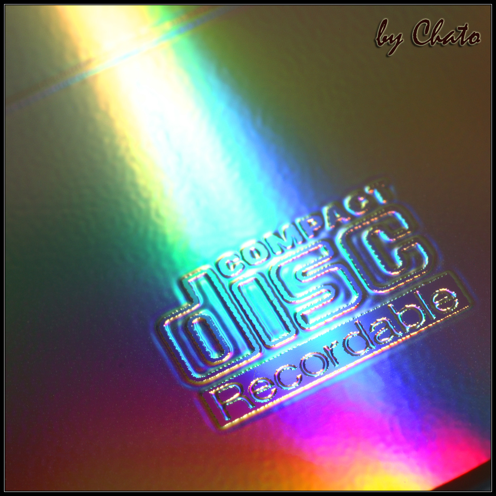
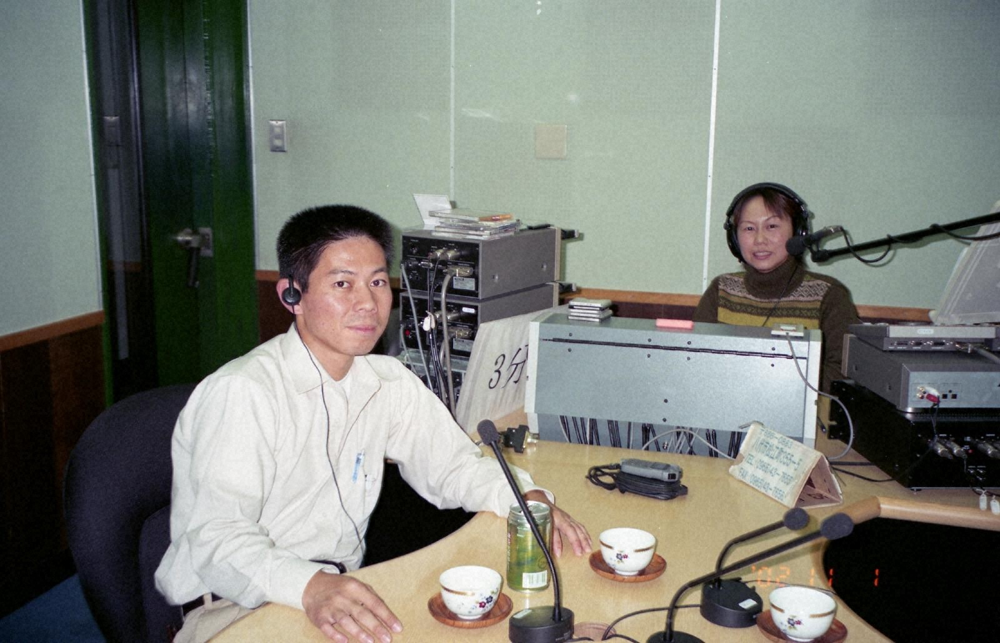

20年前の今日、2006年11月17日。オリコンのシングルチャートで、モーニング娘。の31枚目のシングル「歩いてる」が初登場1位を獲得しました。大ヒット曲を連発した黄金期から年月が流れ、およそ3年半ぶりに手にしたチャートの頂点でした。

## 3年半の雌伏と激動の世代交代

モーニング娘。がシングルチャートの1位から遠ざかったのは、2003年4月23日に発売された18枚目のシングル「AS FOR ONE DAY」以来のことでした。このシングルは初期メンバーである保田圭さんの卒業作であり、この作品を最後にグループの連続首位獲得記録は途切れていました。

その後の約3年半、グループは激しいメンバーの入れ替わりを経験します。1期生や2期生が次々とグループを巣立ち、2003年に加入した6期メンバー（藤本美貴さん、亀井絵里さん、道重さゆみさん、田中れいなさん）や、2005年に加入した7期メンバーの久住小春さんたちが前線に立ちました。彼女たちの参加した作品も「シャボン玉」や「大阪 恋の歌」が週間2位を記録するなど上位にはランクインしていたものの、あと一歩のところで首位の座には手が届かない日々が続いていました。

## 8人体制で挑んだ31枚目のシングル

転機となったのは、2006年11月8日に発売された31枚目のシングル「歩いてる」でした。この年の夏に5期メンバーの紺野あさ美さんと小川麻琴さんが相次いで卒業し、グループは吉澤ひとみさんをリーダーとする8人体制となっていました。シングルの参加人数が1桁になるのは、2001年の「ザ☆ピ〜ス!」以来およそ5年ぶりのことでした。

楽曲の作詞と作曲を手がけたのは、結成以来グループを支え続けてきたプロデューサーのつんく♂さんです。華やかでダンサブルな曲調が多かったそれまでのヒット曲とは一線を画し、迷いや葛藤を抱えながらも前を向いて一歩ずつ進んでいく人々の背中をそっと押すような、温かいメッセージが込められた楽曲でした。千葉県九十九里町で撮影されたミュージックビデオの素朴な映像とともに、この歌は熱心なファンだけでなく多くの音楽ファンの心を捉えました。

*Compact Disc Recordable (3866059494) — 写真: Javier Rodríguez from Palma de Mallorca, España / CC BY-SA 2.0*

## 2006年11月17日、快挙のチャート発表

そして迎えた11月17日、発表されたオリコンシングルチャートで「歩いてる」は見事に初登場1位を獲得しました。約3年半ぶりという長い年月を経ての首位返り咲きは、当時の音楽業界でも大きな話題を呼びました。

加入以来、最高位2位にとどまっていた6期メンバーの4人と、加入後4作連続で4位だった久住小春さんにとって、これがモーニング娘。のメンバーとして経験する初めてのオリコン1位でした。これにより、結成時の1期生から7期生までに在籍した歴代メンバー22人全員が、グループ在籍中にオリコンシングル1位を経験するという記念碑的な記録が打ち立てられました。

*Shibuya Scramble Crossing — 写真: Yoshikazu TAKADA / CC BY 2.0*

## ピンク・レディーの偉業を塗り替えた10作目の首位

この日の1位には、もう一つ大きな歴史的意義がありました。日本の歌謡史において、女性グループによるシングルCDのオリコン1位獲得数で歴代トップに立っていたのは、1970年代に社会現象を巻き起こした昭和のスーパーデュオ、ピンク・レディーの9作でした。

モーニング娘。は「AS FOR ONE DAY」の首位獲得時点でピンク・レディーの記録に並んでいましたが、今回の「歩いてる」によって通算10作目の1位を達成し、女性グループとしての歴代単独トップへと躍り出たのです。昭和から平成へと時代が移り変わるなか、女性アイドルグループの歴史に新たな金字塔が打ち立てられた瞬間でした。

*学童疎開調査 — 写真: 南城市教育委員会 / CC BY (Japan Search)*

## 今も歌い継がれる歩みとメッセージ

「歩いてる」はモーニング娘。にとって大切な節目となっただけでなく、生みの親であるつんく♂さんにとっても思い入れの深い楽曲となりました。発表直後の2006年11月29日には、つんく♂さんが率いるバンド「シャ乱Q」が自身の復帰作としてこの曲のロックバラード版セルフカバーをシングルリリースしています。さらに後年、メンバーの道重さゆみさんがベストアルバムでソロカバーするなど、グループの歴史の中で大切に歌い継がれていきました。

今もなお、モーニング娘。は加入と卒業を繰り返す独自のスタイルを守りながら活動を続けています。立ち止まることなく一歩一歩前へ進み続けたあの日の歌声は、20年の歳月が流れた今も色あせることなく響いています。

### 参考資料

- <https://ja.wikipedia.org/wiki/11%E6%9C%8817%E6%97%A5>
- <https://commons.wikimedia.org/wiki/File:Weekly_Sh%C5%8Dnen_Magazine_and_Weekly_Sh%C5%8Dnen_Sunday_in_Feb_2005.jpg>
- <https://commons.wikimedia.org/wiki/File:Compact_Disc_Recordable_(3866059494).jpg>
- <https://www.flickr.com/photos/34530295@N06/14311923655>
- <https://nanjo-archive.jp/document/?detail=9087&genre=6>
