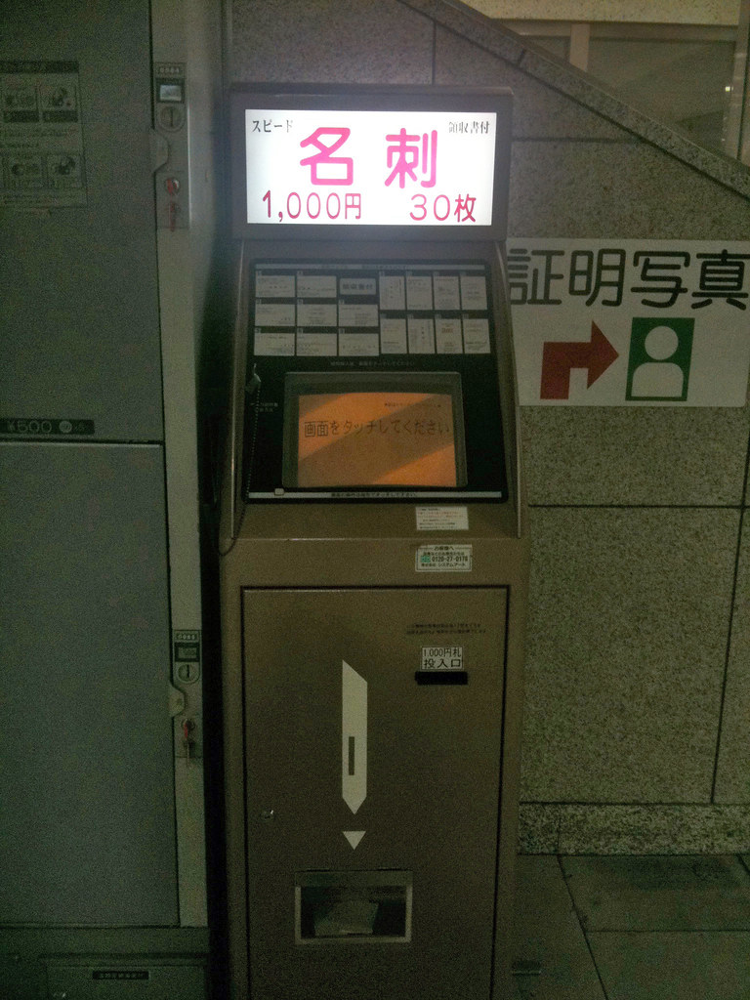
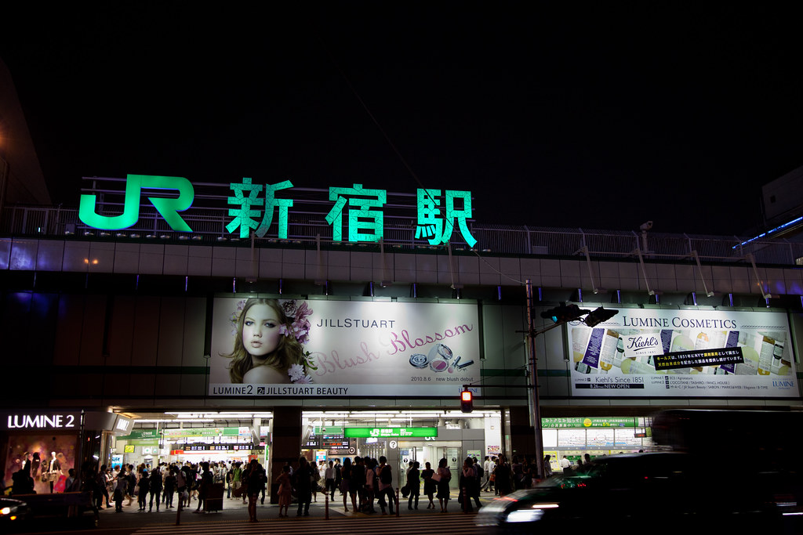
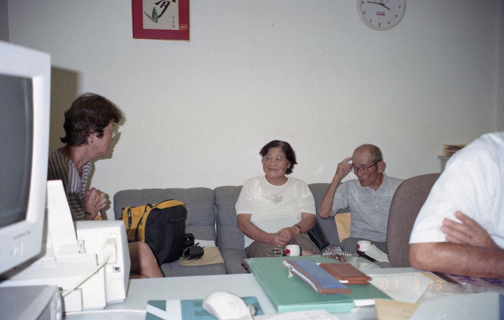

25年前の今日、2001年11月18日。東日本旅客鉄道（JR東日本）が非接触型のIC乗車カード「Suica（スイカ）」のサービスを開始しました。自動改札機の投入口に切符やカードを差し込む必要がなく、カードを読み取り機にかざすだけで通過できる画期的な仕組みは、駅の改札風景を根本から一変させました。現在では鉄道の乗車券にとどまらず、全国の店舗で買い物ができる電子マネーやスマートフォン決済として、私たちの暮らしに欠かせない社会基盤となっています。

## 改札混雑の解消へ——イオカードからの転換

Suica導入以前の日本の鉄道では、紙の切符や定期券のほか、磁気式のカードが利用されていました。自動券売機で乗車券を購入するオレンジカードに続き、JR東日本では1991年から首都圏で直接自動改札機に投入できる磁気式プリペイド乗車カード「イオカード」を展開していました。しかし、膨大な利用客が集中する首都圏のラッシュ時において、磁気カードを1枚ずつ投入口に通して受け取る動作は、改札機前での人の滞留を引き起こす原因となっていました。また、磁気カードは機械内部を通るため、読み取り部の摩耗や詰まりといった機械トラブルの発生も課題でした。大量の乗客を円滑に通過させるため、非接触で高速に処理できる新しい乗車カードの導入が求められていたのです。

## 2001年11月18日、首都圏で始まったサービス

2001年11月18日、JR東日本は首都圏エリアの各駅でSuicaの本格的なサービスを開始しました。定期券機能と、あらかじめ入金しておくことで運賃精算ができるプリペイド機能を兼ね備えたカードとして登場しました。パスケースに入れたまま改札機の読み取り部にカードを当てるだけで瞬時にゲートが開く体験は、多くの利用者にとって新鮮な驚きとなりました。導入当初は乗車カードとしての利用が中心でしたが、従来の磁気カードに比べて改札の通過が圧倒的にスムーズになり、首都圏の駅改札の風景は急速に変化していきました。

*小田急線新宿駅の名刺自販機 - business card vending machine in Shinjuku station, Tokyo — 写真: karitsu / CC BY-SA 2.0*

## ソニーの「フェリカ」技術と「タッチ＆ゴー」

Suicaの核となったのは、ソニーが開発した非接触型ICカード技術「フェリカ」でした。カード内部に集積回路（IC）チップとアンテナが内蔵されており、13.56メガヘルツ帯の電波を用いて改札機との間で無線通信を行います。電波によってカード側に電力が供給されるため、電池を内蔵することなくデータの読み書きや演算が可能です。フェリカの電波は半径10センチメートル程度の読み取り可能範囲を持っていましたが、改札機の通過時に通信時間を確実に確保するため、JR東日本は「タッチ＆ゴー」というキャッチフレーズを宣伝で使用しました。カードを空中にかざすのではなく、読み取り機に軽くタッチさせる使い方を定着させることで、通信エラーを防ぎ素早い通過を実現したのです。

*新宿駅 Shinjuku station — 写真: Dennis Wong / CC BY 2.0*

## 名前に込められた意味とペンギンキャラクター

「Suica」という名称は、英語の「Super Urban Intelligent CArd」の頭字語に由来しています。同時に、「スイスイ行けるICカード」という日本語の語感も掛け合わされており、果物のスイカとも語呂合わせがなされました。カード券面やロゴマークにはJR東日本のイメージカラーである緑色と、線路を表す記号が取り入れられ、文字の「ic」の部分を反転させてICカードであることを強調しています。また、イメージキャラクターにはイラストレーターのさかざきちはるがデザインしたペンギンが採用され、新技術に親しみやすさを与えるシンボルとして広く親しまれました。

*ペルー移民調査 — 写真: 南城市教育委員会 / CC BY (Japan Search)*

## 全国のICカード相互利用と電子マネーの拡大

首都圏のJR線から始まったSuicaのネットワークは、急速に全国へと広がっていきました。2007年3月18日には関東の私鉄や地下鉄が導入した「PASMO」との相互利用が開始されました。さらに2013年3月23日には、Kitaca、TOICA、manaca、ICOCA、PiTaPa、SUGOCA、nimoca、はやかけんを加えた全国10種類の交通系ICカードによる全国相互利用サービスが実現し、北海道から九州まで1枚のカードで移動できるようになりました。また、駅売店や街中の店舗で買い物ができる電子マネーサービスも普及し、交通機関の枠を超えた決済手段へと発展していきました。

## 携帯電話への搭載と現在へ受け継がれる仕組み

プラスチックのカードにとどまらず、2006年には携帯電話を利用する「モバイルSuica」が導入されました。その後、2016年にはアイフォーンのアップルペイ、2018年にはアンドロイドのグーグルペイにも対応し、スマートフォンをかざすだけで改札を通れる環境が整いました。モバイルSuicaの発行枚数は2023年時点で2,000万枚を超え、Suica全体の発行枚数は2024年6月時点で約1億557万枚に達しています。25年前のこの日に始まった「タッチ＆ゴー」の仕組みは、切符を買うために券売機に並んでいた駅の日常を塗り替え、今も日本の移動と生活を支え続けています。

### 参考資料

- <https://ja.wikipedia.org/wiki/%E6%9D%B1%E6%97%A5%E6%9C%AC%E6%97%85%E5%AE%A2%E9%89%84%E9%81%93>
- <https://commons.wikimedia.org/wiki/File:Joban_Highway_Bus_Mito_Iwaki.jpg>
- <https://www.flickr.com/photos/15142906@N00/5243835461>
- <https://www.flickr.com/photos/97247234@N00/4948808808>
- <https://nanjo-archive.jp/document/?detail=8260&genre=6>
