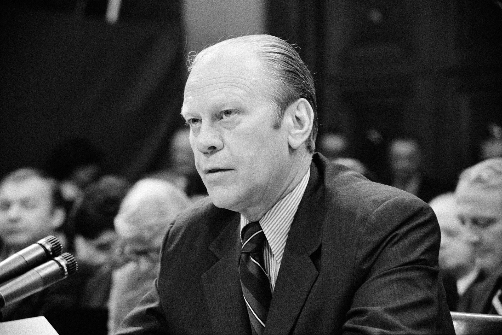
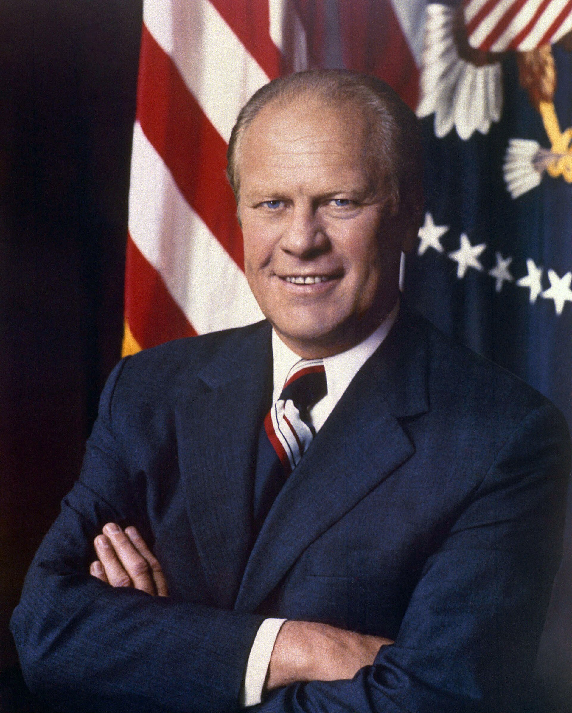
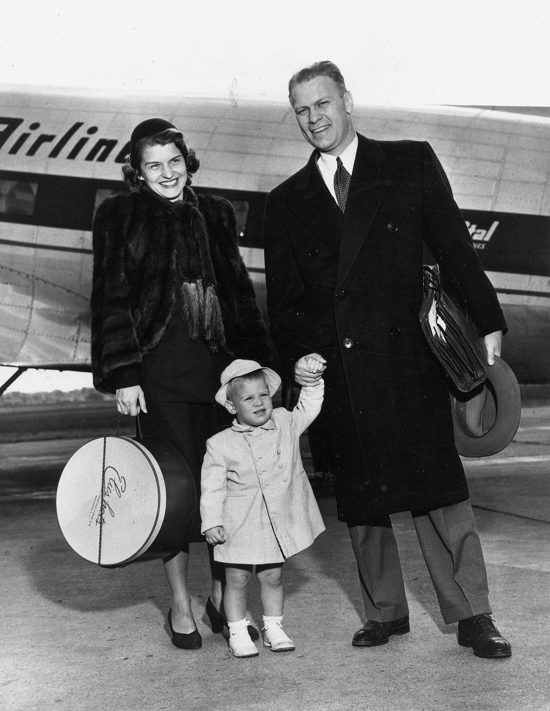

52年前の今日、1974年11月18日。アメリカの第38代大統領ジェラルド・フォード氏が、現職のアメリカ大統領として史上初めて日本の地を踏みました。それまで日米首脳の会談はワシントンなどで行われていましたが、ホワイトハウスの主が公式に日本を訪れた例はありませんでした。混迷を極めた国際情勢とアメリカ国内の混乱の中で実現したこの訪問は、戦後における日米関係の大きな転換点となりました。

## 前任者の辞任からわずか3か月後の異例の訪日

フォード氏が大統領に昇格したのは、訪日のわずか3か月前、1974年8月のことでした。前任のリチャード・ニクソン大統領が、ホワイトハウスを揺るがしたウォーターゲート事件の責任を取って辞任したためです。さらにその前年、1973年にはスピロ・アグニュー副大統領も収賄疑惑で辞任しており、フォード氏は憲法修正第25条の規定に基づき、議会の承認を経て副大統領から大統領へと就任した人物でした。

そのためフォード氏は、アメリカ史上唯一「大統領選挙でも副大統領選挙でも国民の直接投票を経て選出されたことがない大統領」という特異な立場にありました。国民の政治不信が頂点に達していた時期に就任した彼は、「私たちの長い悪夢は終わった」と宣言し、傷ついた合衆国の信頼回復を最優先課題として政権運営をスタートさせたのです。

## 清廉で飾らない人柄――「私はリンカーンではなくフォードだ」

フォード氏は1913年、ネブラスカ州オマハに生まれました。幼少期に両親が離婚し、母の再婚相手である養父の名を譲り受けて育ちました。ミシガン大学時代にはアメリカンフットボールのスター選手として全米王座に輝き、苦学しながらイェール大学のロースクールを卒業して弁護士となった経歴を持ちます。

1949年から24年間にわたり下院議員を務め、共和党の院内総務として議会を率いた彼は、誠実で飾らない人柄で知られていました。高級車ブランドのリンカーンを引き合いに出し、「私はフォードであって、リンカーンではない」と自ら語った言葉は、彼の素朴で実直な政治姿勢を象徴するものとして語り継がれています。メディアでは階段でつまずく姿などが取り沙汰されることもありましたが、その清廉潔白さは失墜した大統領職の威信を立て直す上で大きな力となりました。

*Gerald Ford hearing2 — 写真: Thomas J. O'Halloran, photographer / Public domain*

## かつての交戦国の元首と対面――昭和天皇との歴史的会見

1974年11月18日、日本に到着したフォード大統領は、皇居で昭和天皇と会見しました。この対面は極めて象徴的な意味を持っていました。フォード大統領自身、第二次世界大戦中はアメリカ海軍の予備役少尉として入隊し、軽空母モンテレーに乗務して太平洋戦線に従軍した軍人でした。フィリピン海では巨大な台風による遭難で九死に一生を得るなど、かつて日本軍と激戦を繰り広げた当事者だったのです。

戦火を交えた過去を乗り越え、現職のアメリカ大統領が日本の元首と笑顔で言葉を交わした姿は、世界中に大きく報じられました。儀礼的な訪問にとどまらず、両国の間に確固たる信頼関係を築くための歴史的な対面となったのです。

*Gerald Ford presidential portrait (cropped) — 写真: David Hume Kennerly / Public domain*

## 翌年の昭和天皇訪米へ――強固になった日米関係

フォード大統領の来日は、その後の日米外交に極めて大きな成果をもたらしました。大統領の訪問から1年も経たない1975年秋、今度は昭和天皇と香淳皇后が史上初めてアメリカを公式訪問したのです。ワシントンで天皇を迎えたフォード大統領は温かく歓迎し、両国の絆が戦争の影を完全に払拭して新たな同盟関係へと進展したことを世界に示しました。

さらにフォード大統領は、1976年2月19日、第二次世界大戦中に日系アメリカ人の強制収容を可能にした悪名高い「大統領令9066号」を正式に廃止する署名を行いました。これは奇しくも、1942年にフランクリン・ルーズベルト大統領が同令に署名してからちょうど34年目の日のことでした。歴史の過ちを真摯に見つめ直し、日系人コミュニティの名誉回復に道を開いたことも、フォード政権が残した重要な足跡の一つです。

*Gerald R. Ford with Mrs. Ford and Michael Ford - NARA - 7064467 — 写真: Unknown authorUnknown author / Public domain*

## 開かれた扉、そして今も残る功績

フォード氏は1976年の大統領選挙で民主党のジミー・カーター氏に僅差で敗れ、ホワイトハウスを去りました。しかし退任後、対立候補だったカーター氏とは深い友情を築き、1999年にはビル・クリントン大統領から大統領自由勲章を授与されました。2006年12月に93歳で亡くなった際にも、後任の大統領たちから「国が最も分断されていた時代に癒やしをもたらした指導者」として惜しみない賛辞が送られました。

現在、アメリカ海軍の最新鋭原子力空母の1番艦には「ジェラルド・R・フォード」の名が冠されています。今日では現職アメリカ大統領の訪日は特別な出来事ではなく、日常的な外交日程の一つとなりましたが、その最初の第一歩を踏み出したのは52年前のこの日でした。激動の時代に現職大統領として初めて日本の地を踏んだフォード氏の足跡は、日米の戦後史に深く刻まれています。

### 参考資料

- <https://ja.wikipedia.org/wiki/11%E6%9C%8818%E6%97%A5>
- <https://commons.wikimedia.org/wiki/File:CAC_CC_001_18_7_0000_0666.jpg>
- <https://commons.wikimedia.org/wiki/File:Gerald_Ford_hearing2.jpg>
- <https://commons.wikimedia.org/wiki/File:Gerald_Ford_presidential_portrait_(cropped).jpg>
- <https://commons.wikimedia.org/wiki/File:Gerald_R._Ford_with_Mrs._Ford_and_Michael_Ford_-_NARA_-_7064467.jpg>
