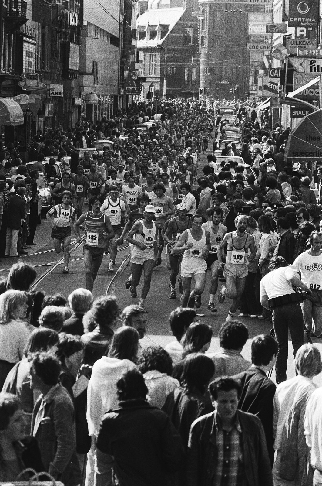
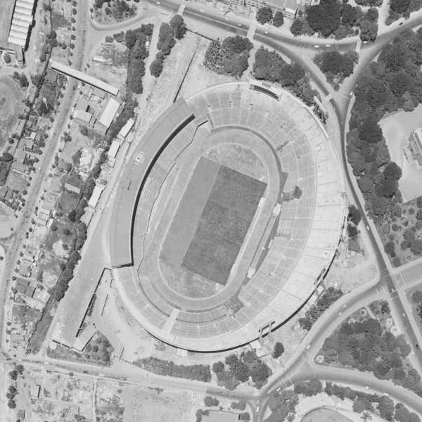
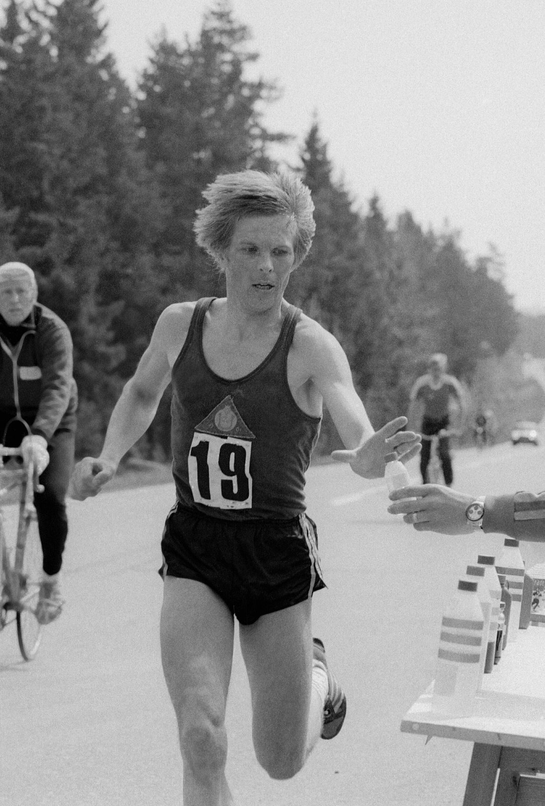

47年前の今日、1979年11月18日。東京の国立霞ヶ丘競技場を発着点として、世界で初めて国際陸上競技連盟（IAAF）が公認した女性限定のマラソン大会「第1回東京国際女子マラソン」が開催されました。沿道に詰めかけた大勢の市民が見守るなか、大都会・東京の公道を女性ランナーたちが駆け抜けました。

## 「女性に長距離は困難」という偏見との闘い

近代オリンピックが始まって以来、陸上競技の長距離種目は長らく男子限定で行われていました。長距離を走ることは女性の身体にとって危険である、という科学的根拠の乏しい見解が根強く信じられていたためです。1960年代後半から海外のマラソン大会で非公式に参加する女性が現れ始め、徐々に門戸が開かれつつありましたが、国際統括団体による正式な公認レースは存在していませんでした。

日本国内でも1970年代後半になって女性の長距離挑戦が本格化し、1979年春の別府大分毎日マラソンで試験的に女子の参加が認められました。そして同年秋、世界陸上界の常識を覆す舞台として企画されたのが、女性ランナーだけを対象とした国際公認レース「東京国際女子マラソン」でした。

## 都心を貫く42.195キロの舞台設定

コースは、国立霞ヶ丘競技場をスタート・ゴールとし、大森海岸交番前を折り返す42.195キロに設定されました。スタートした選手たちは、東京タワーや増上寺、皇居、東京駅、品川駅といった東京の象徴的な名所の前を走り抜けていきます。

首都・東京の中心部の公道を大規模に封鎖して女性たちだけのマラソン大会を開催することは、当時の警察関係者や交通当局にとっても前例のない大事業でした。大会の主催には日本陸上競技連盟に加え、朝日新聞社やテレビ朝日が名を連ね、テレビ中継を通じて女性アスリートの力強い走りが日本中の茶の間に届けられました。

*1979年の資料 — 写真: Koen Suyk / Anefo / CC0*

## ランナーを苦しめた名物「強力坂」

東京国際女子マラソンの最大の特徴であり、世界屈指の難コースと言わしめたのが、レース終盤の急勾配でした。大森海岸を折り返して戻ってきたランナーたちは、35キロ地点を過ぎた水道橋駅前から四谷にかけて、過酷な上り坂を迎えます。

この坂はビル11階建てに匹敵する高低差およそ30メートルにおよび、ランナーたちから「強力坂（ごうりきざか）」と呼ばれて恐れられました。疲れがピークに達する終盤に現れるこの壁は、数々のドラマを生み出し、後にシドニー五輪金メダリストとなる高橋尚子選手も2003年大会でこの坂に苦杯をなめることになります。

*事件当時の写真ではありません · 1963年 — 写真: 国土地理院 / Attribution*

## 初代女王スミスと五輪種目への決定打

記念すべき第1回大会を制したのは、イギリスのジョイス・スミス選手でした。スミス選手をはじめとする世界のトップランナーたちが見せた見事な完走劇は、女性の耐久力に対する世間の偏見を一挙に吹き飛ばしました。

この大会を現地で視察した国際陸連のアドリアーン・ポーレン会長は、選手たちの力走と大会運営の成功を高く評価し、女子マラソンのオリンピック種目採用を正式に支持することを表明しました。この決定的な後押しにより、5年後の1984年ロサンゼルスオリンピックで女子マラソンが正式採用され、女性アスリートの歴史が大きく前進したのです。

*事件当時の写真ではありません · 1979年 — 写真: V. K. Hietanen / CC BY 4.0*

## 日本女子長距離の黄金期を築いた舞台

東京国際女子マラソンは、オリンピックや世界陸上選手権の日本代表選考レースの第1弾として定着し、日本の長距離界を世界トップレベルへと押し上げる揺籃となりました。1983年の第5回大会では佐々木七恵選手が日本人として初優勝を飾り、日本中に女子マラソンブームを巻き起こします。

全30回の歴史の中で、日本人選手は11回の優勝を数えました。1995年から1999年にかけての5連覇、2005年から2008年にかけての4連覇など、日本勢の黄金期を象徴する数々の名勝負がこのコースで刻まれました。参加資格も日本陸連登録者でフルマラソン3時間15分以内など厳しい基準が設けられ、エリートランナーたちの誇り高い目標であり続けました。

## 30年の歴史に幕、そして受け継がれる精神

2007年に一般市民も走る大規模な「東京マラソン」が始まると、同一都市内で年に2回の大規模な交通規制を行うことが困難であるとの警視庁の指摘を受け、大会は転換期を迎えます。2008年11月16日、第30回記念大会をもって東京国際女子マラソンはその輝かしい歴史に幕を下ろしました。最後の号砲を鳴らすスターターには、第1回優勝者のジョイス・スミスさんが招かれました。

エリート女子単独レースの系譜は横浜国際女子マラソンやさいたま国際マラソンへと引き継がれ、女性市民ランナーの舞台は東京マラソンへと合流していきました。秋の東京を駆け抜けた女性たちの勇姿は、いま世界中で当たり前に走るすべての女性ランナーの原点として、スポーツの歴史に燦然と輝いています。

### 参考資料

- <https://ja.wikipedia.org/wiki/11%E6%9C%8818%E6%97%A5>
- <https://commons.wikimedia.org/wiki/File:TANGE-gimnasio-Tokio-2.jpg>
- <https://commons.wikimedia.org/wiki/File:Marathons,_steden,_Bestanddeelnr_930-2753.jpg>
- <https://commons.wikimedia.org/wiki/File:Aerial_view_of_the_national_stadium.19630626.jpg>
- <https://commons.wikimedia.org/wiki/File:Jukka-Toivola-1979.jpg>
