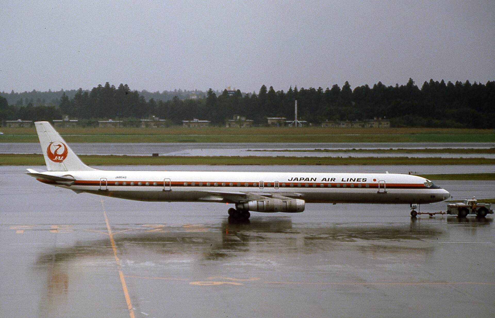
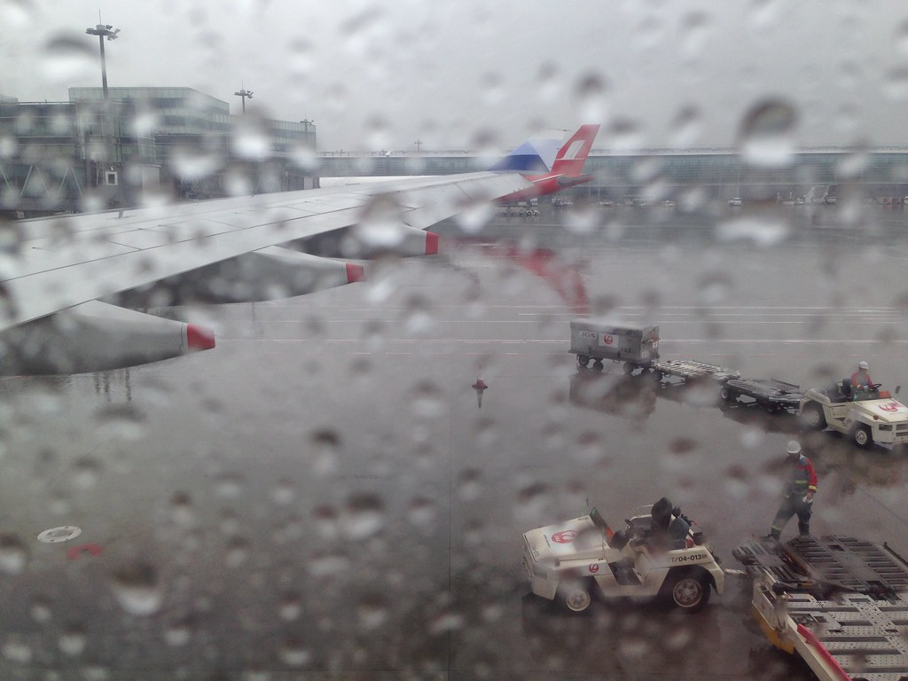
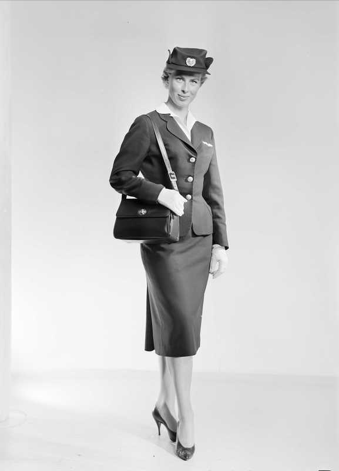

39年前の今日、1987年11月18日。日本航空株式会社法が正式に廃止され、日本航空（JAL）が完全民営化されました。戦後日本の復興とともに国の特別な庇護と管理のもとで発展してきた航空会社が、すべての政府保有株式を売却し、純粋な民間企業として自立した空へと飛び立った一日でした。

## 戦後日本の復興と「半官半民」の歩み

日本航空の歴史は、1951年8月1日に資本金1億円、東京・銀座を本社として設立されたところから始まりました。直後の8月下旬にはフィリピン航空からリースしたダグラスDC-3「金星号」による招待飛行を実施し、同年10月にはマーチン2-0-2「木星号」によって戦後初となる国内民間航空便の運航を開始しました。

その後、1953年8月に国会で「日本航空株式会社法」が可決され、同年10月1日に政府出資の特殊会社として再発足しました。敗戦からの経済復興と国際社会への復帰をめざす日本にとって、国の信用を背負ったナショナル・フラッグ・キャリアの確立は国家的な要請だったのです。1959年には当時の社長の家紋から着想を得た「鶴丸」のマークが誕生し、白地に赤い鶴の姿は世界各国の空港で日本の顔として広く認知されるようになりました。

## 行政改革と「完全民営化」の決断

半官半民の体制のもとで国際線を一手に担い、成長を遂げた日本航空でしたが、1980年代に入ると大きな転換期を迎えます。国内外で航空自由化や規制緩和の動きが強まり、公共部門が抱える非効率性を是正し、競争原理によって事業を活性化させる「民営化」が国の重要課題として浮上しました。

政府による手厚い保護は安定をもたらす一方で、経営の自主性や柔軟な事業判断を制約する要因にもなっていました。国が保有する株式をすべて民間に売却し、市場の厳しい規律の中で自活する体制へと移行することが決定され、その根拠となる法改正の準備が進められました。

*事件当時の写真ではありません · 1986年 — 写真: Pete Macklin / CC BY 2.0*

## 1987年11月18日、日本航空株式会社法の廃止

1987年11月18日、日本航空株式会社法が廃止され、日本航空は完全民営化を達成しました。設立以来30年以上にわたり会社を縛り、同時に支えてきた特別な法律のくびきから解き放たれた瞬間でした。

この日をもって、同社は会社法上の一般民間企業として市場競争に直面することになりました。路線開設や運賃設定、設備投資において国の監督から離れる一方、赤字や経営悪化に対して国が支援を行う後ろ盾も消滅しました。自らの経営判断と収益力だけで安全運航と企業価値を維持しなければならない、厳しい航海への船出でした。

*東京國際機場, 羽田機場, 東京, 日本, 東京国際空港, とうきょうこくさいくうこう, 羽田空港, はねだくうこう, Tokyo International Airport, Haneda Airport, HND, Tokyo, Japan — 写真: bryan... / CC BY-SA 2.0*

## 激動の再編と会社更生法の適用

民営化後の日本航空は、さらなる競争力強化をめざして歩みを進めました。2002年10月には国内第3位の規模を持っていた日本エアシステム（JAS）と経営統合を行い、持株会社「日本航空システム」を設立。世界の旅客数ランキングでも上位に位置する巨大航空グループが誕生しました。2007年には国際的な航空連合「ワンワールド」への加盟も果たします。

しかし、急激な事業拡大と高コスト体質、さらに2008年の世界的な金融危機などが重なり、同社の経営は急速に悪化していきました。そして完全民営化から23年が経過した2010年1月19日、日本航空は東京地方裁判所に会社更生法の適用を申請し、経営破綻に追い込まれました。

*SAS flight attendant 1959 — 写真: E. Rude / CC BY-SA 3.0*

## 稲盛和夫氏による再生と「鶴丸」の復活

破綻直後の2010年2月、京セラの名誉会長であった稲盛和夫氏が代表取締役会長兼グループCEOに就任しました。金融機関による5,200億円以上の債権放棄、100%減資、グループ全体で1万5,000人を超える大幅な人員整理、さらに採算の取れない路線の徹底的な見直しが行われました。

稲盛氏が持ち込んだ徹底した採算意識と意識改革によって、同社は急速に業績を回復させ、2011年3月に会社更生手続を終了しました。同年4月には、経営破綻時に廃止されていた伝統の「鶴丸」ロゴを尾翼に復活させました。原点に立ち返り、安全と利用客への感謝を忘れない姿勢を示すシンボルとして選ばれたのです。そして2012年9月には、東京証券取引所への再上場を果たしました。

## 民営化から現在へ続く軌跡

日本航空が完全民営化された1987年は、国鉄の分割民営化など、日本の産業構造が大きく転換した節目の年でもありました。国の庇護の下にあった時代を終え、自由な競争環境の中で破綻と再生という最大の試練を乗り越えた同社は、現在も全日本空輸とともに日本の航空輸送を支え続けています。

2023年には日経平均株価の構成銘柄へ13年ぶりに復帰し、最新鋭機エアバスA350の導入など次世代に向けた投資を続けています。かつて国を挙げて空へ飛び立った航空会社が、本当の意味で自立した企業として歩み出した1987年11月18日。その決断の重みは、今も日本の空を飛ぶ無数の翼の中に息づいています。

### 参考資料

- <https://ja.wikipedia.org/wiki/11%E6%9C%8818%E6%97%A5>
- <https://commons.wikimedia.org/wiki/File:Doris_Twitchell_Allen,_founder_of_CISV,_with_the_Japanese_Prime_Minister_Nakasone_in_1987.jpg>
- <https://commons.wikimedia.org/wiki/File:139_8-10-86_JA8042_Narita_(52922423282).jpg>
- <https://www.flickr.com/photos/91049143@N00/13752911633>
- <https://commons.wikimedia.org/wiki/File:SAS_flight_attendant_1959.jpg>
