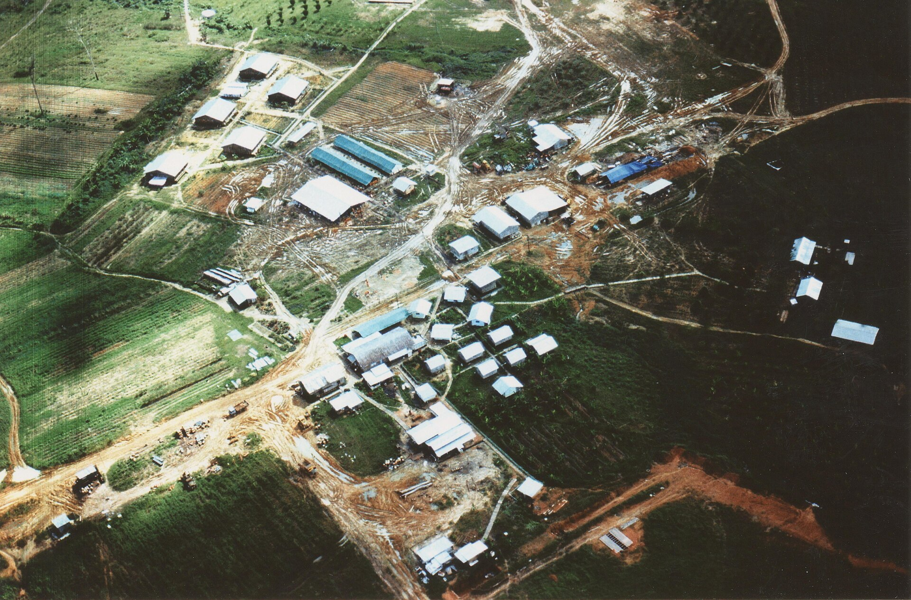
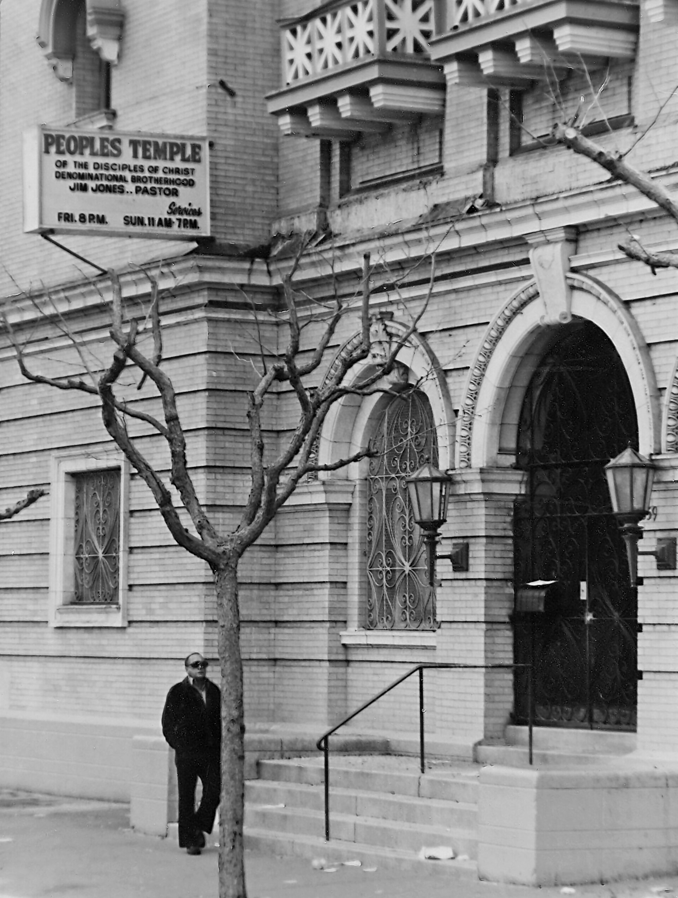
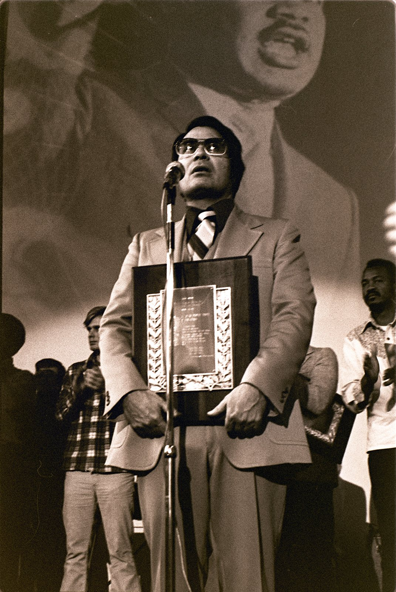

48年前の今日、1978年11月18日。南米ガイアナの密林に作られた開拓地で、アメリカの新興宗教「人民寺院」の信者ら918人が命を落としました。教祖ジム・ジョーンズが「社会主義の楽園」と称して信者を集めた孤立無援の集落で、一体何が起きていたのでしょうか。

## アメリカ社会での急成長と政治への接近

人民寺院は1955年、ジム・ジョーンズによってインディアナ州インディアナポリスで設立されました。キリスト教の信仰復興運動にマルクス主義を融合させた「使徒社会主義」を掲げ、人種差別撤廃を強く訴えたことで、アフリカ系アメリカ人を中心に多くの信者を獲得していきました。1965年にはカリフォルニア州へ拠点を移し、1970年代半ばにはサンフランシスコに本部を置きます。

当時のサンフランシスコで教団は有力政治家たちと親密な関係を築きました。市長選でジョージ・モスコーニの当選に関与し、ジョーンズはサンフランシスコ住宅公社委員会の委員長に指名されるなど、公的な地位や補助金を手に入れて栄華を極めました。有力議員や知事らが教団のパーティーに列席するほど、その影響力は強大でした。

## 疑惑の告発とガイアナ密林への集団移住

しかし、教団の急成長の裏では、信者に対する暴力や財産の搾取、マインドコントロールの実態が元信者らによって告発され始めていました。1977年夏、雑誌に虐待の詳細を暴く記事が掲載されることを事前に知ったジョーンズは、追及の手を逃れるようにして信者数百人とともに南米ガイアナへ脱出しました。

教団は1974年からガイアナ北西部の熱帯雨林に約3,800エーカーの土地を借り受け、「人民寺院農業計画」、通称ジョーンズタウンの開拓を進めていました。ガイアナは英語を公用語とする社会主義国であり、教団にとってマスメディアや警察の監視が及ばない「聖域」と見なされていたのです。1978年には集落の人口は1000人近くに達していました。

*1978年の資料 — 写真: Federal Bureau of Investigation / Public domain*

## 「楽園」の実態と閉ざされた共同体

信者たちにとってジョーンズタウンは理想のユートピアであるはずでした。しかし実際の生活は、痩せた土地での過酷な重労働に追われる日々でした。週に数日の厳しい農作業に加え、夜にはジョーンズによる社会主義の講義や思想教育が何時間も課されました。

敷地内のスピーカーからは、ジョーンズの演説やニュース朗読が昼夜を問わず流され続けました。外部との連絡は短波放送に限定され、教祖の許可なく町を離れることは禁じられていました。教団が推計2600万ドルもの莫大な資産を抱えていたにもかかわらず、信者たちの食事は主に米や豆、青物野菜に限られており、外界から完全に遮断された環境で極度の心理的支配が行われていました。

*1978年の資料 — 写真: Nicolas Martin / CC BY-SA 4.0*

## 1978年11月18日：空港での銃撃と服毒命令

教団に家族を奪われた元信者らの訴えを受け、1978年11月、アメリカ合衆国下院議員のレオ・ライアンを代表とする調査団がジョーンズタウンを訪問しました。調査を終え、帰国を希望する一部の信者を連れてポート・カイトゥマの空港滑走路に向かった調査団を、教団の武装信者が襲撃しました。この銃撃により、ライアン議員を含む代表団の5名が命を落としました。

凶行の後、ジョーンズは信者たちをパビリオンに集集させ、「革命的自殺」を決行するよう促しました。用意されたシアン化物入りの飲み物が配られ、子どもたちから順に服毒させられました。現地に残されたオーディオテープには、教祖の説法とともに、子どもたちの泣き叫ぶ声や混乱の様子が生々しく記録されていました。さらに首都ジョージタウンの支部でも信者4名が死亡しました。

*1977年の資料 — 写真: Nancy Wong / CC BY-SA 3.0*

## 918人の犠牲と今もジャングルに眠る跡地

この惨劇による死者は計918人にのぼり、そのうち3割を超える304人が未成年者でした。生還者らの証言から、自発的な集団自殺というよりは、武装した警備員に囲まれて毒を強制された大量殺人であったと捉えられています。この事件は、2001年9月11日のアメリカ同時多発テロ事件が起きるまで、故意によるアメリカ合衆国市民の死者数として歴史上最多の記録となりました。

かつて人々が「理想の共同体」を夢見て切り拓いたジョーンズタウンは、事件後に放棄されました。その後に建物の再利用が試みられたものの火災によって断念され、現在では建造物も朽ち果て、元の鬱蒼とした熱帯雨林のジャングルへと完全に飲み込まれています。

### 参考資料

- <https://ja.wikipedia.org/wiki/11%E6%9C%8818%E6%97%A5>
- <https://commons.wikimedia.org/wiki/File:Central_Jonestown_5.jpg>
- <https://commons.wikimedia.org/wiki/File:Central_Jonestown_6.jpg>
- <https://commons.wikimedia.org/wiki/File:Peoples_Temple.jpg>
- <https://commons.wikimedia.org/wiki/File:Jim_Jones,_1977.jpg>
