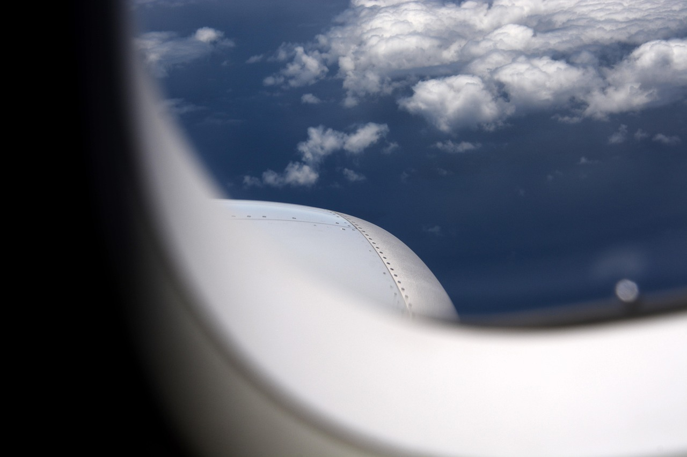
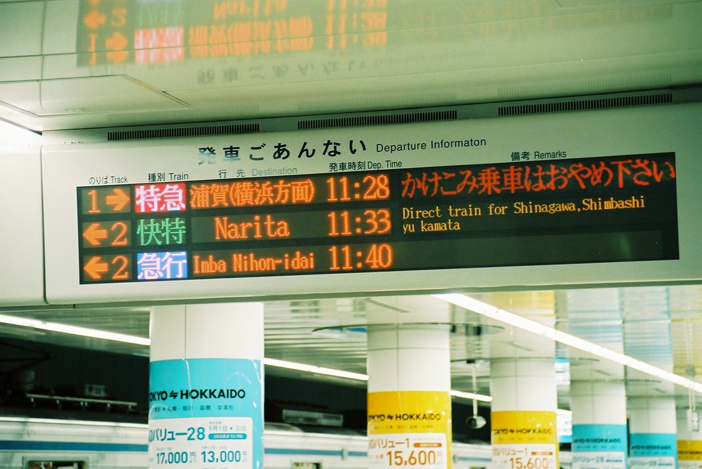

28年前の今日、1998年11月18日。京急空港線の羽田空港駅（現在の羽田空港第1・第2ターミナル駅）が開業しました。これに合わせて、都営地下鉄浅草線、京成本線を直通して羽田空港と成田空港を1本で結ぶ「エアポート快特」と「エアポート特急」が運転を開始。日本の空の玄関口である2大空港が、ついにレールで直結しました。

## 国内線と国際線を結ぶ日本初の2空港連絡列車

1998年11月18日のダイヤ改正は、首都圏の鉄道ネットワークにおいて大きな転換点となりました。京浜急行電鉄、東京都交通局（都営地下鉄）、京成電鉄の3事業者が協力し、羽田空港駅と成田空港駅を結ぶ直通列車を走らせたのです。運行を開始したのは、通過駅を設けて速達性を高めた「エアポート快特」と「エアポート特急」（のちに快特に統合され廃止）でした。国内線主体の羽田空港と、国際線専用だった成田空港の間を乗り換えなしで行き来できるようになり、空の旅の利便性は飛躍的に向上しました。

## 参詣鉄道から始まった空港線の長い歴史

この直通運転を支えた京急空港線は、もともと1902年に穴守稲荷神社への参拝客を運ぶ「穴守線」として開業した歴史を持ちます。1931年に羽田飛行場が開港すると航空客の輸送も担うようになりましたが、太平洋戦争の敗戦後に大きな苦難を経験しました。空港敷地が連合国軍に強制接収され、海老取川以東の路線を失ってしまったのです。空港対岸で行き止まりとなった路線は、長く地域住民や参拝客が利用するローカル支線にとどまっていました。

*当日の写真ではありません · 事件当時の写真ではありません · イメージ写真 — 写真: garten-gg / Pixabay Content License*

## 地下トンネルで空港中心部へ乗り入れ

転機が訪れたのは羽田空港の沖合展開事業でした。京急は再び空港アクセス鉄道へと返り咲くため、新ターミナル直下への延伸を計画します。1989年に免許を申請し、1992年2月に着工。首都高速道路湾岸線や国道357号の建設に先立って開削工法で地下駅を掘り進めるなど、大規模な土木工事が行われました。開業2日前の1998年11月16日には、関係者多数が出席して出発式が執り行われ、穴守稲荷神社の宮司による安全祈願ののち、記念の花電車が成田空港へと向けて走り出しました。

*当日の写真ではありません · 事件当時の写真ではありません · イメージ写真 — 写真: annekroiss / Pixabay Content License*

## 地下鉄浅草線が果たしたバイパスの役割

羽田と成田の直結を可能にした立役者は、真ん中を貫く都営浅草線でした。1960年に日本で初めて公営地下鉄と郊外私鉄の相互乗り入れを実現した浅草線は、標準軌（1,435ミリ）への統一などを経て京急と京成を結びつけていました。東京の中心部を抜けつつも、浅草線の線形を生かすことで、都心を縦断して2つの空港をつなぐ直通ルートが完成したのです。

*Haneda Airport Station — 写真: Hyougushi / CC BY-SA 2.0*

## 今に続く赤い電車の記憶

開業した駅は、その後の国際線ターミナル（現・第3ターミナル）開業や第2ターミナル供用に伴い、2020年に「羽田空港第1・第2ターミナル駅」へと改称されました。駅のホームでは、2005年からロックバンド「くるり」が手がけた京急のイメージソング「赤い電車」が駅メロディとして響いています。四半世紀以上前に始まった2空港直結のレールは、いまも多くの旅行者やビジネス客を乗せて走り続けています。

### 参考資料

- <https://ja.wikipedia.org/wiki/%E9%83%BD%E5%96%B6%E5%9C%B0%E4%B8%8B%E9%89%84%E6%B5%85%E8%8D%89%E7%B7%9A>
- <https://pixabay.com/photos/airplane-travel-adventure-6867678/>
- <https://pixabay.com/photos/aircraft-sunset-silhouette-clouds-1362586/>
- <https://pixabay.com/photos/sky-aviation-airplane-aircraft-6768714/>
- <https://www.flickr.com/photos/71481771@N00/201521213>
