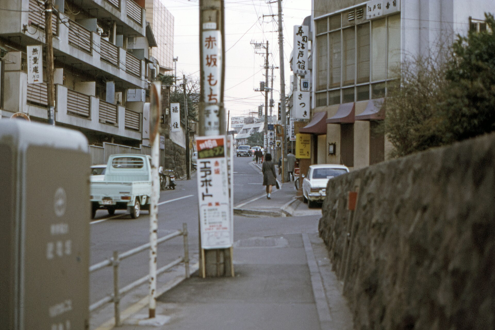
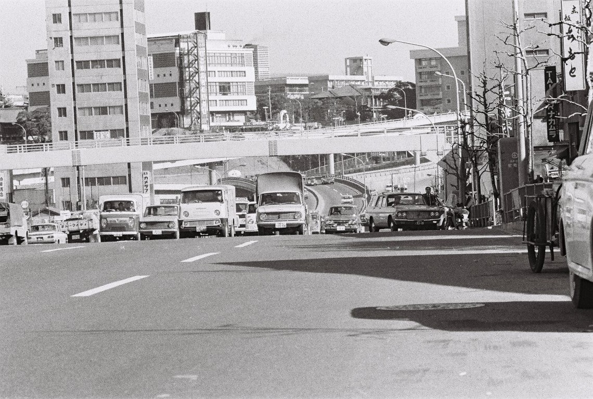
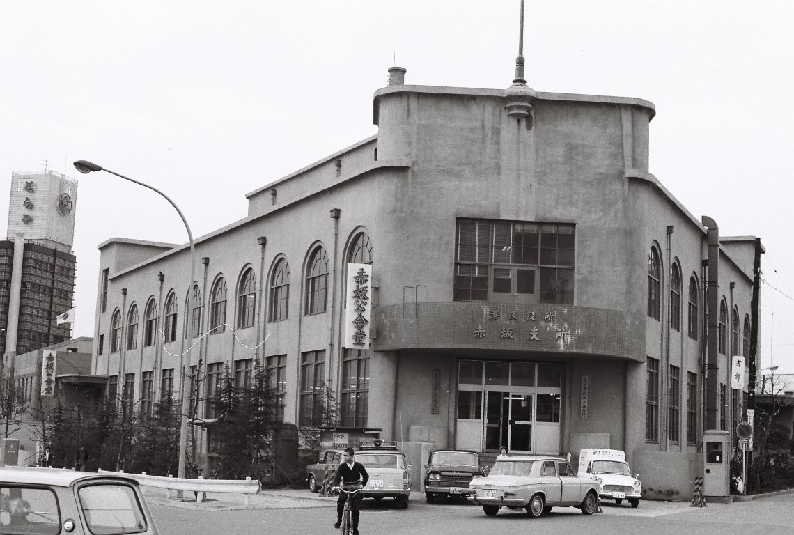

46年前の今日、1980年11月19日。人気絶頂の中で芸能界を電撃引退した山口百恵さんが、俳優の三浦友和さんと東京都港区赤坂の霊南坂教会で結婚式を挙げました。わずか21歳でステージを降り、自ら選んだ家庭への道を歩み始めた昭和の大スターの門出に、日本中が熱い視線を注ぎました。

## 「ゴールデンコンビ」の誕生と日本中の熱狂

二人の出会いは1974年、グリコ「プリッツ」のCM撮影でした。同年、名作映画『伊豆の踊子』で映画初共演を果たすと、二人の瑞々しい演技と抜群の相性は瞬く間に観客を魅了します。以降、二人が共演した主演映画は12作に及び、1本あたり平均200万人を動員、累計120億円もの興行収入を記録しました。

さらにテレビ界でも、1974年から始まったTBSの『赤いシリーズ』で共演を重ね、『赤い疑惑』や『赤い衝撃』などでお茶の間の涙を誘いました。スクリーンとブラウン管の双方で息の合った姿を見せる二人は、いつしか「ゴールデンコンビ」と呼ばれる国民的人気カップルとなっていったのです。

## 衝撃の恋人宣言から「完全引退」の発表へ

二人の関係が現実の恋として公になったのは、1979年10月20日のことでした。大阪厚生年金会館でのリサイタルのステージ上、山口百恵さんは観客に向けて「私が好きな人は、三浦友和さんです」と突如発表します。その後、三浦友和さんも記者会見を開き、「結婚を前提にして付き合っています」と堂々と交際を認めました。

そして翌1980年3月7日、二人はそろって婚約を発表します。同時に百恵さんの口から語られたのは、「我が儘な…生き方を私は選びました。お仕事は全面的に、引退させて頂きます」という芸能界引退の決意でした。人気歌手として頂点を極めていた21歳の女性が下したこの決断は、日本社会全体に大きな衝撃をもたらしました。

*Found Photo - Japan - Tokyo - street view 3.tif (34176177731) — 写真: David Pirmann / CC BY 2.0*

## 武道館に置かれた白いマイクと伝説のラストステージ

引退へ向けた日々は、まさに熱狂の連続でした。1980年9月に発売された自叙伝『蒼い時』は、自らの生い立ちや葛藤、恋愛を赤裸々に綴り、発売からわずか1か月で100万部、年末までに200万部を超える空前のベストセラーとなりました。

1980年10月5日、日本武道館で行われたファイナルコンサートはTBS系列で全国に生中継されました。百恵さんは集まったファンに対し、「本当に…私のわがまま、許してくれてありがとう。幸せになります」と涙ながらに感謝を伝え、最後の歌「さよならの向う側」を熱唱。歌い終えると、深々と頭を下げ、白いマイクを静かにステージの中央へ置いたまま、舞台裏へと歩み去りました。この演出は、今なお語り継がれる日本の音楽史上屈指の名場面となっています。

*元赤坂一丁目 — 写真: ndl / CC BY (Japan Search)*

## 1980年11月19日、霊南坂教会での誓い

10月15日のホリプロ20周年記念式典で「いい日旅立ち」を歌い、引退記者会見を終えて芸能活動から完全に退いた百恵さん。それから約1か月後の1980年11月19日、二人の結婚式が東京都港区赤坂にある霊南坂教会で執り行われました。

飯清牧師の司式のもとで執り行われた挙式には、親族や関係者が集まり、二人は厳かな空気の中で永遠の愛を誓い合いました。教会周辺には早朝から多くの報道陣やファンが駆けつけ、静かな祈りの場は異例の熱気に包まれました。スクリーンの中で幾度となく結ばれる姿を演じてきた二人が、現実の世界で結ばれた瞬間でした。

*旧赤坂支所・赤坂公会堂 — 写真: ndl / CC BY (Japan Search)*

## 7年半の輝きと今も変わらぬ伝説の輝き

山口百恵さんの芸能生活は、1973年5月の歌手デビューから引退まで、わずか7年半という短い期間でした。その間にリリースしたシングルは31作、累計売上は1,142万枚にのぼり、1970年代に最も多くのレコードを売り上げた歌手となりました。また、デビュー曲から引退後のシングルまで405週連続でオリコン100位以内にランクインするなど、数々の金字塔を打ち立てています。

引退後、多くのファンや関係者が復帰を望む声をあげましたが、百恵さんが再び表舞台に立つことはありませんでした。潔くスポットライトを背にし、自らが選んだ家庭を守り続けたその生き方は、昭和を代表するスーパースターの誇りとして、今も人々の記憶に刻まれています。

### 参考資料

- <https://ja.wikipedia.org/wiki/11%E6%9C%8819%E6%97%A5>
- <https://pixabay.com/photos/music-player-record-player-7792956/>
- <https://commons.wikimedia.org/wiki/File:Found_Photo_-_Japan_-_Tokyo_-_street_view_3.tif_(34176177731).jpg>
- <https://adeac.jp/minato-city/catalog/mp900033-100070>
- <https://adeac.jp/minato-city/catalog/mp900010-100070>
