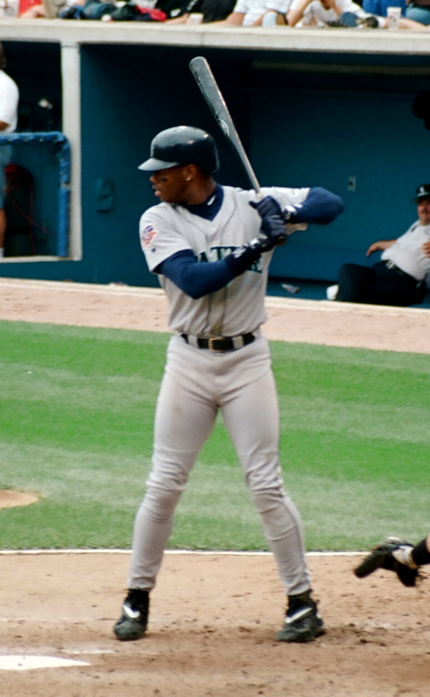
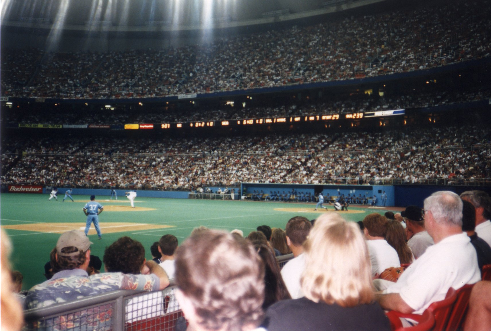
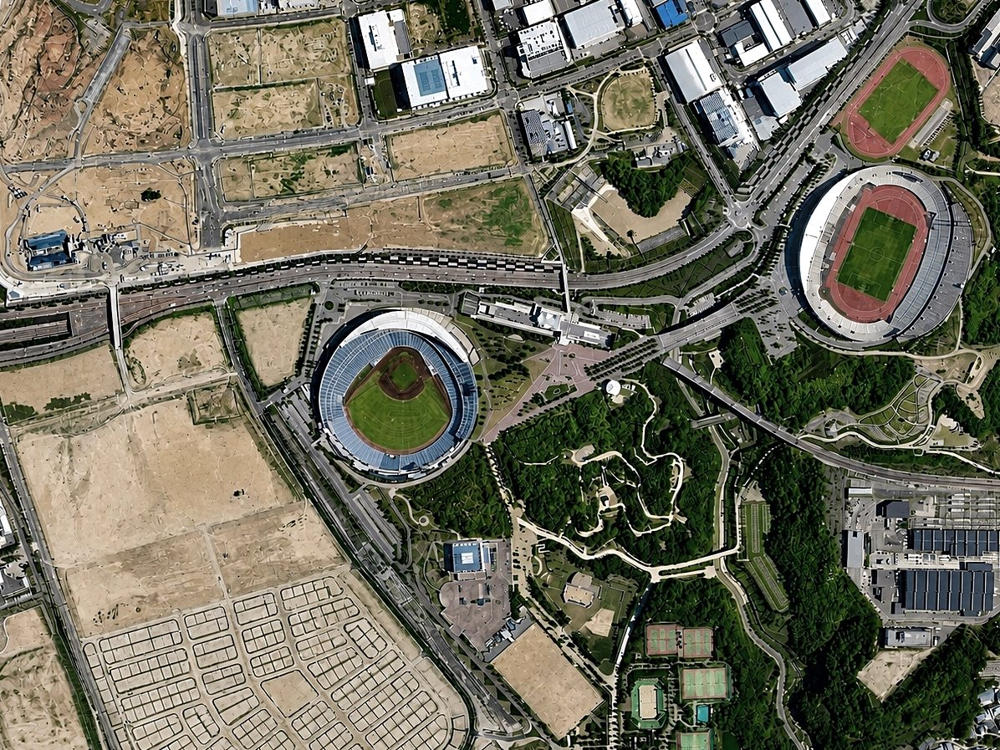

26年前の今日、2000年11月19日。オリックス・ブルーウェーブのイチロー外野手が、米大リーグのシアトル・マリナーズと3年契約を結びました。前人未到の記録を打ち立て続けた天才打者が、日本人野手として初めて大リーグへ挑む瞬間でした。海を越えて旋風を巻き起こす伝説の幕開けとなった日を振り返ります。

## 日本球界を席巻した天才打者の歩み

イチロー選手は愛工大名電高校時代から際立った成績を残し、高校3年間の通算打率は5割を超えていました。1991年のドラフト会議でオリックス・ブルーウェーブから4位指名を受けてプロ入りを果たします。

細身の体格からプロ入り当初は評価が分かれたものの、卓越した打撃センスで頭角を現しました。日本プロ野球では最多タイ記録となる7年連続の首位打者を獲得し、パ・リーグ最多記録となる最多安打を5回達成。さらに打点王や盗塁王、最高出塁率のタイトルも手中に収め、日本球界の頂点に君臨していました。

## シアトル・マリナーズと日本の特別な縁

イチロー選手の移籍先となったシアトル・マリナーズは、日本と非常に深い結びつきを持つ球団でした。1992年に球団がフロリダ州タンパベイへの移転危機に直面した際、地元からの要請に応える形で任天堂の山内溥氏らが出資し、シアトルへの残留を実現させた歴史があります。

さらに2000年には横浜ベイスターズから佐々木主浩投手が加入し、アメリカンリーグの新人王に輝く活躍を見せていました。日本企業による球団保有の歴史と日本人投手の成功が、シアトルという街と日本との距離を縮めていました。

*1997年の資料 — 写真: clare_and_ben / CC BY-SA 2.0*

## 2000年11月19日、3年契約が成立

2000年オフ、イチロー選手はポスティングシステムを利用して大リーグ挑戦を表明しました。交渉権を獲得したマリナーズとの間で詰めの交渉が進められ、2000年11月19日、正式に3年契約の締結が発表されました。

背番号は日本時代と同じ「51」に決定しました。野茂英雄投手ら投手の成功例はあったものの、「日本人野手はメジャーのスピードとパワーに通用しないのではないか」という疑問の声は、日米双方で根強く囁かれていました。未知の領域へ踏み出すイチロー選手の一挙手一投足に、ファンの熱い視線が注がれました。

*1996年の資料 — 写真: marbla123 / CC BY 2.0*

## 懐疑論を一変させた2001年の衝撃

迎えた2001年シーズン、イチロー選手は開幕からその懐疑的な声を瞬く間に一掃しました。MLB新人最多安打記録となる242安打を放ち、打率3割5分を記録。首位打者と盗塁王のタイトルを獲得しただけでなく、ゴールドグラブ賞やシルバースラッガー賞も受賞しました。

さらにシーズンMVPと新人王を同時に獲得するという、メジャーリーグの長い歴史でもフレッド・リン以来史上2人目となる大快挙を成し遂げました。イチロー選手の大活躍に牽引されたマリナーズは、アメリカンリーグ史上最多、メジャー史上最多タイとなるシーズン116勝を記録し、本拠地セーフコ・フィールドは熱狂に包まれました。

*Green Stadium Kobe aerial photograph 1990 — 写真: 国土地理院 / CC BY 4.0*

## 積み上げた金字塔と永久欠番「51」

その後もイチロー選手の進化は止まりませんでした。2004年にはシーズン262安打を放ち、84年ぶりに大リーグのシーズン最多安打記録を更新。史上唯一となる10年連続200安打以上や、通算3000安打、500盗塁を達成しました。日米通算4367安打はギネス世界記録に認定されています。

2018年からはマリナーズの会長付特別補佐を務め、2019年に東京で行われた開幕シリーズで現役を退きました。マリナーズで背負い続けた背番号51は永久欠番となり、2021年には球団殿堂入りも果たしました。2000年11月19日の契約合意は、日本の野球史のみならず、世界のプロ野球の歴史が大きく動いた一日でした。

### 参考資料

- <https://ja.wikipedia.org/wiki/%E3%82%B7%E3%82%A2%E3%83%88%E3%83%AB%E3%83%BB%E3%83%9E%E3%83%AA%E3%83%8A%E3%83%BC%E3%82%BA>
- <https://commons.wikimedia.org/wiki/File:Edgar_Martinez_1997.jpg>
- <https://commons.wikimedia.org/wiki/File:Ken_Griffey_Jr._1997_(cropped).jpg>
- <https://commons.wikimedia.org/wiki/File:10_inside_kindome.jpg>
- <https://commons.wikimedia.org/wiki/File:Green_Stadium_Kobe_aerial_photograph_1990.jpg>
