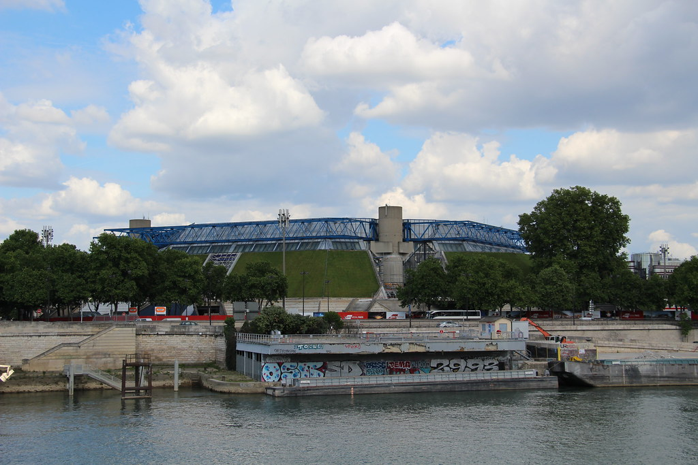

21年前の今日、2005年11月19日。15歳の浅田真央選手が、フィギュアスケートのグランプリシリーズ・フランス杯でシニア初優勝を果たしました。世界中を驚かせた天才少女の快進撃は、ここから本格的なシニアの伝説へとつながっていきます。

## 「天才少女」から世界ジュニア女王へ

1990年9月に愛知県名古屋市で生まれた浅田真央は、5歳でスケートを始めました。早くから才能を開花させ、小学6年生で特例出場した2002年の全日本選手権では、3回転フリップ-3回転ループ-3回転トウループのコンビネーションジャンプを披露して7位に入り、「天才少女」として全国的な注目を浴びました。

2004–2005シーズンには、ジュニアグランプリファイナルで国際大会女子シングル史上5人目、ジュニア女子としては史上初となる3回転アクセルを成功させて優勝。2005年の世界ジュニア選手権でも大会史上初の3回転アクセルを決めて初出場初優勝を飾り、名実ともにジュニアの頂点に立ってシニアへと挑むことになりました。

## シニア参戦、世界の強豪に挑んだ2005年秋

2005–2006シーズン、15歳になった浅田はシニアのグランプリシリーズに初めて参戦しました。初戦となった中国杯では、当時の世界女王であったロシアのイリーナ・スルツカヤに次ぐ堂々の2位に入り、世界トップレベルに通用することを早々に証明します。

続いて臨んだのが、11月にフランスのパリで開催されたエリック・ボンパール杯（フランス杯）でした。リンクにはアメリカの実力者サーシャ・コーエンや、日本のエース荒川静香など、世界の第一線で活躍するトップスケーターたちが顔を揃えていました。

*Paris - Palais Omnisports de Paris-Bercy (POPB) — 写真: corno.fulgur75 / CC BY 2.0*

## ショート・フリー完全制覇の圧巻劇

このフランス杯で、浅田はショートプログラム、フリーともに1位という圧倒的な強さを見せつけました。合計得点は182.42点を記録。2位のコーエンに7.30点差をつけ、3位の荒川にも9.12点差をつけての堂々たるシリーズ初優勝でした。

シニア本格参戦からわずか2戦目での優勝という快挙は、国内外に大きな衝撃を与えました。この勝利によってポイントを重ねた浅田は、上位選手のみが出場できるグランプリファイナルへの切符を確実に手に入れたのです。

*Palais Omnisports de Paris-Bercy — 写真: gadl / CC BY-SA 2.0*

## ファイナル制覇と「87日」の壁

フランス杯での勝利の勢いそのままに、浅田は12月に開催されたグランプリファイナルに出場。ここでもショート、フリーともに1位の合計189.62点をマークし、世界女王スルツカヤを8.14点差で破って、日本選手としては村主章枝以来2人目となるファイナル優勝を15歳で成し遂げました。

シニアの強豪を次々と打ち負かしたことから、翌年2月の2006年トリノオリンピック出場を期待する声が日本中で沸き起こりました。しかし、国際スケート連盟（ISU）の五輪参加基準「五輪前年の6月30日までに15歳」という年齢制限にわずか87日足りず、代表資格を得ることはできませんでした。

*Le Palais Omnisports de Paris Bercy — 写真: Metro Centric / CC BY 2.0*

## 日本女子フィギュア黄金期の幕開け

トリノ五輪への出場はかなわなかったものの、浅田の登場は日本女子フィギュア界に空前のブームを巻き起こしました。このシーズンのトリノ五輪では荒川静香がアジア選手として初の金メダルを獲得し、日本スケート界は黄金時代へと突入します。

浅田真央はその後、2008年、2010年、2014年と世界選手権を3度制覇。2010年バンクーバーオリンピックでは銀メダルを獲得し、女子史上初めて1つの大会で3度の3回転アクセルを成功させる歴史的快挙を残しました。世界の頂点へ駆け上がったそのすべての第一歩が、2005年11月19日のフランスの氷上にありました。

### 参考資料

- <https://ja.wikipedia.org/wiki/11%E6%9C%8819%E6%97%A5>
- <https://commons.wikimedia.org/wiki/File:Pentes_gazonn%C3%A9es_du_Palais_Omnisport_de_Bercy,_vers_1993.jpg>
- <https://www.flickr.com/photos/129231073@N06/23192905886>
- <https://www.flickr.com/photos/24183489@N00/315999337>
- <https://www.flickr.com/photos/16782093@N03/4058499553>
