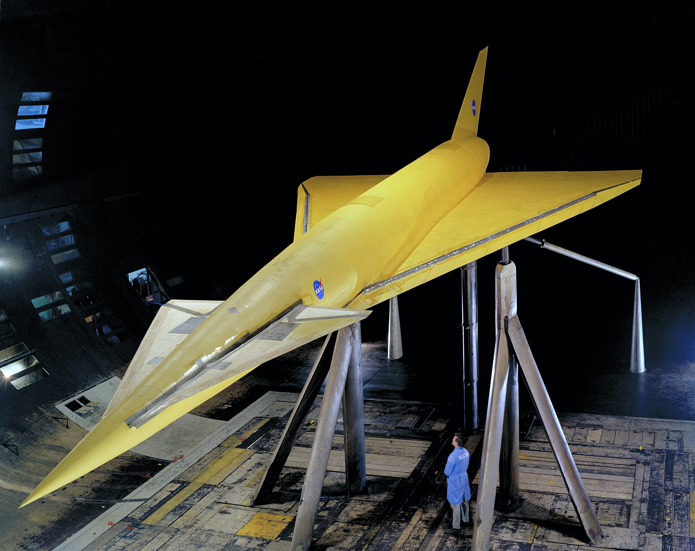
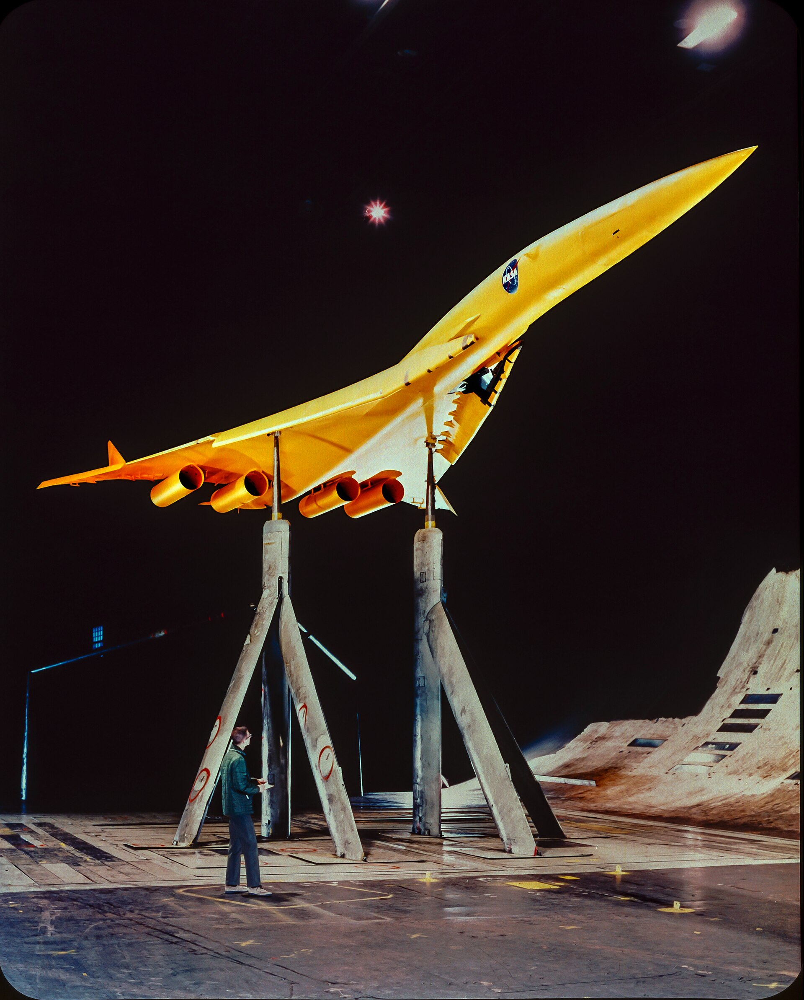
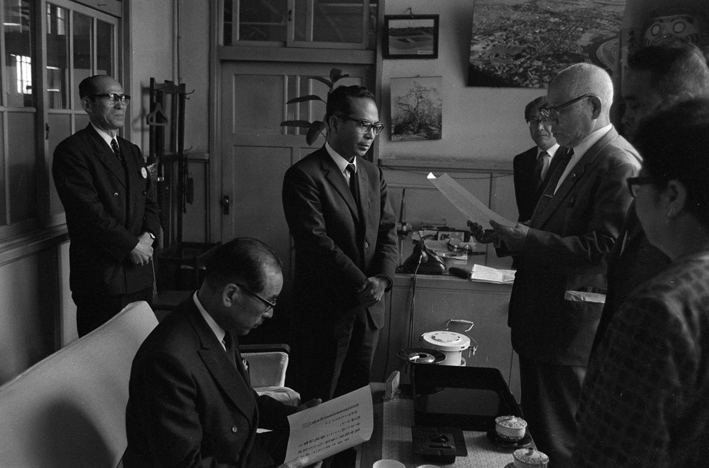

55年前の今日、1971年11月19日。航空自衛隊向けに開発が進められていた国産初の超音速高等練習機「XT-2」の試作1号機が、通算30回目の試験飛行において、日本の航空機として初めて音速を突破しました。敗戦による航空機開発の禁止から立ち上がり、自前の技術で音速の壁を打ち破った瞬間でした。

## 超音速の時代へ——立ちふさがった操縦教育の壁

1960年代、航空自衛隊はマッハ2級の戦闘機であるF-104Jの導入を進めていました。しかし、それまで使用していた亜音速の練習機T-33Aを終えたばかりの新人パイロットにとって、高性能なF-104への移行はあまりに操縦が難しく、教育上の大きな課題となっていました。

戦闘機へ進む手前で超音速飛行を学べる練習機が必要とされ、当初はアメリカ空軍が運用していたT-38などの海外製航空機の導入が有力視されていました。実際、1965年には調査団がアメリカへ派遣され、一度は海外機の選定へと傾いていました。

## 「今開発しなければ、永遠にできない」——国産への決断

その流れを大きく変えたのが、防衛庁技術研究本部の守屋富次郎本部長でした。守屋本部長は「日本はこの機会に超音速機を開発しなければ、永遠に開発できなくなる」と強く主張しました。

当時の松野防衛庁長官も装備の国産化を後押ししたことで、状況は一転します。時間を懸念する声もありましたが、最終的に日本独自の手で超音速高等練習機「XT-2」を開発することが決まりました。それは、戦後の日本の航空産業にとって極めて重い決断でした。

*1967年の資料 — 写真: NASA Ames Research Center / NASA / Public domain*

## 戦後派技術者たちの結束——ASTETの誕生

1967年9月、三菱重工業の開発計画案が採択され、富士重工業や川崎重工業、新明和工業なども協力する国家プロジェクトとして動き出しました。同年10月には各社の技術者を結集した設計チーム「ASTET」が組織されます。

チームリーダーを務めた三菱重工の池田研爾第2技術部長は戦時中の開発経験を持っていましたが、集まった他のメンバーは全員が戦前・戦中の開発を知らない戦後派の若手技術者たちでした。経験のない超音速領域の設計に挑むため、模型審査や風洞実験を重ね、海外製のアドーア・エンジンをライセンス生産して搭載する計画が進められました。

*1969年の資料 — 写真: NASA Ames Research Center / NASA / Public domain*

## 1971年11月19日、30回目の空で成し遂げた快挙

1971年4月28日、ついに試作1号機がロールアウトし、7月20日に初飛行に成功しました。そして迎えた11月19日、通算30回目となる試験飛行が実施されます。

テストパイロットの操縦により大空へ飛び立った試作機は、水平飛行において国産機として史上初となる音速突破（マッハ1超）を記録しました。自前の翼で音の壁を破ったこの瞬間は、日本の航空機開発が世界水準へと追いついた証しでした。開発費約60億円を投じたプロジェクトは、見事に結実したのです。

*県会議員当選授与式 — 写真: ndl / CC BY (Japan Search)*

## 青空を彩ったブルーインパルスと1,450人のパイロット

制式採用されたT-2は、1988年までに計96機が生産されました。宮城県の松島基地に置かれた第21飛行隊と第22飛行隊などで運用され、2004年に後継機に役割を譲るまでの間に、延べ30万7千飛行時間を記録し、実に1,450人もの戦闘機パイロットを育て上げました。

また、1982年からはアクロバットチーム「ブルーインパルス」の2代目機体としても活躍しました。青と白と水色の精悍なカラーリングは女子高校生のグループが提案した公募案が原案となり、全国の航空祭で多くの人々を魅了しました。2006年3月に全機が退役するまで、T-2は日本の防空と航空技術の礎であり続けました。

### 参考資料

- <https://ja.wikipedia.org/wiki/11%E6%9C%8819%E6%97%A5>
- <https://commons.wikimedia.org/wiki/File:Test_of_the_XT-2.jpg>
- <https://commons.wikimedia.org/wiki/File:Hypersonic_Transport_Model_(AC-40028).jpg>
- <https://commons.wikimedia.org/wiki/File:Supersonic_Transport_Model_mounted_in_the_Ames_40x80_Foot_Wind_Tunnel_(AC-42062).jpg>
- <https://adeac.jp/koshigaya-city-digital-archives/catalog/mp146324-200020>
