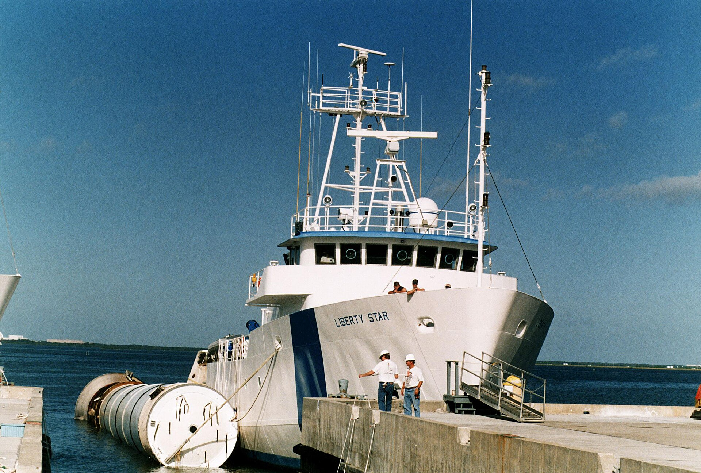
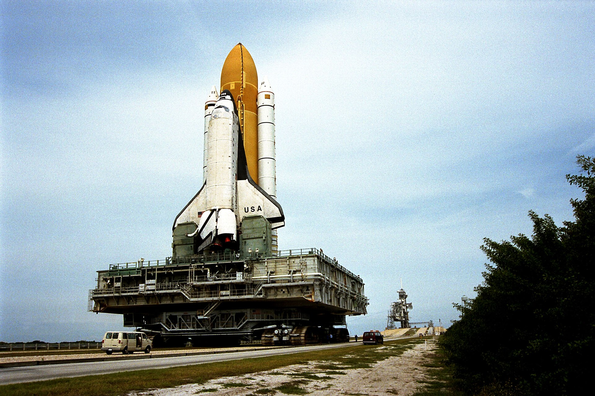
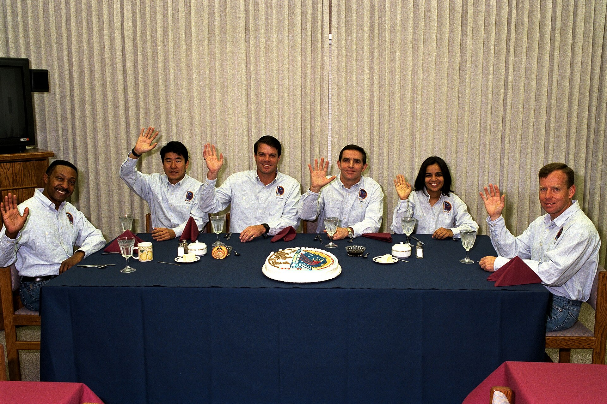

29年前の今日、1997年11月19日。スペースシャトル「コロンビア」がアメリカのケネディ宇宙センターから轟音とともに打ち上げられ、宇宙飛行士の土井隆雄さんが初めて宇宙へと旅立ちました。1985年に宇宙飛行士に選ばれてから12年、地道な訓練と仲間のサポートを続けてきた土井さんにとって、待望の初飛行でした。

## 第1期生選抜から始まった長い待機の日々

土井隆雄さんは東京大学大学院で宇宙工学の博士課程を修了後、宇宙科学研究所やアメリカ航空宇宙局（NASA）の研究員を経て、1985年8月に当時の宇宙開発事業団（NASDA）によって初の宇宙飛行士に選抜されました。このとき一緒に選ばれたのが毛利衛さんと向井千秋さんです。

しかし、日本人の宇宙飛行の機会は限られていました。最初の搭乗科学技術者としての飛行は最年長の毛利さんに託され、2回目の飛行は日本人女性初となる向井さんが担うことになります。土井さんは二人の宇宙飛行を地上から支えるバックアップやサポート役に専念しました。さらに、後から選ばれた若田光一さんが搭乗運用技術者として先に宇宙へ行くことになっても、土井さんは腐ることなく自身の役割に徹し、自らも搭乗運用技術者の資格を取得して次の好機をじっと待ち続けました。

## 1997年11月19日、スペースシャトル「コロンビア」打ち上げ

選抜から実に12年が経過した1997年11月19日、ついに土井隆雄さんにその時が訪れました。スペースシャトル「コロンビア」によるミッション「STS-87」のクルーとして搭乗し、宇宙へと飛び立ったのです。

このミッションで土井さんに託されたのは、日本人宇宙飛行士として前人未到の挑戦でした。それは、船外活動用宇宙服を着て宇宙船の外へ出て作業を行う「船外活動」、いわゆる宇宙遊泳でした。地上での12年間にわたる厳しい訓練と研鑽のすべてをぶつける舞台が、ついに整ったのです。

*Liberty Star with SRB after STS-87 (2) — 写真: NASA / Public domain*

## 日本人初の船外活動とISS建設への布石

軌道上に到達した土井さんは、船外活動用宇宙服を身にまとい、コロンビアの貨物室から漆黒の宇宙空間へと足を踏み出しました。日本人として初めて宇宙空間に直接その身を置いた瞬間でした。

この船外活動は単なるパフォーマンスではなく、将来の国際宇宙ステーション（ISS）建設を見据えた重要なマニュアル作業や技術試験を行う実戦的な任務でした。無重力空間という過酷な環境のなかで、土井さんは落ち着いた動作で予定されていた作業を着実にこなし、日本人宇宙飛行士の作業能力と技術の高さを世界に証明しました。12月5日に地球へ帰還した土井さんには、翌1998年1月に内閣総理大臣顕彰が授与されています。

*STS-087 shuttle — 写真: NASA / Public domain*

## 2008年の再飛行と日本実験棟「きぼう」の組み立て

土井隆雄さんの宇宙への挑戦は、初飛行の成功だけで終わりませんでした。毛利さんや向井さんが一線を退いた後も現役の宇宙飛行士として活動を続け、2008年3月にはスペースシャトル「エンデバー」（STS-123）で2度目の宇宙飛行を果たしました。

このミッションで担当したのが、日本が開発した国際宇宙ステーションの日本実験棟「きぼう」の第1便となる船内保管室の軌道上への設置作業でした。日本の有人宇宙開発における最大の拠点である「きぼう」の歴史的な第一歩を自らの手で宇宙に刻み、日本が有人宇宙施設を持つ時代を切り拓いたのです。

*STS-87 preflight breakfast — 写真: NASA / Public domain*

## 天文学への情熱と今に続く宇宙の探求

土井さんは宇宙飛行士であると同時に、熱心な天体観測家としても広く知られています。中学生の頃から太陽の黒点観測を始め、宇宙飛行士として多忙な日々を送る傍らでも観測を続け、2002年と2007年には超新星を発見して日本天文学会から表彰を受けました。

その後、国際連合宇宙部の宇宙応用課長を務め、京都大学で後進の育成に携わるなど、現場を離れてもなお宇宙と人類の関わりを探求し続けています。1997年11月19日、12年の準備を経てコロンビアで宇宙へ飛び立った土井さんの勇姿は、いまも日本の宇宙開発の大きな誇りとして輝き続けています。

### 参考資料

- <https://ja.wikipedia.org/wiki/11%E6%9C%8819%E6%97%A5>
- <https://commons.wikimedia.org/wiki/File:Liberty_Star_with_SRB_after_STS-87.jpg>
- <https://commons.wikimedia.org/wiki/File:Liberty_Star_with_SRB_after_STS-87_(2).jpg>
- <https://commons.wikimedia.org/wiki/File:STS-087_shuttle.jpg>
- <https://commons.wikimedia.org/wiki/File:STS-87_preflight_breakfast.jpg>
