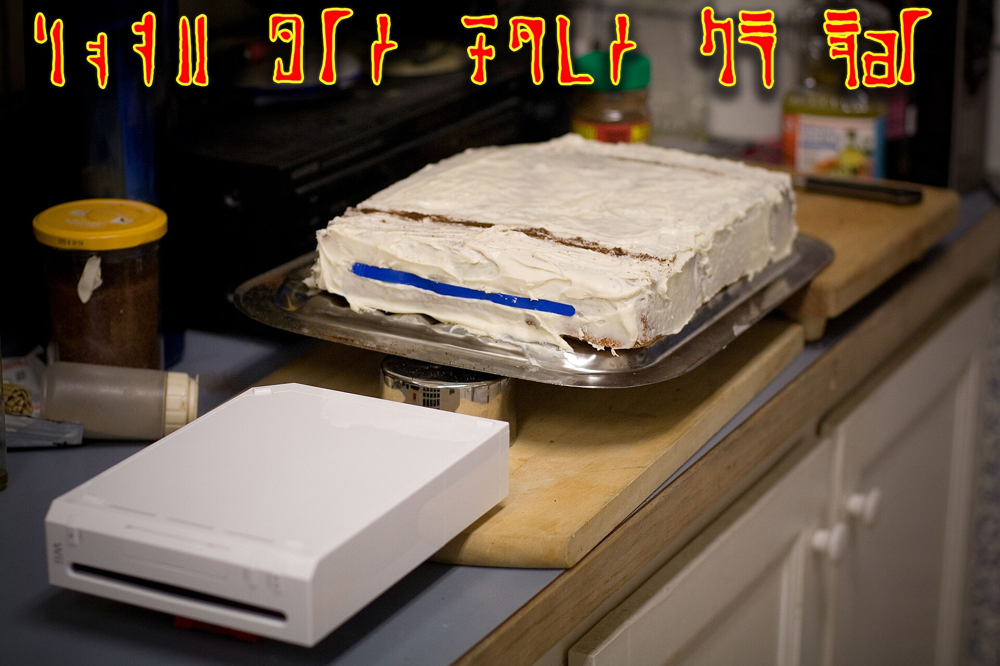
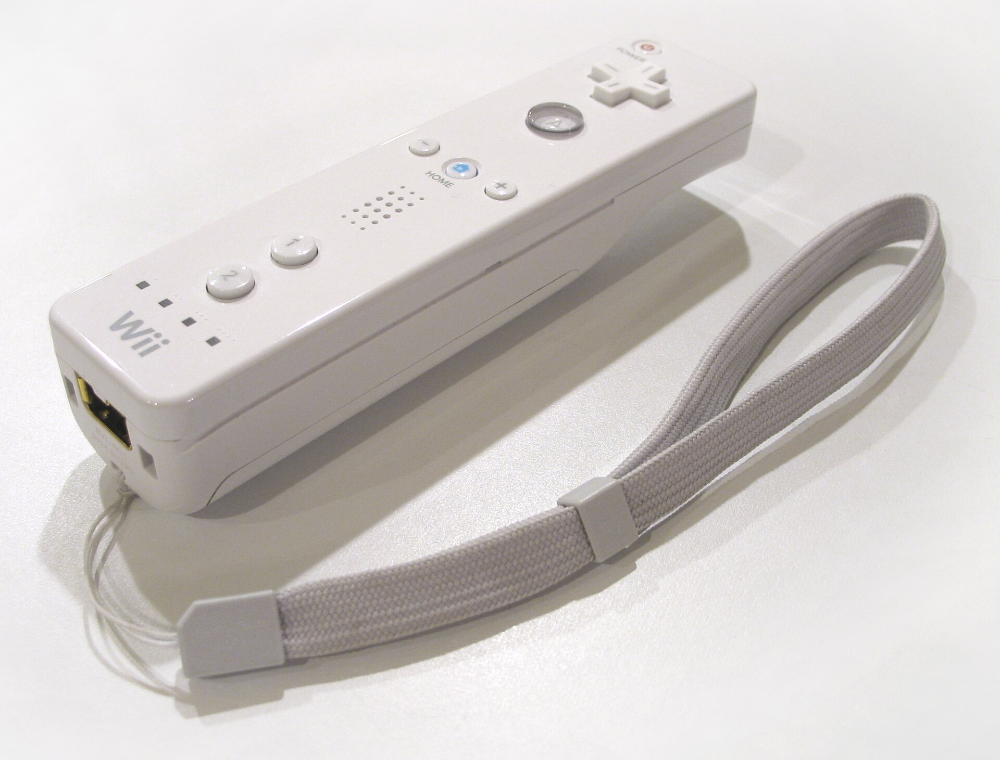
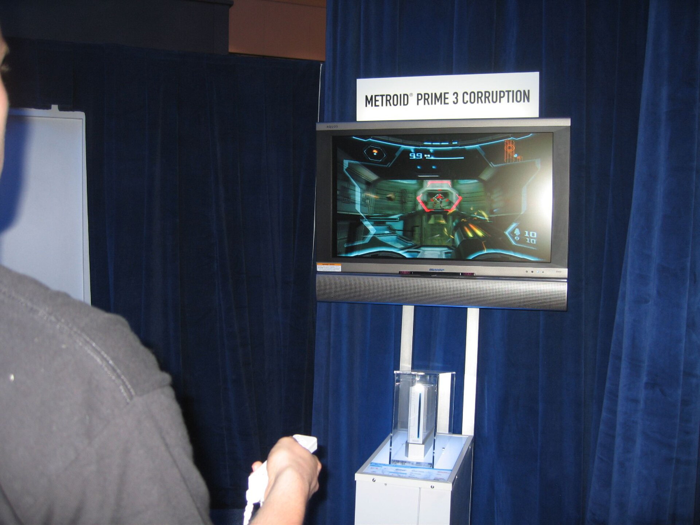

20年前の今日、2006年11月19日。任天堂の新型据え置き型ゲーム機「Wii」が、北米市場で発売を迎えました。コントローラーを振って直感的に遊ぶというこれまでにない操作体系は、世界中に驚きをもたらしました。日本での発売を控えるなか、海を越えて届いた熱気は、ゲーム業界の歴史を塗り替える第一歩となったのです。

## 「ゲーム人口の拡大」を目指した新たな挑戦

2000年代に入り、ゲーム業界では映像の高度化が進む一方で、複雑すぎる操作についていけなくなった人々が離れていく「ゲーム離れ」が問題視されていました。任天堂はこの課題に向き合い、既存の愛好家だけでなく、これまで遊ばなかった人々も振り向かせる「ゲーム人口の拡大」を打ち出しました。

2004年に発売された携帯型ゲーム機「ニンテンドーDS」はその先陣を切り、世界で1億5000万台以上を普及させる大きな成功を収めました。そしてリビングに置く据え置き型ゲーム機においても同じ変革を起こすべく、次世代機の開発が進められていったのです。

## 「レボリューション」から正式名称「Wii」の発表へ

2003年5月、任天堂は「ニンテンドー ゲームキューブ」の次世代機を開発中であることを公表しました。翌2004年6月には「革命」を意味するコードネーム「レボリューション」が明かされ、大きな注目を集めました。

2005年9月には、片手で操作できる棒状の革新的なコントローラーが披露されました。従来のボタン操作とは異なり、直感的に振ったり向けたりできる仕組みは業界に衝撃を与えました。そして2006年4月28日、親しみやすい「Wii」という正式名称が世界へ向けて発表されたのです。

*Wii Cake — 写真: Joshin Yamada / CC BY 2.0*

## 2006年11月19日、北米での熱狂的な先行発売

2006年11月19日、Wiiは日本に先駆けて北米（アメリカ、カナダ、メキシコ）で発売開始となりました。北米市場での本体価格は250ドル以下に設定され、テニスやボウリングなどを直感的に遊べるゲームソフト『Wii Sports』が標準で同梱されました。

発売当日、現地の販売店の前には実物をいち早く手に入れようと大勢の人々が列を作りました。テレビ画面に向かって実際に腕を振り、家族や友人と一緒に声を上げて楽しむ姿は、従来のゲームの光景を一変させました。

*Wii Remote Image — 写真: Greyson Orlando / Public domain*

## 12月2日の日本発売と世界へ広がるブーム

北米での先行発売に続き、2006年12月2日には待望の日本国内での発売日を迎えました。日本でのメーカー希望小売価格は2万5000円（税込）で、国内のゲーム売り場にも多くのファンや家族連れが詰めかけました。

さらに12月7日には豪州やイタリア、12月8日には欧州各国、12月9日にはスペインでも発売が続き、世界的な広がりを見せました。本体は発熱や消費電力を抑え、リビングに自然に置けるようDVDジャケット3枚分という小型サイズに設計されていました。

*Wii Demonstration E3 2006 — 写真: Alex Hansen / CC BY 2.0*

## 据え置き型初となる出荷1億台突破の金字塔

Wiiの快進撃は発売後も続きました。本体に同梱された『Wii Sports』は、本体同梱版を含めると世界で最も売れたゲームソフトとして記録されることになります。

そしてWiiは、任天堂の据え置き型ゲーム機として初めて世界累計出荷台数1億台を突破する偉業を達成しました。普段ゲームに触れることのなかったシニア層や子どもたちまでがリモコンを握り、お茶の間でスポーツゲームを楽しむ姿は大きな社会現象となりました。2013年に本体の生産は終了しましたが、その存在感は際立っていました。

## 今も受け継がれる「誰もが遊べる」体験の価値

2006年11月19日の発売から20年が経ちました。Wiiが切り拓いた「体感的な操作」や「家族みんなで画面を囲む楽しさ」という思想は、現代のゲーム文化にも色濃く受け継がれています。

複雑なボタン操作を覚えなくても、ただリモコンを振るだけで誰もが笑顔になれたあの体験。リビングのテレビの前に集まり、家族で夢中になって汗を流した時間は、今も色あせない思い出です。20年前のあの日、海を越えて始まった新しいゲームの歴史は、世界中の家庭に笑顔を届けました。

### 参考資料

- <https://ja.wikipedia.org/wiki/%E4%BB%BB%E5%A4%A9%E5%A0%82>
- <https://commons.wikimedia.org/wiki/File:Reginald_Fils-Aime.jpg>
- <https://commons.wikimedia.org/wiki/File:Wii_Cake.jpg>
- <https://commons.wikimedia.org/wiki/File:Wii_Remote_Image.jpg>
- <https://commons.wikimedia.org/wiki/File:Wii_Demonstration_E3_2006.jpg>
