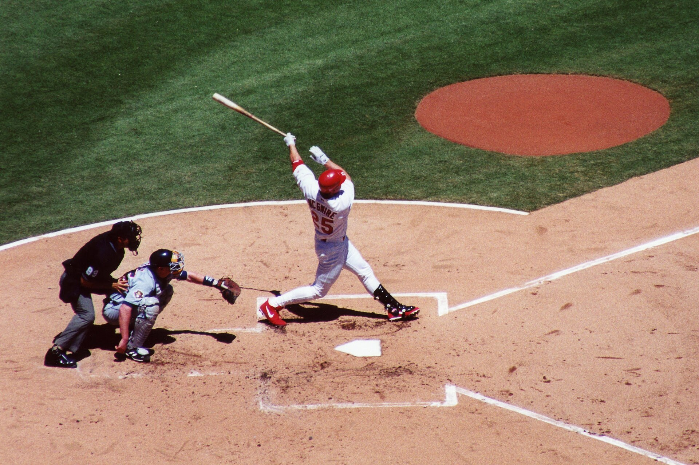

25年前の今日、2001年11月20日。シアトル・マリナーズのイチロー選手が、メジャーリーグベースボールで日本人初となる最優秀選手、シーズンMVPに選出されました。日本から海を渡ったばかりの野手が、野球の本場アメリカで頂点に立ったこの知らせは、日本中に大きな熱狂をもたらしました。

## 日本人野手初の大リーグ挑戦とシアトルの縁

愛知県西春日井郡豊山町に生まれたイチロー選手は、愛工大名電高校を経て日本プロ野球で輝かしい実績を残しました。日本球界では7年連続を含む7度の首位打者、5度の最多安打、打点王や盗塁王も獲得し、トップ打者として君臨しました。そして2000年のオフシーズン、日本人初の野手としてメジャーリーグへの移籍を決断します。移籍先となったシアトル・マリナーズは、1992年に任天堂の山内溥氏らが出資して球団買収に携わり、本拠地移転の危機を乗り越えた経緯を持つなど、日本と非常に深い関わりを持つ球団でした。これまで投手が大リーグで活躍することはあっても、日本人野手が通用するのかという懐疑的な視線が一部に残るなか、イチロー選手の挑戦が始まりました。

## 圧倒的な打棒で打ち立てた242安打の新人記録

迎えた2001年シーズン、イチロー選手は開幕から快音を響かせ続けました。巧みなバットコントロールと俊足を生かして安打を量産し、シーズン打率3割5分を記録してアメリカン・リーグの首位打者を獲得します。さらに盗塁王のタイトルも手にし、アジア人選手として史上初となる首位打者と盗塁王の二冠を達成しました。このシーズンにイチロー選手が放った安打数は242本に達し、メジャーリーグにおける新人最多安打記録を樹立しました。打率3割5分もアメリカン・リーグの新人最高打率記録となりました。イチロー選手が牽引したシアトル・マリナーズはレギュラーシーズンで116勝を記録し、アメリカン・リーグ史上最多勝利、そしてメジャーリーグ史上最多勝利タイ記録を達成しました。

*2001年の資料 — 写真: Rick Dikeman / CC BY-SA 3.0*

## フレッド・リン以来の快挙、新人王とMVPの同時獲得

2001年11月20日、全米を驚嘆させた1年を締めくくる知らせが届きました。アメリカン・リーグの最優秀選手（MVP）に、イチロー選手が日本人として初めて選ばれたのです。アジア出身選手としても史上初のシーズンMVP受賞という歴史的な快挙でした。イチロー選手はこの年、MVPと新人王にとどまらず、首位打者、盗塁王、シルバースラッガー賞、ゴールドグラブ賞を同時に受賞しました。長いメジャーリーグの歴史において、同じシーズンにMVPと新人王を同時に受賞したのは、1975年のフレッド・リン選手と2001年のイチロー選手のわずか2人しかいません。アジア出身打者として初の新人王受賞でもあり、その選出は全米の野球界に衝撃を与えました。

*Seattle Safeco Field 01 — 写真: Mikano / CC BY-SA 3.0*

## 262安打と世界記録へ続いた軌跡

2001年の快挙は、偉大なキャリアのほんの始まりに過ぎませんでした。イチロー選手はメジャーリーグ史上唯一となる「10年連続200安打以上」という前人未到の記録を達成します。2004年にはシーズン262安打を放ち、それまでのMLB最多安打記録を84年ぶりに更新してコミッショナー特別表彰を受けました。その後も着実に安打を積み重ね、2016年にはメジャー通算3000安打と500盗塁を達成しました。日本プロ野球とメジャーリーグを合算した通算安打数は4367本に達し、ギネス世界記録に認定されました。通算3604試合の出場記録も世界記録となり、アジア人選手初となるアメリカ野球殿堂入りを果たすなど、世界のプロ野球史に確固たる足跡を刻みました。

*Norm and Constance Rice at Mariners game, 1990 (52420212352) — 写真: Seattle Municipal Archives from Seattle, WA / CC BY 2.0*

## 今も色あせない背番号51の偉業

シアトル・マリナーズにおいて、イチロー選手が着用した背番号51は永久欠番に指定されています。2018年からは球団の会長付特別補佐兼インストラクターとして活動し、今もチームを支え続けています。マリナーズにはイチロー選手をはじめこれまで11人の日本人選手が所属し、日本とシアトルを結ぶ特別な絆は今も続いています。2001年に打ち立てられたシーズン242安打の新人記録、そしてチームが記録した116勝という金字塔は、四半世紀が経過した今も破られていません。2001年11月20日、日本人野手として未知の世界に飛び込み、最高峰の栄誉を手にした瞬間は、今も日本のスポーツ史に輝く金字塔として語り継がれています。

### 参考資料

- <https://ja.wikipedia.org/wiki/%E3%82%B7%E3%82%A2%E3%83%88%E3%83%AB%E3%83%BB%E3%83%9E%E3%83%AA%E3%83%8A%E3%83%BC%E3%82%BA>
- <https://commons.wikimedia.org/wiki/File:Ichiro_Suzuki_Apr_20_2001.jpg>
- <https://commons.wikimedia.org/wiki/File:Mark_mcgwire.jpg>
- <https://commons.wikimedia.org/wiki/File:Seattle_Safeco_Field_01.jpg>
- <https://commons.wikimedia.org/wiki/File:Norm_and_Constance_Rice_at_Mariners_game,_1990_(52420212352).jpg>
