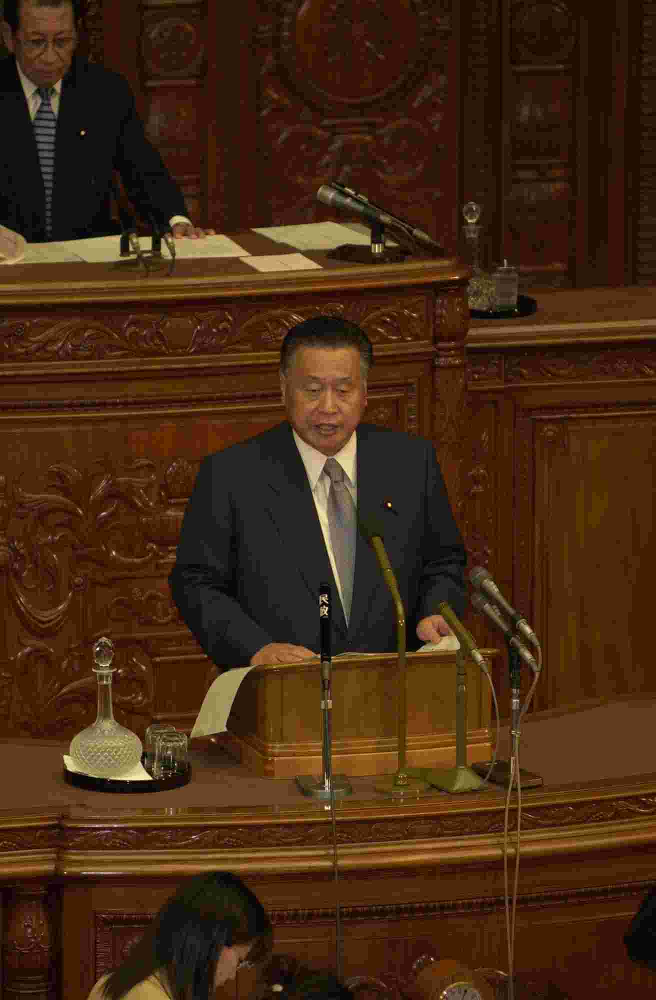
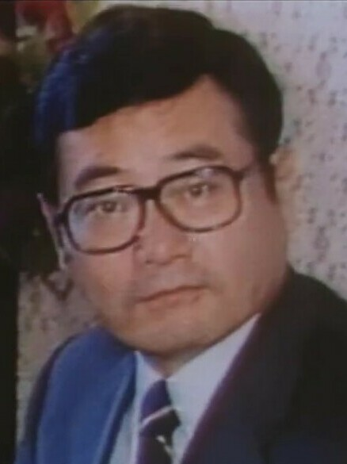
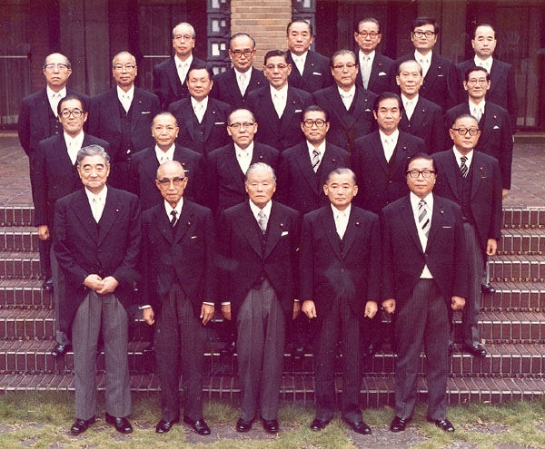

26年前の今日、2000年11月20日。自民党の加藤紘一元幹事長が第2次森内閣打倒を目指して起こした「加藤の乱」が、内閣不信任決議案の採決直前に事実上の挫折を迎えました。日本中の視線がテレビ中継に注がれたあの一夜は、平成の政治史における最大のドラマの一つとして記憶されています。

## 支持率低迷と「総理に一番近い男」の焦燥

2000年秋、第2次森内閣は「神の国」発言や閣僚のスキャンダルなどが重なり、内閣不支持率は7割に達していました。翌年夏に参議院議員選挙を控える中、自民党内では危機感が急速に高まっていました。

当時、保守本流である宏池会の会長を務め、「総理に一番近い男」と目されていたのが加藤紘一氏でした。加藤氏は山崎拓氏、小泉純一郎氏とともに「YKK」と呼ばれ、党内の次世代リーダーとして大きな発言力を持っていました。加藤氏はNHKの番組などで「国民の7割が支持しない内閣に、不信任案反対と言えるのか」と語り、倒閣の意思を公然と示しました。

## 64人の造反宣言と世論の熱狂

衆議院の定数480人のうち、当時の与党は272議席を占め、過半数を31議席上回っているにすぎませんでした。野党が提出する内閣不信任決議案に対し、加藤派45人と山崎派19人の計64人が賛成または欠席すれば、内閣不信任案は可決される計算でした。

加藤氏はマスメディアやインターネットを活用し、世論を味方につける戦略をとりました。政界再編への期待感から、不信任案提出当日の夜は各局のニュース番組が高視聴率を連発しました。街の居酒屋や銭湯、タクシーの利用者が目に見えて減るなど、日本中が永田町の動向を固唾をのんで見守っていました。

*20000921 Yoshiro Mori Shoshin1 — 写真: 内閣官房内閣広報室 / CC BY 4.0*

## 野中幹事長による徹底的な切り崩し工作

しかし、自民党執行部の反撃は極めて迅速かつ苛烈でした。幹事長を務めていた野中広務氏は、造反議員に対して「除名」や次の選挙での「公認剥奪」、さらには対立候補の擁立を示唆して強烈な圧力をかけました。

小選挙区制のもとでは、党の公認を失うことは政治生命の危機に直結します。さらに、派閥の長老である宮澤喜一元首相が加藤氏との決別を表明し、側近だった丹羽雄哉氏や古賀誠氏らが離反したことで、加藤派の結束は急速に崩壊していきました。

*Koichi Kato 1985 (cropped) — 写真: 防衛庁 / CC BY 3.0*

## ホテルオークラ東京での涙の慰留劇

11月20日夜9時30分、ホテルオークラ東京で加藤派と山崎派の合同総会が開かれました。同調者が次々と脱落し、敗北が決定的となる中、加藤氏は自分たちに従った若手議員の処分を避けるため、山崎氏と2人だけで本会議場へ行き不信任票を投じると宣言します。

その瞬間、立ち上がって議場へ向かおうとする加藤氏の肩を、側近の谷垣禎一氏がつかみました。「加藤先生は大将なんだから! 独りで突撃なんてダメですよ! 加藤先生が動く時は俺たちだってついていくんだから!」。同じく加藤派の杉山憲夫氏も「死ぬも生きるも一緒だ」と涙ながらに説得しました。この生々しい光景はテレビカメラを通じて全国に中継され、加藤氏は歯を食いしばりながら本会議への出席を断念しました。

*Second Ōhira Cabinet — 写真: 公益財団法人大平正芳記念財団、内閣官房内閣広報室 / CC BY 4.0*

## 「名誉ある撤退」の果てと小泉政権の誕生

加藤氏は採決への欠席を「名誉ある撤退」と表現しましたが、党内での求心力低下は避けられませんでした。名門派閥の宏池会は真っ二つに分裂し、加藤派に所属していた若手議員たちも四散することになりました。後に首相となる菅義偉氏はこの乱の直後に加藤氏と距離を置き、岸田文雄氏も「勝負をかける時は絶対に負け戦をしてはならない」という教訓を得たと述懐しています。

そして皮肉にも、森派の会長として執行部側にとどまっていた盟友・小泉純一郎氏が、翌2001年春の総裁選で国民的な旋風を巻き起こし、首相の座を射止めることになります。権力の冷徹さと人間関係の綾が交錯したあの夜の出来事は、今も日本の政局を語る上で欠かせない転換点として語り継がれています。

### 参考資料

- <https://ja.wikipedia.org/wiki/11%E6%9C%8820%E6%97%A5>
- <https://commons.wikimedia.org/wiki/File:20000921_Yoshiro_Mori_Shoshin2.jpg>
- <https://commons.wikimedia.org/wiki/File:20000921_Yoshiro_Mori_Shoshin1.jpg>
- <https://commons.wikimedia.org/wiki/File:Koichi_Kato_1985_(cropped).jpg>
- <https://commons.wikimedia.org/wiki/File:Second_%C5%8Chira_Cabinet.jpg>
