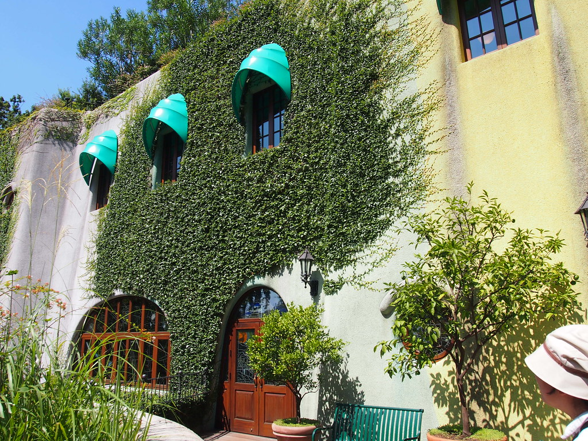

22年前の今日、2004年11月20日。スタジオジブリ制作、宮崎駿監督のアニメーション映画『ハウルの動く城』が全国東宝系で劇場公開されました。映画館には早朝から長蛇の列ができ、日本中が動く城と魔法の世界に沸き立ちました。

## 日比谷スカラ座から始まった熱狂

2004年11月20日、映画『ハウルの動く城』は日比谷スカラ座（現在のTOHOシネマズ日比谷 SCREEN12）を筆頭に全国で封切られました。2001年に公開され、ベルリン国際映画祭金熊賞や米アカデミー賞長編アニメーション賞を受賞した『千と千尋の神隠し』以来、3年ぶりとなる宮崎駿監督の長編作品とあって、公開前から社会的な注目度は極めて高いものでした。糸井重里氏による「ふたりが暮らした。」をはじめ、「ヒロインは、90歳の少女。」「恋人は、弱虫の魔法使い。」といった印象的なキャッチコピーが街を彩り、劇場には幅広い年代のファンが押し寄せました。

## 『魔女の宅急便』以来15年ぶりの他者原作

本作は、イギリスの作家ダイアナ・ウィン・ジョーンズのファンタジー小説『魔法使いハウルと火の悪魔』を原作としています。宮崎駿監督がスタジオジブリで他者の著作を原作とした長編映画を手がけるのは、1989年の『魔女の宅急便』以来、実に15年ぶりのことでした。物語の中盤までは原作の流れを踏襲しつつも、後半にかけては宮崎監督独自の脚色が大きく加えられました。監督は本作のテーマを「戦火の恋」と位置づけ、原作には描かれていなかった激しい戦争描写や空襲の光景を劇中に盛り込み、混迷する時代を生きる男女のドラマを力強く描き出しました。

*当日の写真ではありません · 事件当時の写真ではありません · イメージ写真 — 写真: niekverlaan / Pixabay Content License*

## 個性豊かなキャラクターと「動く城」の奇妙な同居生活

物語の主人公は、帽子屋で働く地味で控えめな18歳の少女ソフィーです。彼女は荒地の魔女の呪いによって90歳の老婆へと姿を変えられてしまいます。街を離れたソフィーが荒地で出会ったのが、4本の鳥のような足で歩く巨大なガラクタのような「ハウルの動く城」でした。城の暖炉には城の動力を司る火の悪魔カルシファーがおり、ハウルの弟子の少年マルクルが暮らしていました。日本語版では、ソフィーの少女時代と老婆の姿を一貫して女優の倍賞千恵子さんが演じ分け、その繊細で温かみのある演技が観客の心を捉えました。

*Studio Ghibli — 写真: Dick Thomas Johnson / CC BY 2.0*

## 原作からの大胆な飛躍と原作者の賛辞

映画化にあたり、原作者のダイアナ・ウィン・ジョーンズが出した条件は「ハウルの性格を変えないように」という一点だけでした。美青年でありながら見栄っ張りで臆病、精神的な脆さを抱えた魔法使いハウルは、宮崎監督の演出によって人間味あふれるキャラクターとして造形されました。映画を鑑賞した原作者ジョーンズは、「とても素晴らしかった」「宮崎は私が執筆したときと同じ精神で映画を作った」と完成度を絶賛しました。また、サリマンの使い犬「ヒン」は、宮崎監督と旧知の仲である押井守監督をモデルにして描かれ、声優を務めた原田大二郎さんの独特な鳴き声とともに親しまれました。

*studio ghibli museum — 写真: skvidal / CC BY-SA 2.0*

## 興収196億円、日本映画の歴代記録を塗り替える

公開後の興行は記録的な快進撃を続けました。最終的な観客動員数は1500万人、興行収入は196億円に達しました。この成績は、当時の日本歴代興行収入ランキングにおいて『千と千尋の神隠し』『タイタニック』『ハリー・ポッターと賢者の石』に次ぐ歴代4位、邦画としては『千と千尋の神隠し』に次ぐ歴代2位の快挙でした。これにより、当時の日本映画歴代興行収入ランキングの上位3作品（『千と千尋の神隠し』『ハウルの動く城』『もののけ姫』）は、すべてスタジオジブリおよび宮崎駿監督作品によって独占されることとなりました。

## 今なお輝き続ける宮崎アニメの金字塔

『ハウルの動く城』はその後、アカデミー賞長編アニメーション映画部門へのノミネートをはじめ、国内外で数多くの映画賞を受賞し、世界的な評価を確固たるものにしました。カルシファーとハウルの心臓をめぐる契約の謎、戦火を飛び越えて青空へと旅立つ動く城のラストシーンは、公開から20年以上が経過した今も色あせることはありません。世代を超えて多くの人々に観続けられている本作は、日本のアニメーション史に刻まれた不朽の名作として愛され続けています。

### 参考資料

- <https://ja.wikipedia.org/wiki/%E3%82%B9%E3%82%BF%E3%82%B8%E3%82%AA%E3%82%B8%E3%83%96%E3%83%AA>
- <https://pixabay.com/photos/film-35mm-vintage-projector-1365334/>
- <https://pixabay.com/photos/projector-film-exhibition-show-422145/>
- <https://www.flickr.com/photos/31029865@N06/6158049983>
- <https://www.flickr.com/photos/80009874@N00/8025600359>
