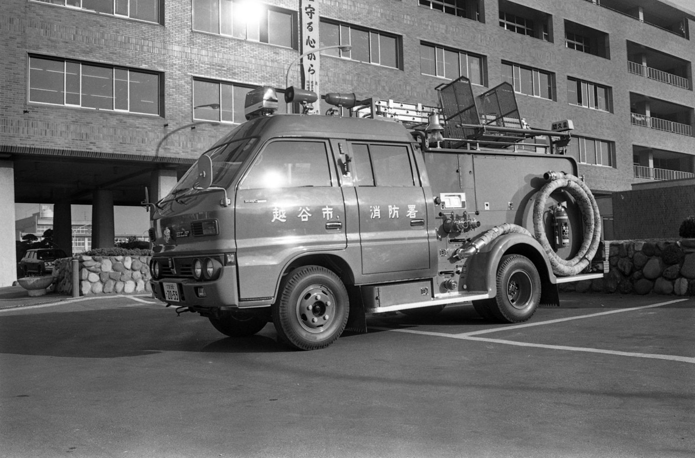
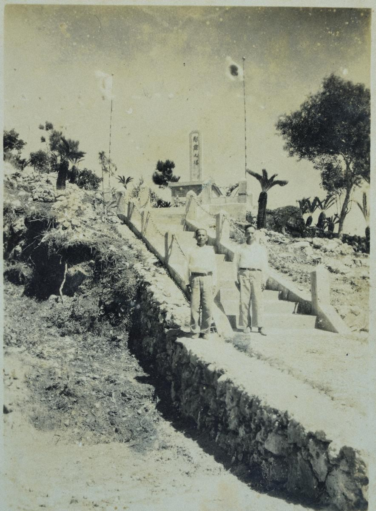
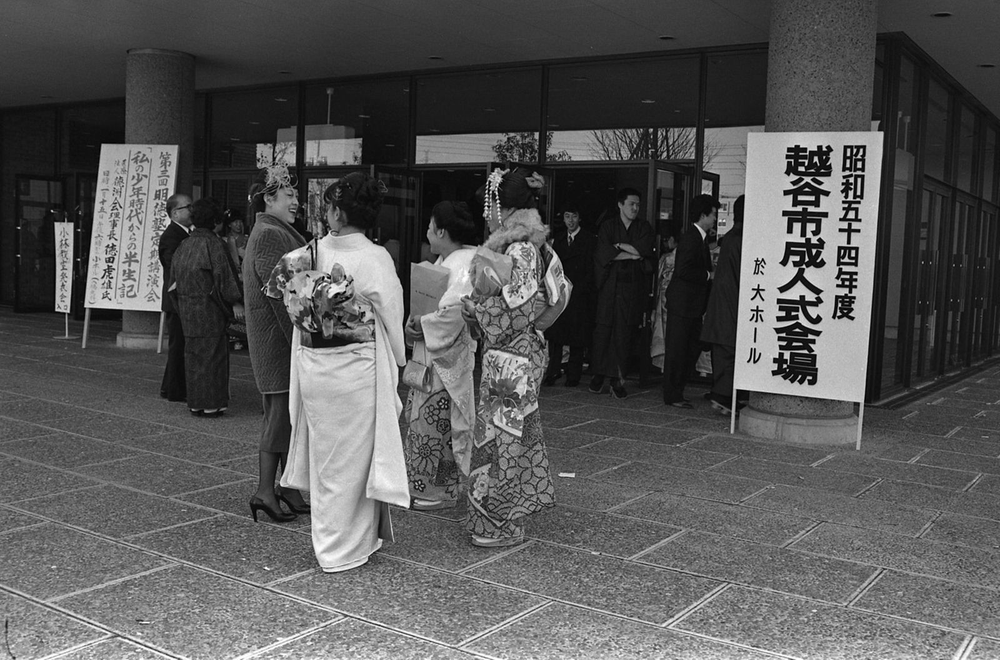

1980年11月20日、栃木県塩谷郡藤原町（現・日光市）の川治温泉にある「川治プリンスホテル雅苑」で、死者45名、負傷者22名を出す火災が発生しました。紅葉を楽しむために訪れていた高齢者を中心に甚大な犠牲を出し、戦後の日本の宿泊施設火災として最悪の大惨事となりました。

## 紅葉狩りの客で賑わう名門温泉街での出火

1980年11月20日の午後、紅葉の季節を迎えた栃木県の川治温泉には多くの観光客が訪れていました。現場となった「川治プリンスホテル雅苑」（西武グループのプリンスホテルとは無関係）には、当日112名の宿泊客が滞在していました。その大半は、東京都杉並区から紅葉見物旅行に訪れていた2組の老人クラブの会員たちでした。1組は本館最上階である4階の客室でくつろいでおり、もう1組はちょうどホテルに到着したばかりの穏やかな時間帯でした。

平穏な空気が一変したのは午後3時15分頃のことです。ホテルの浴場棟付近から火の手が上がりました。出火原因は、大浴場と女子浴場の間にあった露天風呂の解体工事でした。転落防止用の鉄柵を切断するために使われていたガスバーナーのアセチレンガスの火花が、何かの拍子に浴場棟の建物の隙間に入り込み、内部の可燃物に燃え移ったと推定されています。

## 被害を拡大させた「訓練」の誤認放送

火災の初期段階において、被害を決定的に拡大させる重大な過失が重なりました。出火直前の午後3時12分頃、火災報知機のベルが館内に鳴り響きました。しかしホテル側はこの日、自動火災報知設備の増設工事を行っており、その1時間ほど前にも点検作業が実施されていました。

ベルの音を聞いたホテルの従業員は、現場の確認を行うこともなく工事による誤作動だと独断で判断しました。そして館内スピーカーを通じて「ただいまのはベルの訓練です」という放送を流してしまったのです。この誤った館内放送を信じた宿泊客たちは危険を察知できず、部屋にとどまることになりました。

異変にいち早く気付いたのは、老人クラブを運んできた観光バスの運転手でした。2階の廊下に出た際に煙と異臭に気付き、フロントの従業員へ知らせました。フロント係が119番通報を行ったのは午後3時34分で、すでに浴場付近は猛烈な炎と黒煙に包まれていました。

*消防車 — 写真: ndl / CC BY (Japan Search)*

## 増改築が招いた迷路と消防設備の不備

火勢が瞬く間に全館へ広がった背景には、建物の構造的な欠陥と防災意識の著しい欠如がありました。同ホテルは木造2階建ての建物から出発し、1960年、1964年、1968年と増築を重ねて鉄骨造5階建ての簡易防火建築物を増設していました。さらに1979年には木造2階建ての武家屋敷風玄関や、移築した明治時代の旧栃木県知事公舎を別館として接続するなど、複雑な増改築を繰り返していました。

新館と旧館の間には防火戸が設置されておらず、館内はまるで迷路のように入り組んでいました。ホテル側は防火管理者を選任しておらず、消防計画の作成や避難訓練も一切行っていませんでした。前年の1979年末に行われた消防署の査察では、消火栓や誘導灯など8項目にわたる設備の不備が指摘されていたにもかかわらず、放置されたままでした。従業員数名がバケツの水や泡消火器で消火を試みたものの火勢を抑えられず、屋内消火栓設備も使用できませんでした。

*久手堅の慰霊碑 — 写真: 南城市教育委員会 / CC BY (Japan Search)*

## 命がけの救助活動と有毒ガスの脅威

通報を受けた消防隊員42名と地元消防団385名が現場へ急行しました。しかし、崖の上に位置するホテルへ部隊が到着した時には、すでに全館に火の手が回っており建物内への進入は不可能な状況でした。当時は川治ダムの完成前だったため、消火用の水利を得ることも困難を極めました。

炎が燃え盛る中、宿泊客を救おうと身を挺した人々がいました。老人クラブに同行していたバスガイド1名と添乗員1名は、逃げ遅れた高齢客を助け出すため、猛煙が渦巻く建物の中へ果敢に飛び込みました。しかし火勢に阻まれ、尊い命を落とすこととなりました。

火災は同日午後6時45分頃に鎮火しましたが、延床面積約3,582平方メートルが全焼しました。犠牲となったのは宿泊客40名、従業員3名、そして救助に向かったバスガイドと添乗員各1名の計45名（男性9名、女性36名）にのぼり、重軽傷者も22名を出しました。死者の多くは逃げ遅れた高齢者で、死因の大半は新建材から発生した一酸化炭素中毒でした。

*成人式(コミセン大ホール) — 写真: ndl / CC BY (Japan Search)*

## 経営者への刑事責任と「適マーク」制度の創設

この惨事を受け、警察と検察はホテルの安全管理責任を厳しく追及しました。ホテルの社長とその妻である専務が業務上過失致死傷罪で、工事の作業員が業務上失火などの罪で起訴されました。一審の宇都宮地裁は社長に禁錮2年6ヵ月執行猶予3年、実質的な経営者で防火管理責任者と認められた専務に禁錮2年6ヵ月の実刑判決を言い渡しました。専務は控訴・上告したものの、1990年11月16日に最高裁第一小法廷が上告を棄却し実刑が確定しました。日本のホテル火災において経営者に実刑が下された初の司法判断となりました。

また行政面でも再発防止への動きが加速しました。火災翌年の1981年5月、消防庁によりホテルや旅館の防火基準適合表示制度、通称「適マーク」制度が制定されました。利用者が建物の安全性を一目で判断できるように金や銀のマークを掲示する仕組みが全国に普及していきました。

## 今に語り継がれる教訓と慰霊の祈り

火災後、焼け跡となったホテルは解体され、その敷地には日本金型工業健康保険組合の保養所「川治温泉 金型かわじ荘」が建設されました。また、川治温泉駅近くの川治霊園には、火災の犠牲となった45名を悼む慰霊碑が建立されています。

行楽シーズンの平穏な午後を一瞬にして地獄に変えた川治プリンスホテルの火災は、防火設備の点検怠慢や非常時の誤った初動対応がいかに壊滅的な結果を招くかを突きつけました。安全を軽視した代償の重さは、40年以上が経過した今も日本の防災史に消えない教訓として刻まれています。

### 参考資料

- <https://ja.wikipedia.org/wiki/11%E6%9C%8820%E6%97%A5>
- <https://jmapps.ne.jp/chigasaki_history/det.html?data_id=887>
- <https://adeac.jp/koshigaya-city-digital-archives/catalog/mp176773-200020>
- <https://nanjo-archive.jp/document/?detail=2239&genre=6>
- <https://adeac.jp/koshigaya-city-digital-archives/catalog/mp183597-200020>
