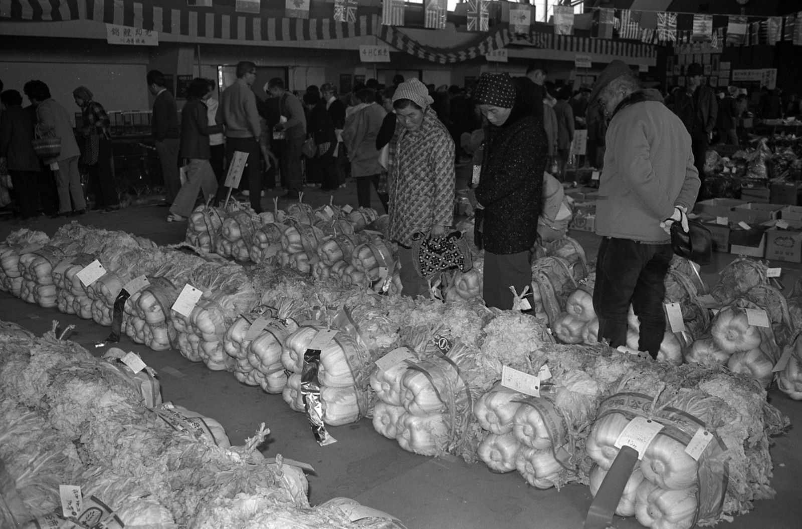
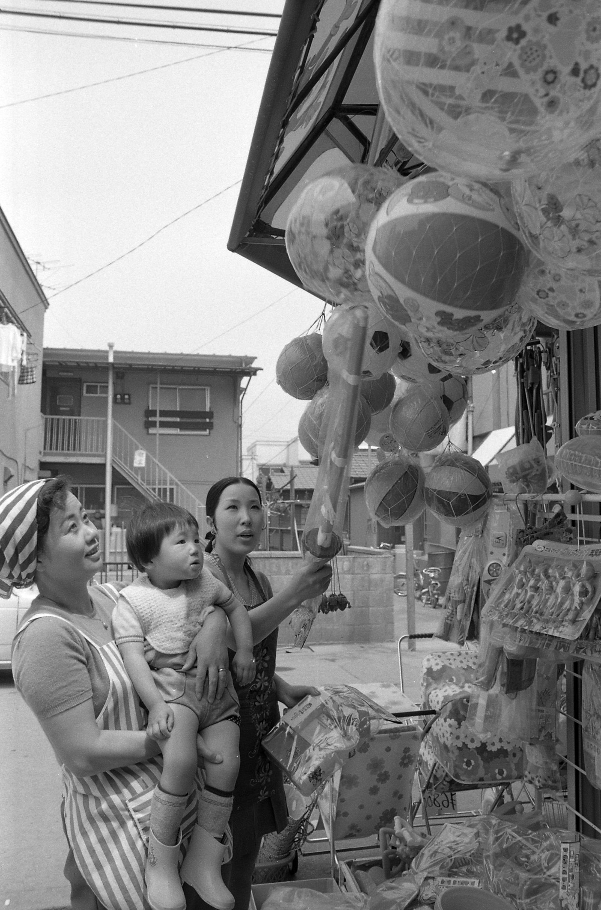
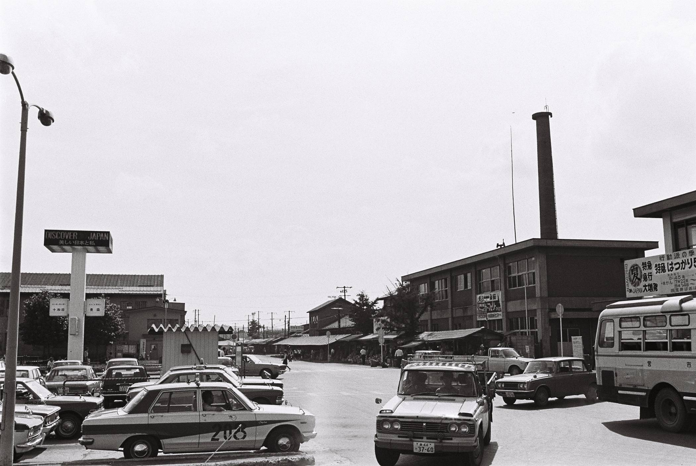

53年前の今日、1973年11月20日。イトーヨーカ堂がアメリカのサウスランド・カンパニーとライセンス契約を結び、株式会社ヨークセブンを設立しました。今日のセブン-イレブン・ジャパンの原点となる会社の誕生です。当時は誰も想像していなかった、新しい小売業態への果敢な挑戦がここから始まりました。

## 社内の反対を押し切った新事業への決断

1970年代初頭の日本は、大型総合スーパーが次々と出店し、流通業界を席巻していた時代でした。そうした中、アメリカで普及していた小型のコンビニエンスストアに目をつけたのが、イトーヨーカ堂の鈴木敏文でした。しかし社内では「小さな店で品ぞろえも限られるコンビニが、日本で成功するはずがない」と、事業の将来性を疑問視する声が大半を占めていました。

反対意見が渦巻くなか、鈴木は自らの信念を曲げませんでした。事業が失敗した際には、自分が保有しているイトーヨーカ堂の株式を提供して損失の穴埋めをすると申し出たのです。退路を断った覚悟を示したことで、オーナーである伊藤雅俊から事業推進の承諾を取りつけ、1973年11月に株式会社ヨークセブンの設立へと漕ぎ着けました。

## 豊洲の酒屋から始まった第1号店

会社設立から半年後の1974年5月15日、東京都江東区豊洲に記念すべきセブン-イレブンの日本第1号店「豊洲店」がオープンしました。この店舗は、同地で酒屋「山本茂商店」を営んでいた店主がフランチャイズに応募したことで誕生しました。店主は先代の急逝により大学を中途退学して店を継いだものの、旧来の酒屋経営に限界と将来への不安を感じていたところでした。

開店初日の豊洲店で、記念すべき最初に売れた商品はサングラスでした。この年の6月には、神奈川県相模原市に初の直営店となる相生店を出店。アメリカのビジネスモデルをそのまま持ち込むのではなく、日本の住宅街や商店街の事情に合わせたきめ細かな店づくりが手探りで進められていきました。

*農業祭 — 写真: ndl / CC BY (Japan Search)*

## 24時間営業の開始と急成長

創業当初の店舗は朝7時から夜11時までの営業でしたが、1975年には福島県郡山市虎丸町の直営店「虎丸店」において、日本国内で初めてとなる24時間営業を開始しました。深夜でも明るく清潔な店内で買い物ができる利便性は、夜間の勤務者や若者層を中心に絶大な支持を集めることになります。

出店スピードも加速しました。1976年5月には国内100店舗を達成し、同年9月には商品の共同配送や配送業者の集約化をスタートさせて物流網の効率化を進めました。1977年には200店、300店を相次いで突破。1978年1月には商号を現在の「株式会社セブン-イレブン・ジャパン」へと変更し、同年5月には札幌市に札幌北33条店を開いて北海道へ進出しました。そして1979年、店舗数でKマートを抜き、名実ともに国内コンビニ業界のトップへと躍り出たのです。

*玩具売場（蒲生商店街にて） — 写真: ndl / CC BY (Japan Search)*

## POS導入と生活サービスの開拓

セブン-イレブンが単なる小売店を超えて生活のインフラへと進化するうえで、大きな転機となったのが情報システムの導入でした。1982年10月にPOS（販売時点情報管理）システムを導入し、電子発注台帳（EOB）による単品管理と迅速な発注体制を確立しました。天候や近隣の行事に合わせて無駄なく商品を揃える手法は、流通業界に革命をもたらしました。

さらに1987年10月には東京電力の料金収納代理業務を開始し、翌年3月には東京ガス、1989年には第一生命保険料やNHK受信料の収納も開始しました。買い物のついでに公共料金を支払える便利さは、全国の生活者に広く受け入れられ、コンビニの役割を買い物以上の生活拠点へと押し上げました。

*青森駅前周辺の露店と市場・八戸工業港と漁連ドック — 写真: 松村泰雄 / CC BY-SA (Japan Search)*

## 親会社の逆買収劇と世界展開

日本市場で劇的な成長を遂げたセブン-イレブンは、やがて本国アメリカを驚かせる出来事を成し遂げます。1980年代後半、ライセンス供与元であったアメリカのサウスランド・コーポレーションが経営難に陥り、1990年代初頭には破産申請を行う事態となりました。

1991年3月、セブン-イレブン・ジャパンは親会社のイトーヨーカ堂と共同で4億3000万ドルを出資し、サウスランド社の株式の約7割を取得して傘下に収めました。子会社が経営難の本家を救済・再建するという「逆買収」は、日米両国の経済界で大きな話題を呼びました。その後、日本流の店舗運営ノウハウをアメリカに逆輸入して業績を見事に回復させ、2007年には全世界の店舗数でマクドナルドを抜いて世界一のチェーンへと成長しました。

## 47都道府県制覇と今に続く存在感

地域を集中的に開拓するドミナント戦略を貫いてきた同社は、物流拠点の整備とともに着実に出店地域を広げていきました。2018年1月には日本の小売業として初となる国内20,000店舗超えを達成。そして2019年7月には未出店だった沖縄県に初の店舗を開業し、ついに全都道府県への出店を成し遂げました。

2025年8月末時点での国内店舗数は21,787店に達し、業界第1位の規模を誇り続けています。1973年11月20日、小さな事務所で産声を上げたヨークセブンの挑戦は、半世紀を経て、24時間日本中の生活を照らし支え続ける巨大なネットワークとなりました。

### 参考資料

- <https://ja.wikipedia.org/wiki/11%E6%9C%8820%E6%97%A5>
- <https://www.flickr.com/photos/123583221@N06/14233344186>
- <https://adeac.jp/koshigaya-city-digital-archives/catalog/mp162582-200020>
- <https://adeac.jp/koshigaya-city-digital-archives/catalog/mp161329-200020>
- <https://kenshi-archives.pref.aomori.lg.jp/il/meta_pub/G0000004pic_12792-101>
