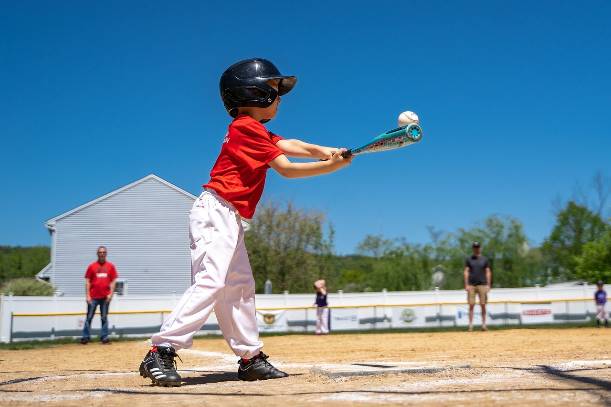
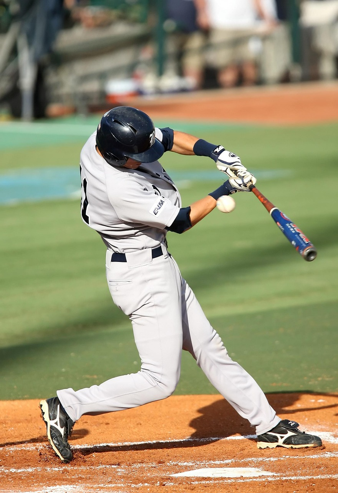
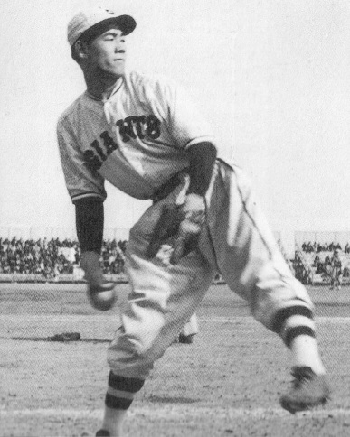

28年前の今日、1998年11月20日。プロ野球の新人選手選択会議（ドラフト会議）が行われ、甲子園を熱狂の渦に巻き込んだ横浜高校のエース、松坂大輔投手の交渉権を西武ライオンズが引き当てました。超高校級の逸材として日本中から視線が注がれるなか、競合抽選の行方に列島が沸き立ちました。

## 甲子園を圧倒した「平成の怪物」の衝撃

1998年の高校野球は、まさに松坂大輔投手の独壇場でした。横浜高校のエースとしてマウンドに上がった松坂投手は、高校生として初めて甲子園で時速150キロを超える球速を記録し、切れ味鋭いスライダーを武器に全国の強豪校をねじ伏せました。春の選抜高等学校野球大会を制すると、夏の全国高等学校野球選手権大会でも驚異的な投球を披露します。準々決勝のPL学園戦では延長17回に及ぶ激闘の末、一人で250球を投げ抜いて完投勝利。翌日の準決勝・明徳義塾戦でも救援登板して逆転劇を呼び込み、決勝の京都成章戦では嶋清一以来59年ぶり史上2人目となる決勝戦でのノーヒットノーランという金字塔を打ち立てました。

## 公式戦44連勝無敗という前人未到の記録

松坂投手を擁する横浜高校の快進撃は甲子園だけにとどまりませんでした。1997年秋の神奈川県大会から、1998年の春の選抜大会、夏の選手権大会、さらには明治神宮大会や国体に至るまで、チームは公式戦44連勝無敗という驚異的な記録を残しました。甲子園春夏連覇に加え、明治神宮大会と国体も制覇する「史上唯一の四冠」を達成。メディアやファンから「平成の怪物」と称された松坂投手の進路は、野球ファンのみならず社会的な関心事となっていきました。

*当日の写真ではありません · 事件当時の写真ではありません · イメージ写真 — 写真: jatocreate / Pixabay Content License*

## 11月20日、運命のドラフト会議と競合抽選

1998年11月20日、プロ野球のドラフト会議（新人選手選択会議）の会場に全球団の関係者が集まりました。最大の注目は言うまでもなく松坂投手の1巡目指名でした。1巡目入札で松坂投手には複数球団の指名が重複し、当たりくじを引くための厳正な抽選へと委ねられることになりました。息をのむ静寂のなか、見事に交渉権獲得のクジを引き当てたのが西武ライオンズでした。球団関係者の歓喜とともに、日本中が注目した怪物の行き先が決定した瞬間でした。

*当日の写真ではありません · 事件当時の写真ではありません · イメージ写真 — 写真: KeithJJ / Pixabay Content License*

## プロ入り直後から球界を席巻したルーキー時代

西武ライオンズに入団した松坂投手は、プロの世界でもすぐにその圧倒的な実力を証明しました。高卒ルーキーとなった1999年シーズン、パシフィック・リーグ最多勝利のタイトルを獲得し、文句なしの満票近くで新人王に選出されます。松坂投手の活躍は一過性のものではなく、1999年から2001年まで3年連続で最多勝利に輝き、2001年には最高の投手に贈られる沢村栄治賞も受賞。ゴールデングラブ賞にはパ・リーグの投手として史上最多となる通算7回選出されるなど、名実ともに日本プロ野球界を代表する大エースへと登りつめました。

*Eiji Sawamura 2 — 写真: ベースボール・マガジン社 / Public domain*

## メジャー制覇と日本代表「松坂世代」の輝き

日本で頂点を極めた松坂投手は、2006年オフにポスティングシステムを利用してメジャーリーグのボストン・レッドソックスへと移籍しました。2007年にはメジャー1年目でワールドシリーズ優勝を経験。また、日本代表としても2004年アテネオリンピックで銅メダルを獲得したほか、2006年と2009年の第1回・第2回ワールド・ベースボール・クラシック（WBC）において2大会連続で日本の世界一に大きく貢献し、大会最優秀選手（MVP）に輝くなど国際舞台でも無類の強さを誇りました。松坂投手と同じ1980年度生まれのプロ野球選手たちは「松坂世代」と呼ばれ、日本野球の一大潮流を築くことになります。

## 今も語り継がれるあの日の熱気

1998年11月20日のドラフト会議から年月が流れ、松坂投手は日米通算377試合登板、170勝、2128奪三振という堂々たる記録を残して現役生活に幕を下ろしました。しかし、あの夏の甲子園での投球や、ドラフト会議の抽選で見せた球団関係者の表情、そして西武ライオンズの青いユニホームを着てマウンドに上がった初登板の姿は、いまも多くの野球ファンの記憶に色濃く残っています。

### 参考資料

- <https://ja.wikipedia.org/wiki/%E3%83%97%E3%83%AD%E9%87%8E%E7%90%83%E3%83%89%E3%83%A9%E3%83%95%E3%83%88%E4%BC%9A%E8%AD%B0>
- <https://commons.wikimedia.org/wiki/File:Seibukyujo-931023-1.jpg>
- <https://pixabay.com/photos/baseball-little-league-youth-kids-7985432/>
- <https://pixabay.com/photos/baseball-baseball-player-batter-1462413/>
- <https://commons.wikimedia.org/wiki/File:Eiji_Sawamura_2.jpg>
