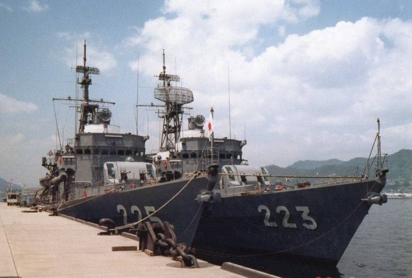
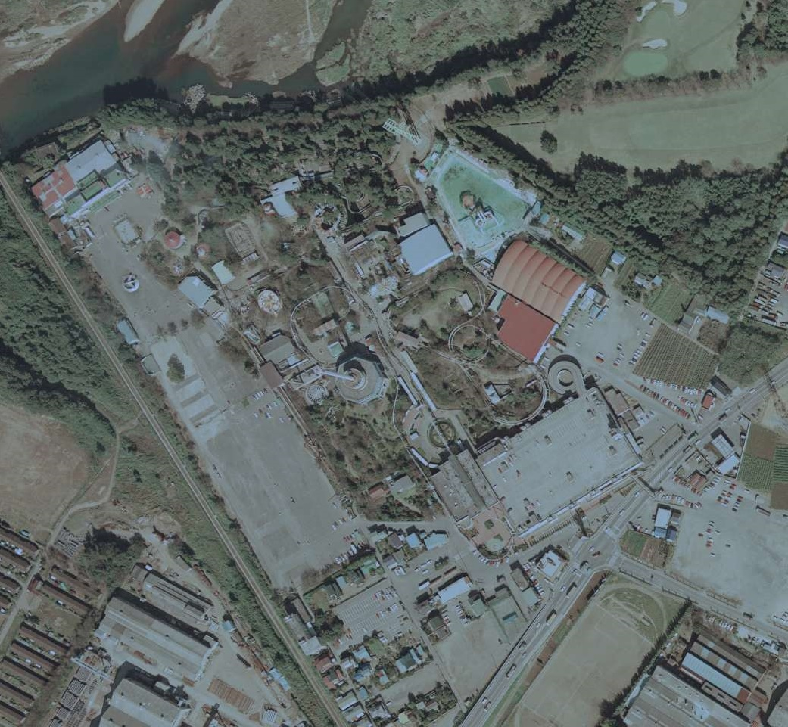

40年前の今日、1986年11月21日。東京都大島町の伊豆大島にある三原山で激しい割れ目噴火が発生し、島民や観光客ら1万人余りが島を脱出する「全島避難」が決まりました。夜空を赤く染めながら集落へと迫る溶岩流の前に、町は前代未聞の海上脱出を決断します。民間船や官公庁の船が闇夜の海に急行し、翌朝までに1万226人全員が無事に救出されました。

## 観光客が押し寄せた噴火開始とつかの間の小康状態

三原山の噴火は、1986年11月15日午後5時25分ごろ、山頂の火孔南壁から始まりました。深さ約230メートル、直径約300メートルの火孔が噴出物で次第に埋まり、19日午前には火口の北西縁を越えて溶岩流がカルデラ床へと流れ下りました。

珍しい火山の噴火を一目見ようと、島には5000人を超える観光客が押し寄せました。その後、山頂の噴火は一時的に落ち着きを見せます。立ち入り禁止区域に指定されて営業ができなくなった商店が営業許可を求めて町役場に陳情に訪れるなど、島内には楽観的なムードさえ漂い始めていました。

## 想定外の割れ目噴火と集落へ迫る赤い溶岩流

しかし、噴火開始から6日目を迎えた11月21日、状況は劇的な暗転を迎えます。昼過ぎからカルデラ北部で有感地震が頻発し始め、午後4時15分にはカルデラ床から割れ目噴火が発生しました。噴煙は高度8000メートルにまで達し、島を大きく揺らしました。

大島町の植村秀正町長は直ちに対策本部を設置し、1957年の噴火を経験していた助役の秋田壽さんを本部長に指名します。事態はさらに悪化し、午後5時46分にはそれまで想定されていなかった外輪山の外側、北西山腹からも割れ目噴火が始まりました。約3000人が暮らす島最大の集落・元町に向かって、真っ赤な溶岩が斜面を流れ下り、人家から数百メートルの地点にまで迫ったのです。

*JS Noshiro(DE-225),JS Yoshino(DE-223) — 写真: Yokohama1998 / CC BY-SA 3.0*

## 夜10時50分の決断――全島民1万人の避難指示

当初は溶岩の流れから離れた島南部への避難が進められていました。しかし、地震活動が南東部へと移動し、南部の波浮港周辺でも地面に亀裂が入る開口割れ目が確認されました。島全体で噴火が連鎖する危険性が高まり、島内に安全な場所は残されていないと判断されます。

午後10時50分、秋田本部長らは全島避難を正式に決定しました。島民だけでなく観光客も含めた1万人を超える人々を、夜の海を越えて本州へと脱出させるという、日本の災害史上でも例のない極めて困難な作戦が幕を開けました。

*Food stall 2 — 写真: Marie-Sophie Mejan / CC BY 4.0*

## 官民の船艇が集結した「史上最大の脱出作戦」

全島避難の決定を受け、海の上では迅速な救出活動が展開されました。東海汽船は政府からの正式要請を待たず、自主判断で高速船を使って観光客を対岸の伊東港へ脱出させた後、東京港にいた自社の定期船などをすべて大島へと向かわせました。定期船の乗客に事情を説明して船から降りてもらうなど、保有船舶を総動員する体制が敷かれました。

さらに国の安全保障会議設置法の適用第1号として官邸主導の指揮が執られ、海上保安庁の巡視船8隻や海上自衛隊の護衛艦2隻、地元の漁船なども救援に駆けつけました。横須賀から南極へ向けて出港したばかりだった南極観測艦「しらせ」も急遽反転し、救助活動に加わりました。翌22日午前5時10分、最後まで残っていた町職員らが船に乗り、観光客を含む1万226人全員の脱出が完了しました。

*Oyama Amusement Park, CKT863-C5-49 — 写真: Geographical Survey Institute of Japan / Attribution*

## 1か月の島外避難と残された島を守った人々

島を離れた島民たちは、東京都内や静岡県の避難所、親類宅などで約1か月間にわたる避難生活を余儀なくされました。寒さが本格化する季節の中、先々の見えない不安を抱えながらの日々が続きました。

一方で、無人となった島にも踏みとどまった人々がいました。島のインフラを守るため東京電力の火力発電所職員3人が島内に残り続け、秋田助役もまた対策の拠点に留まりました。12月20日に避難指示が正式に解除され、島民たちが帰島船で島に戻ってきた際、港の埠頭で真っ先に出迎えたのは秋田助役の姿でした。

## 語り継がれる教訓と今に残る火山の記憶

犠牲者を一人も出さずに成し遂げられたこの夜間救出劇は、官民が連携した優れた危機管理の事例として語り継がれています。対策本部の苦闘は後にドキュメンタリー番組でも大きく取り上げられ、多くの人々に感動を与えました。

現在、三原山のふもとには1986年の噴火で流れ出た溶岩流が冷え固まってできた広大な黒い大地が広がり、「ゴジラ岩」と呼ばれる奇岩などとともにジオパークの名所となっています。40年が経過した今も、夜の海に集まった船の明かりと、故郷の島を脱出したあの夜の記憶は、島民と多くの人々の胸に深く刻まれています。

### 参考資料

- <https://ja.wikipedia.org/wiki/%E4%BC%8A%E8%B1%86%E5%A4%A7%E5%B3%B6>
- <https://commons.wikimedia.org/wiki/File:Fujioka_city_center_area_Aerial_photograph.1986.jpg>
- <https://commons.wikimedia.org/wiki/File:JS_Noshiro(DE-225),JS_Yoshino(DE-223).jpg>
- <https://commons.wikimedia.org/wiki/File:Food_stall_2.jpg>
- <https://commons.wikimedia.org/wiki/File:Oyama_Amusement_Park,_CKT863-C5-49.jpg>
