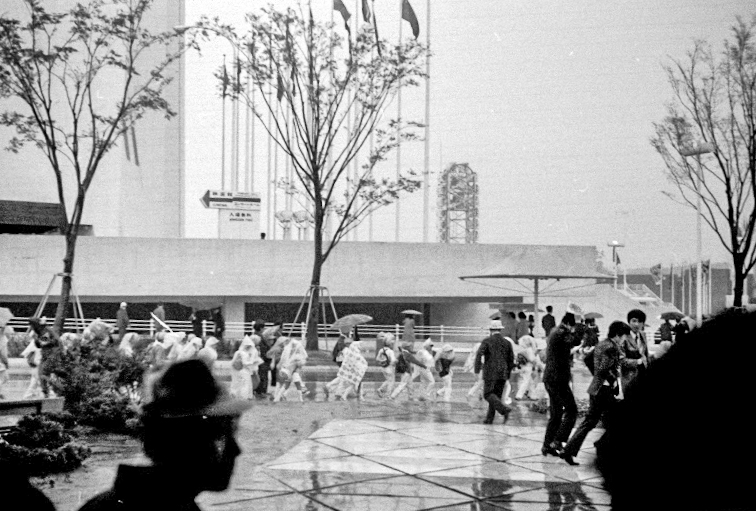
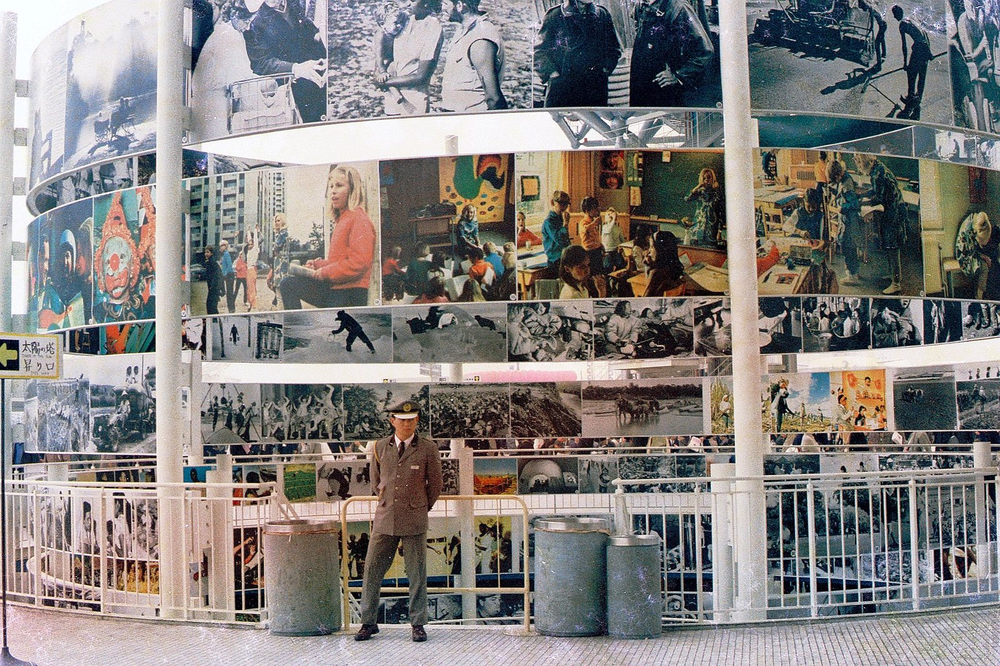
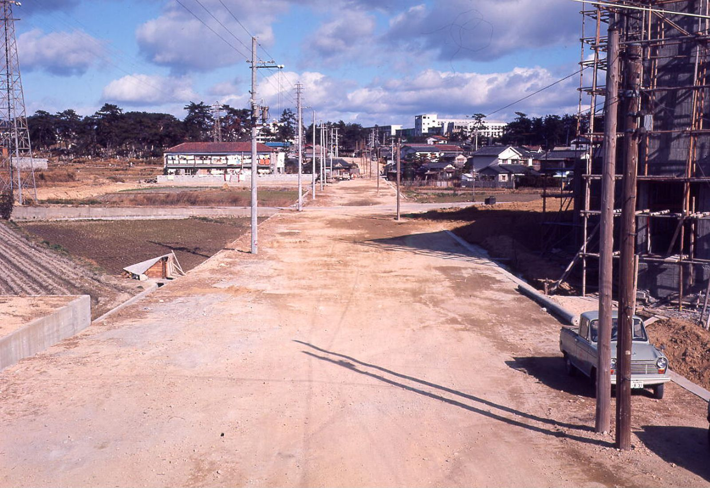

56年前の今日、1970年11月21日。愛知県名古屋市西区のダイヤモンドシティ・名西ショッピングセンター内に、日本ケンタッキー・フライド・チキンの第1号店となる名西店がオープンしました。今や全国の街角でおなじみとなったフライドチキンですが、当時の日本にとっては手で持って食べるアメリカ流のファーストフードは全く未知の食体験でした。

## 商社マンの直談判と大阪万博での手応え

日本へのフライドチキン導入のきっかけは、1964年に遡ります。三菱商事シカゴ支店長代理を務めていた相沢徹が、アメリカ本国のKFCコーポレーションに対して日本進出の可能性を打診したことから交渉が始まりました。相沢は1967年に三菱商事の役員会で事業化を提案し、1969年にKFC側と合弁事業の立ち上げで合意に達します。

本格的な会社設立に先立ち、1970年3月に開幕した日本万国博覧会（大阪万博）の会場内に実験店舗を出店しました。万博会場で提供された本場アメリカのフライドチキンは大好評を博し、日本市場での手応えを確かなものにします。こうして万博の成功を受けた同年7月4日、KFCコーポレーションと三菱商事の折半出資によって日本ケンタッキー・フライド・チキン株式会社が設立されました。代表取締役社長には中村基孝、常務取締役には三菱商事の穀物油脂部出身である富田昭平が就任しました。

## 名古屋郊外で船出した第1号店「名西店」

1970年11月21日、愛知県名古屋市西区に完成したショッピングセンター「ダイヤモンドシティ・名西ショッピングセンター」の中に、日本第1号店となる名西店が開店しました。

アメリカ本国ではモータリゼーションの普及に伴い、広い駐車場を備えた郊外型店舗が主流となっていました。そのため日本側の店舗展開でもアメリカ側の意向に沿って郊外立地が選ばれました。しかし、1970年当時の日本はまだ自家用車の普及が郊外型の消費生活を支えるほどには至っておらず、開店当初の客足は順風満帆とはいきませんでした。赤と白のストライプを基調とした派手な店構えや、骨付きの鶏肉を手づかみで食べるスタイル自体、日本の消費者にとってまだ馴染みの薄いものだったのです。

*1970 in Japan-9 — 写真: Szilas / CC0*

## 大阪・東住吉店から全国へ広がるネットワーク

名西店のオープンからわずか6日後の1970年11月27日には、大阪府大阪市東住吉区のダイヤモンドシティ・東住吉ショッピングセンター内に2号店となる東住吉店が開店しました。この店舗は、春の大阪万博で使用された実験店舗の建物をそのまま移築したものでした。

郊外店での苦心を経て、同社は日本国内の実情に合わせた出店戦略の軌道修正を図ります。大都市の中心部や駅周辺、外国人居住者の多い地域などへと目を向け、1971年9月には神奈川県藤沢市にフランチャイズ1号店となる江ノ島店を開店させました。手探りの挑戦を積み重ねた結果、1973年12月には早くも国内100店舗を達成するまでに急成長を遂げました。

*EXPO'70 (April 1970 by Kingei Marui) — 写真: m-louis .® from Osaka, Japan / CC BY-SA 2.0*

## 店頭のカーネルおじさんは日本生まれのアイデア

今や全国の店舗の前でお客を出迎えている創業者ハーランド・サンダースの等身大人形「カーネル・サンダース立像」は、実は日本独自の発想から生まれたものでした。フライドチキンという食べ物そのものがまだ知られていなかった時代に、少しでも親しみを持ってもらい、通りがかる人々に店舗を印象づけるための看板として考案されたものです。

本国アメリカにはないこの立像は、日本を訪れる外国人観光客にとっても珍しい光景として親しまれています。立像がかけている眼鏡は、眼鏡の産地として世界的に名高い福井県鯖江市で製造されており、実際に度が入っているというこだわりが施されています。

*北夙川通り : 整備途中 — 写真: 西宮市 : ニシノミヤシ / CC BY (Japan Search)*

## 日本の食文化に根づいた半世紀の軌跡

その後、1974年には食材となった鶏への感謝を込めた「鶏の供養祭」が始まり、毎年の恒例行事として受け継がれています。1977年6月には東京都東村山市の久米川店で、日本のファーストフードチェーンとして初となるドライブスルー店舗を開店するなど、日本の食生活の変化に合わせた先進的な取り組みを次々と導入していきました。

創業者であるハーランド・サンダース自身も1972年、1978年、1980年と度々来日し、日本の店舗やスタッフを激励しました。1970年11月21日に名古屋の小さなショッピングセンターの一角から始まった挑戦は、半世紀以上の時を経て、日本の日常の食卓に欠かせない確固たる文化として定着しています。

### 参考資料

- <https://ja.wikipedia.org/wiki/%E5%90%8D%E5%8F%A4%E5%B1%8B%E5%B8%82>
- <https://commons.wikimedia.org/wiki/File:Colonel_Sanders_in_Tehran,_1970s_-_02.jpg>
- <https://commons.wikimedia.org/wiki/File:1970_in_Japan-9.jpg>
- <https://commons.wikimedia.org/wiki/File:EXPO%2770_(April_1970_by_Kingei_Marui).jpg>
- <https://adeac.jp/nishinomiya-city/catalog/0100000040>
