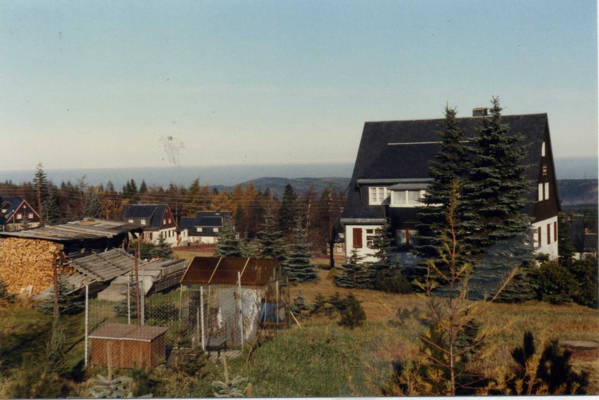
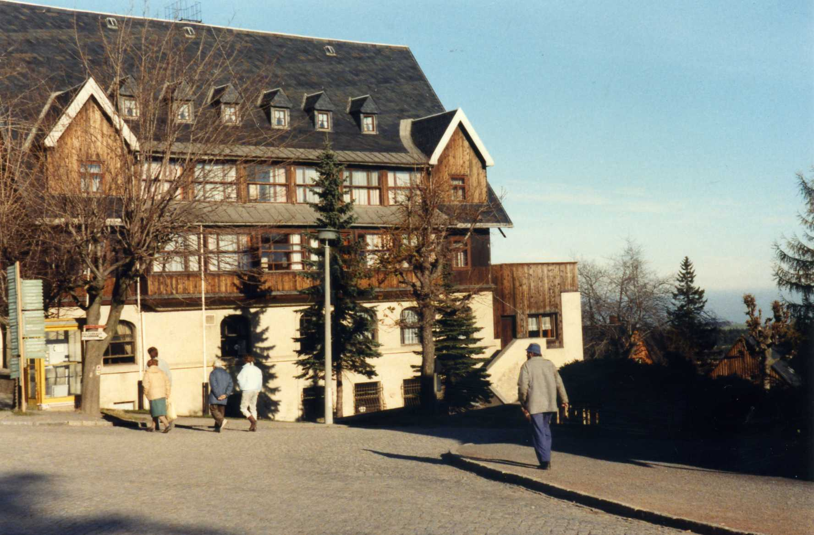
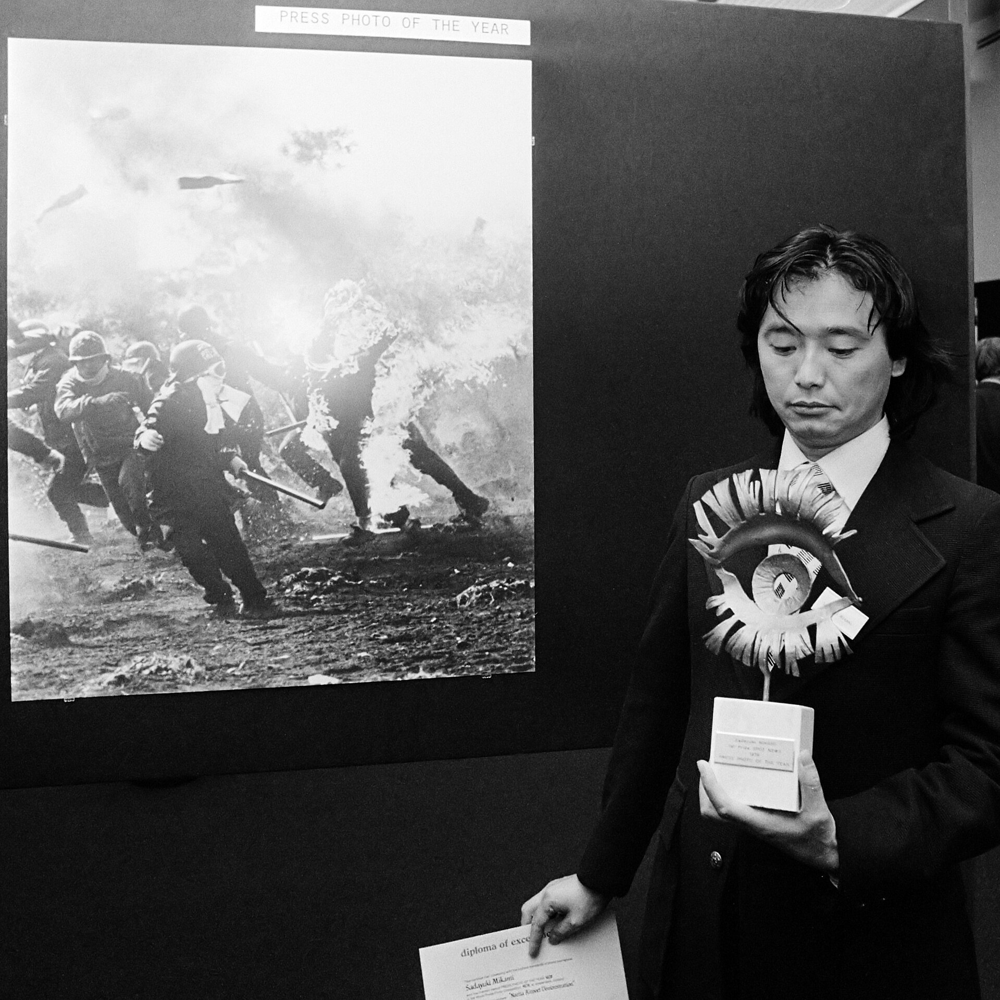

37年前の今日、1989年11月21日。日本最大の労働組合の全国中央組織である「日本労働組合総連合会（連合）」が正式に発足しました。長きにわたり激しい路線対立を続けてきた労働4団体が大同団結したこの日、同時に反発する勢力によって「全国労働組合総連合（全労連）」も結成され、日本の労働運動史における最大の転換点となりました。

## 「水と油」だった総評と同盟の対立

戦後の日本労働運動は、思想や路線の対立による離合集散の連続でした。1960年代以降、労働界には4つの主要な中央組織（ナショナルセンター）が存在していました。自治労や日教組など官公庁労組が中心で日本社会党を支持した「日本労働組合総評議会（総評）」、民間労組中心で労使協調を重視し民社党を支持した「全日本労働総同盟（同盟）」、中間的な「中立労働組合連絡会議（中立労連）」、そして「全国産業別労働組合連合（新産別）」です。

特に総評と同盟は、自衛隊や日米安保条約、原子力発電への賛否などをめぐって鋭く対立し、長年「水と油」と言われていました。

## 全民労協から始まった労働戦線統一への歩み

分断された労働戦線の統一に向けた動きは、1982年12月の「全日本民間労働組合協議会（全民労協）」の結成によって本格化しました。初代議長には電機労連の竪山利文氏が就任し、民間組合を先行させる形で統合への道筋を探っていきます。

全民労協は1986年に連合体への移行を確定させました。これを受け、1987年1月に同盟が解散方針を決め、総評、中立労連、新産別も合流へと舵を切ります。同年11月には同盟と中立労連が解散し、55産別、539万人を結集した「全日本民間労働組合連合会（全民労連、旧連合）」が発足しました。翌1988年には新産別も解散して合流し、残る課題は官公労を抱える総評との最終統合となりました。

*1989年の資料 — 写真: Sludge G / CC BY-SA 2.0*

## 1989年11月21日、800万人を結集した連合の結成大会

1989年9月、総評は第81回定期大会で11月の解散を最終確認し、日教組も連合への加盟を決定しました。総評の真柄栄吉事務局長は「右か左かではなく、前へ」と決断を下し、西側諸国の国際組織である国際自由労連への加盟を表明しました。

そして1989年11月21日、東京厚生年金会館で日本労働組合総連合会の結成大会が開かれました。初代会長には情報通信労連委員長の山岸章氏が選出されます。総評系産別が加わったことで78産別、組合員約800万人が結集し、日本の労働運動における官民統一のナショナルセンターが誕生しました。

*1989年の資料 — 写真: Sludge G / CC BY-SA 2.0*

## 同日発足した全労連、もうひとつの選択

しかし、労働戦線の統一は一枚岩ではありませんでした。連合の路線を「労働界の右翼的再編」「反共・労使協調路線」と批判した日本共産党系の「統一労組懇」や各労組内の非主流派は、連合への合流を拒否しました。

彼らは連合結成とまったく同じ1989年11月21日、「全国労働組合総連合（全労連）」を結成しました。自治労連や全教、国公労連などが参加し、公称140万人で旗揚げします。さらに同年12月9日には、社会党左派系の一部が「全国労働組合連絡協議会（全労協）」を結成。労働界は単一の統一ではなく、新たな陣営へと分岐することになりました。

*Sadayuki Mikami (1979) — 写真: Rob Croes for Anefo / CC0*

## 国政を揺るがした政界再編と「股裂き」の苦悩

連合の発足は、日本の政治構造にも大きな地殻変動をもたらしました。1989年夏の第15回参議院選挙では政治団体「連合の会」が11議席を獲得し、社民勢力の結集を促す接着剤としての存在感を示しました。

しかし、旧総評系が社会党を、旧同盟系が民社党（のち新進党）を支援し続けたため、1990年代中盤の政界再編期には連合内部で支持政党が二分される「股裂き」状態に陥るなど、政治路線をめぐる摩擦も経験しました。その後、1998年の新・民主党結成を経て、1999年には連合政治センターの結成により政治活動の統合が進められていきました。

## 多様化する働き方と労働組合のいま

結成から年月が流れる中で、労働組合を取り巻く環境は激変しました。正社員中心だった組織構成から、パートタイム労働者や派遣労働者など非正規雇用者の待遇改善や組織化への取り組みが重要な課題となってきました。流通や食品分野をはじめ、パート労働者の組合加入は進められています。

2021年には芳野友子氏が歴代初となる女性会長に就任するなど、組織のあり方も変化を続けています。1989年のあの日、働く人々の生活と権利を守るために800万人が一つに集った決断は、今も春闘や政策提言を通じて日本社会に影響を与え続けています。

### 参考資料

- <https://ja.wikipedia.org/wiki/%E6%97%A5%E6%9C%AC%E5%8A%B4%E5%83%8D%E7%B5%84%E5%90%88%E7%B7%8F%E9%80%A3%E5%90%88%E4%BC%9A>
- <https://commons.wikimedia.org/wiki/File:Visit_of_Hiroshi_Mitsuzuka,_Japanese_Minister_for_International_Trade_and_Industry,_to_the_CEC_-_1989_(10).jpg>
- <https://commons.wikimedia.org/wiki/File:Kurort_Oberb%C3%A4renburg_DDR_13_November_1989_(4835004003).jpg>
- <https://commons.wikimedia.org/wiki/File:Oberb%C3%A4renburg_,Bezirk_Dresden.DDR_13_Nov_1989_(4868614631).jpg>
- <https://commons.wikimedia.org/wiki/File:Sadayuki_Mikami_(1979).jpg>
