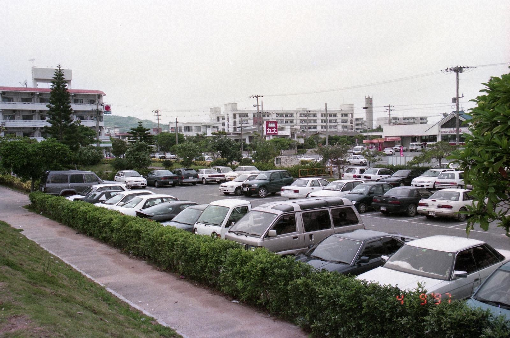
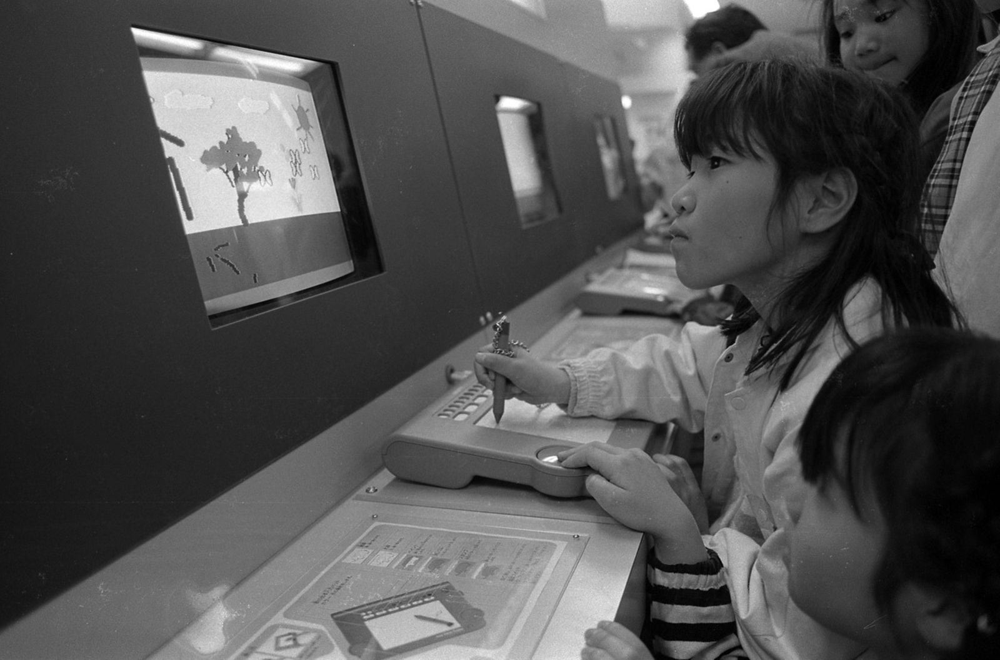
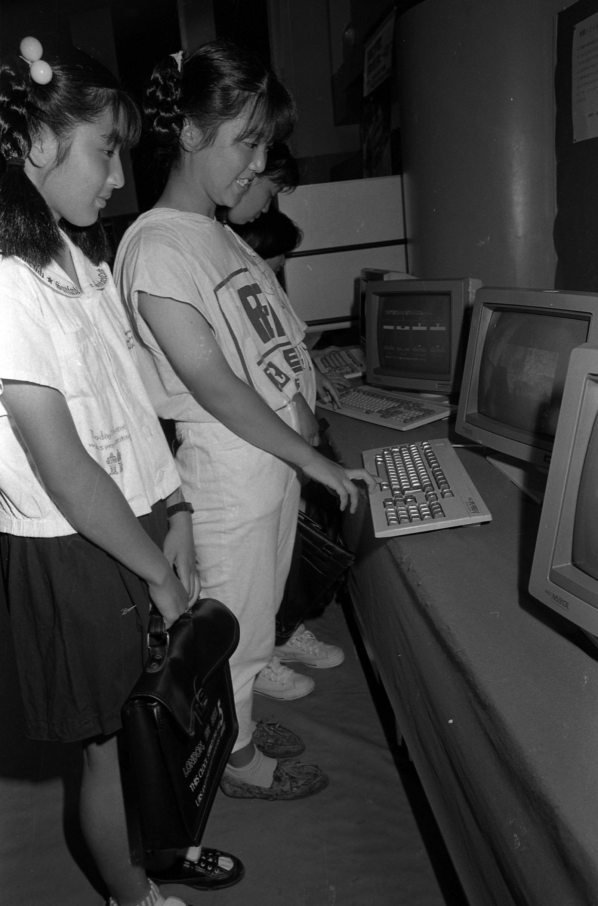

36年前の今日、1990年11月21日。任天堂が新たな家庭用ゲーム機「スーパーファミコン」を日本国内で発売しました。社会現象となったファミリーコンピュータの登場から7年、待ち望まれた後継機が全国の店頭に並びました。

## 前世代機の大ヒットと後継機への期待

任天堂が1983年に発売した「ファミリーコンピュータ」は、日本国内で約1600万台を販売し、家庭における娯楽のあり方を一変させました。多くのソフト開発会社が参入し、国内外で巨大なゲーム市場が形成されていきました。その絶大な人気のなかで、次世代のゲーム機がどのような姿になるのか、世間の注目が集まっていました。

## 開発発表から仕様確定までの道のり

スーパーファミコンの構想が初めて公に語られたのは、1987年9月9日付けの京都新聞でした。当時の山内溥社長が新型機に言及し、翌1988年11月21日には任天堂本社で試作機が公開され、1989年7月の発売予定が発表されました。当初は前世代機との互換性を保つための専用アダプタも検討されていましたが、最終的には互換性の維持を断念し、まったく新しいプラットフォームとして開発が進められることになりました。携帯型ゲーム機「ゲームボーイ」などの増産による半導体不足や、依然としてファミリーコンピュータ市場が活況であったことから発売は延期され、1990年6月21日に正式な発売日が同年11月21日と告知されました。

*新開の風景 — 写真: 南城市教育委員会 / CC BY (Japan Search)*

## 1990年11月21日、本体価格2万5000円で登場

迎えた1990年11月21日、スーパーファミコンは本体価格2万5000円で発売を開始しました。セット内容は本体、取扱説明書、そして二つのコントローラでした。テレビ接続ケーブルやACアダプタは別売りとされ、ファミリーコンピュータ用の機器が流用できるよう配慮されていました。本体と同時に世に出たソフトは3本で、参入を表明したサードパーティは33社にのぼりました。発売を心待ちにしていた人々が店頭に押し寄せ、発売初月の1990年12月だけで出荷台数は約65万台に達しました。

*児童館 コスモスコンピュータ導入 — 写真: ndl / CC BY (Japan Search)*

## 16ビットCPUと表現力の飛躍的向上

スーパーファミコンは、16ビットのカスタムCPUを搭載し、32768色の中から選択できる豊かな色彩表現を実現しました。画面の回転や拡大、縮小機能に加え、ソニー製のチップを用いたステレオPCM音源が導入され、映像と音響のクオリティは前世代機と比べて格段に向上しました。ハードウェアの設計面でも改良が図られ、電源スイッチを入れるとカセット差込口の内部にツメが出てカセットを物理的にロックする機構が新設されました。これにより、通電中に誤ってカセットが抜ける事故を防ぎ、わずかな振動で停止しやすかった問題への安全性が強化されました。

*児童館コスモス 夏休み特別イベント「地球を守る科学技術」 — 写真: ndl / CC BY (Japan Search)*

## 世界への広がりと多彩な展開

スーパーファミコンの人気は瞬く間に定着し、1991年3月には国内出荷が約149万台、同年末には約380万台に拡大しました。海外でも北米や欧州で展開され、韓国では「現代スーパーコンボイ」の名称で親しまれました。その後も、ゲームボーイのソフトをテレビ画面で遊べる「スーパーゲームボーイ」や、衛星放送を利用したデータ放送の受信端末となる周辺機器など、先進的な取り組みが次々と展開されていきました。

## 累計4910万台の普及と今に残る標準

任天堂は1998年に小型の廉価版である「スーパーファミコンジュニア」を発売し、2003年9月に受注生産を終了しました。最終的な出荷台数は、日本国内で1717万台、アメリカで2335万台、その他の国で858万台にのぼり、全世界累計で4910万台を記録しました。十字キーに加えて右側に配されたA・B・X・Yの4つのボタン、そして人差し指で操作する左右のLRボタンという操作系は、現在の家庭用ゲーム機のコントローラにも受け継がれ、世界の標準仕様として生き続けています。

### 参考資料

- <https://ja.wikipedia.org/wiki/%E4%BB%BB%E5%A4%A9%E5%A0%82>
- <https://www.flickr.com/photos/59407191@N04/9227452551>
- <https://nanjo-archive.jp/document/?detail=8085&genre=6>
- <https://adeac.jp/koshigaya-city-digital-archives/catalog/mp234853-200020>
- <https://adeac.jp/koshigaya-city-digital-archives/catalog/mp237517-200020>
