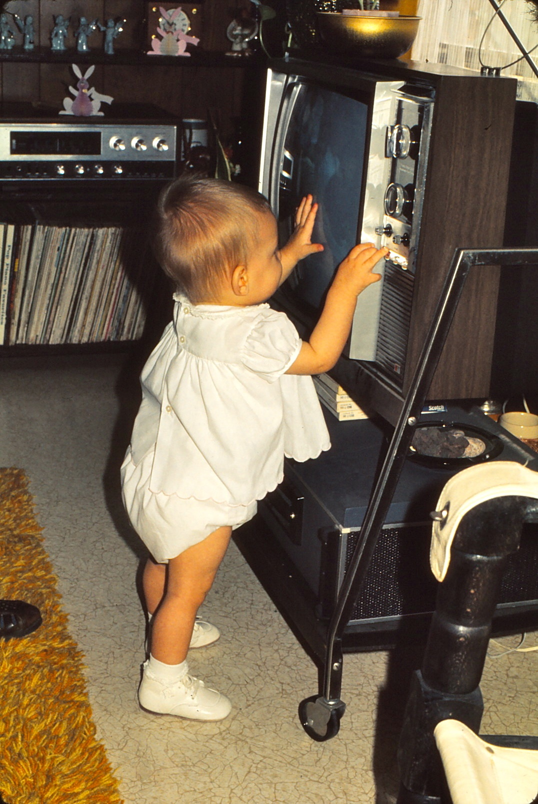
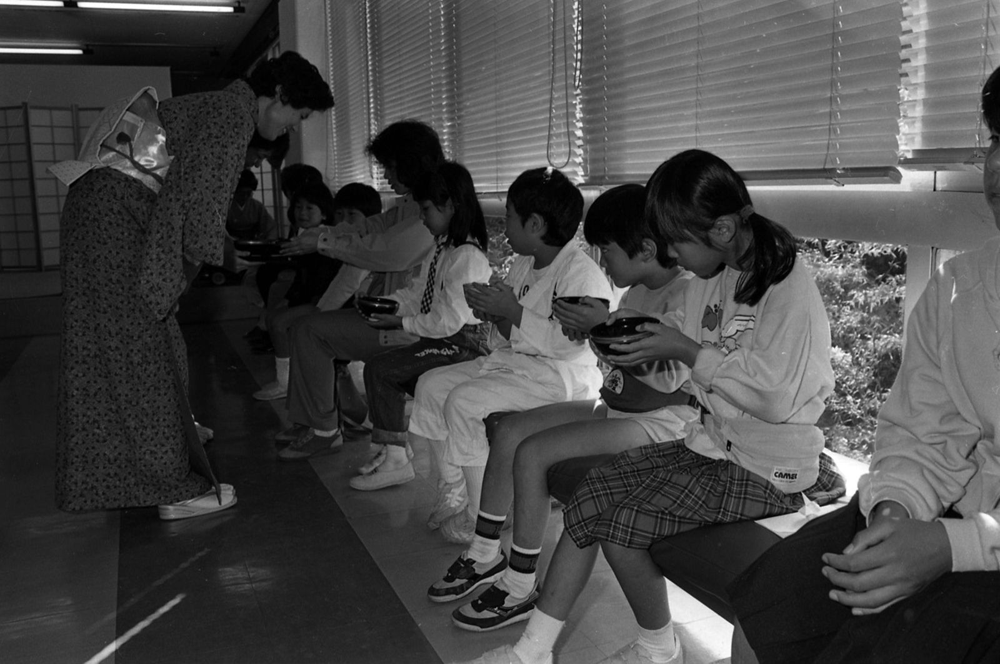

38年前の今日、1988年11月21日。フジテレビでバラエティ番組『あっぱれさんま大先生』の放送が始まりました。タレントの明石家さんまさんが小学校の先生役を務め、スタジオに集まった生徒たちと台本なしのトークを繰り広げたこの番組は、子ども向け番組の常識を鮮やかに覆しました。

## ひょうきん族と一本のカセットテープ

番組が生まれた原点は、大ヒット番組『オレたちひょうきん族』にありました。番組内のコーナーで、さんまさんが幼稚園の先生に扮して園児たちと掛け合いを披露したところ、これが大きな好評を博しました。ディレクターの三宅恵介さんは、子どもとさんまさんの相性の良さに強い手ごたえを感じ、新たな番組の構想を練り始めます。

さらに大きなヒントとなったのが、女優の岸田今日子さんから渡された1本のカセットテープでした。そこには1961年のラジオ番組『勘九郎・のり平の大人の幼稚園』が録音されていました。当時6歳の中村勘三郎さん（当時は五代目勘九郎）と三木のり平さんが繰り広げるシュールな会話に惹かれたさんまさんと三宅さんは、「大人が子どもをあやすのではなく、子どもと本気で渡り合うお笑い番組」という方向性を固めていきました。

## 「挨拶した子は全員落とした」異例のオーディション

こうして行われた出演者のオーディションには、3歳から8歳までの子どもたち160人が集まりました。スタッフが求めていたのは、上手に演技ができる子役ではなく、どこにでもいる「普通の子ども」でした。

三宅ディレクターはのちに、「スタジオの扉を開けてきちんと挨拶した子は全員落とした」と語っています。礼儀正しく大人の期待に応えようとする子どもではなく、落ち着きがなかったり、大人を困らせるような自由奔放さを持った子どもを選抜するためでした。その結果、160人の中から37人が選ばれ、番組初期のメンバーとして教室に並ぶことになります。

*当日の写真ではありません · 事件当時の写真ではありません · イメージ写真 — 写真: Pexels / Pixabay Content License*

## のちの大スターたちが次々と落選した理由

この徹底した選考基準によって、のちに芸能界で大活躍することになる才能豊かな子役たちが、皮肉にも次々と不合格になりました。安達祐実さん、ウエンツ瑛士さん、えなりかずきさん、後藤久美子さん、速水もこみちさん、一色紗英さんといった面々が落選を経験しています。

彼らはプロとしてあまりにも整いすぎていたため、番組が求めた「予測不能な素の面白さ」には当てはまりませんでした。それほどまでに、番組側は作られていない子どものリアルな言動にこだわっていたのです。

*Toddler with television set, Lakeview, New Orleans, 1974 — 写真: Barbara Ann Spengler / CC BY 2.0*

## 1988年11月21日、月曜19時の船出

アニメ『魁!!男塾』の後番組として、1988年11月21日の月曜夜7時枠で放送が始まりました。開始当初はローカル枠だったため関東地方を中心とした放送でしたが、「あっぱれ相談室」や「あっぱれホームルーム」といったコーナーを通じて、子どもたちの歯に衣着せぬ発言がすぐに話題を呼びました。

さんまさんは常々、「これは子ども番組ではなく、お笑い番組である」と公言していました。子ども扱いして優しく見守るのではなく、おかしな発言には容赦なくツッコミを入れ、笑いに消極的な子には自信を持たせる。プロの芸人と同じ土俵でぶつかり合うことで、子どもたちの個性はスタジオの中で爆発的に輝いていきました。

*S61 10/19 第12回交通安全市民まつり — 写真: ndl / CC BY (Japan Search)*

## 内山くん、山崎裕太ら多くのスターが巣立つ

第一期生からは、「うっちゃん」の愛称でぽっちゃり体型と豊かな表情で愛された内山信二さんや、抜群のトーク力を見せた山崎裕太さん、中武佳奈子さん、有田気恵さんなど、個性的な名物生徒が次々と誕生しました。また、のちに女優として活躍する前田愛さんも途中から加入しています。

その後も番組は『やっぱりさんま大先生』や『あっぱれ!!さんま大教授』へと形を変えながら続き、花澤香菜さんや加藤諒さん、日高里菜さんといった才能を輩出しました。単なるバラエティ番組を超えて、平成のテレビ界を彩る才能を育むゆりかごのような役割も果たしたのです。

## 20年余りの歴史と、今も色あせない温もり

番組シリーズは2009年9月まで、タイトルや時間帯を変えながら20年以上の長きにわたって放送されました。2023年には第一期生の山崎裕太さんの企画により、さんまさんの誕生日に合わせた同窓会特番が放送され、大人になったかつての生徒たちが再びさんま先生の前に集まりました。

計算された台本通りには進まない、子どもたちの予測不能な言葉の数々。そして、どんな返答も瞬時に極上の笑いへと仕立て上げたさんま大先生の話術。あの賑やかな教室の笑い声は、今も多くの視聴者の記憶の中に温かく残っています。

### 参考資料

- <https://ja.wikipedia.org/wiki/%E6%98%8E%E7%9F%B3%E5%AE%B6%E3%81%95%E3%82%93%E3%81%BE>
- <https://commons.wikimedia.org/wiki/File:ORIENT_EXPRESS_%2788.jpg>
- <https://pixabay.com/photos/tv-television-retro-classic-old-1844964/>
- <https://commons.wikimedia.org/wiki/File:Toddler_with_television_set,_Lakeview,_New_Orleans,_1974.jpg>
- <https://adeac.jp/koshigaya-city-digital-archives/catalog/mp211898-200020>
