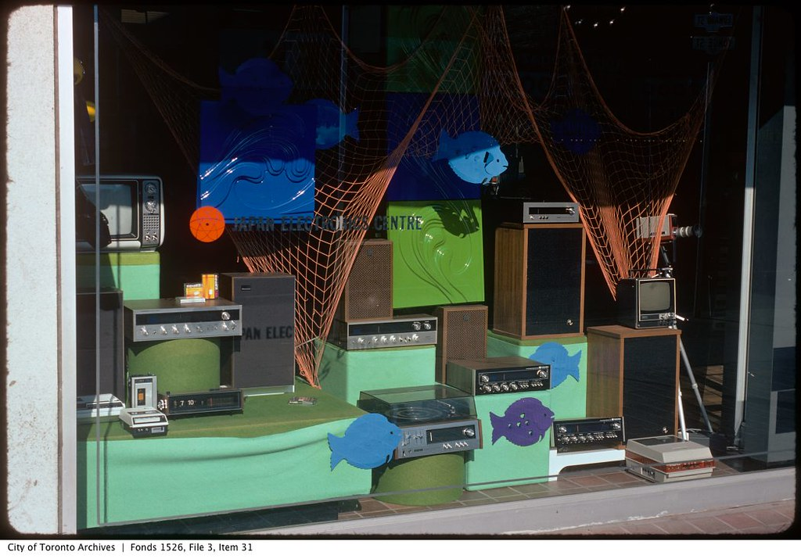
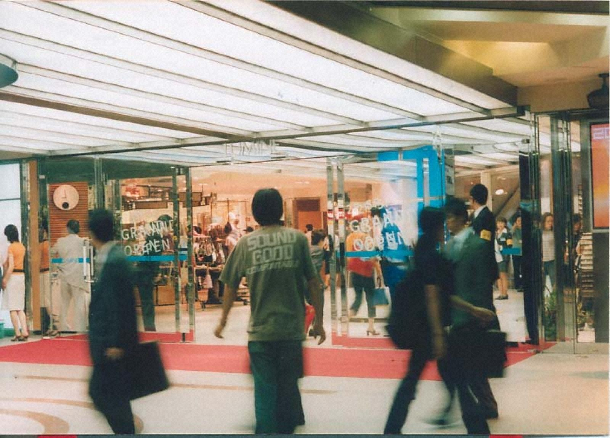
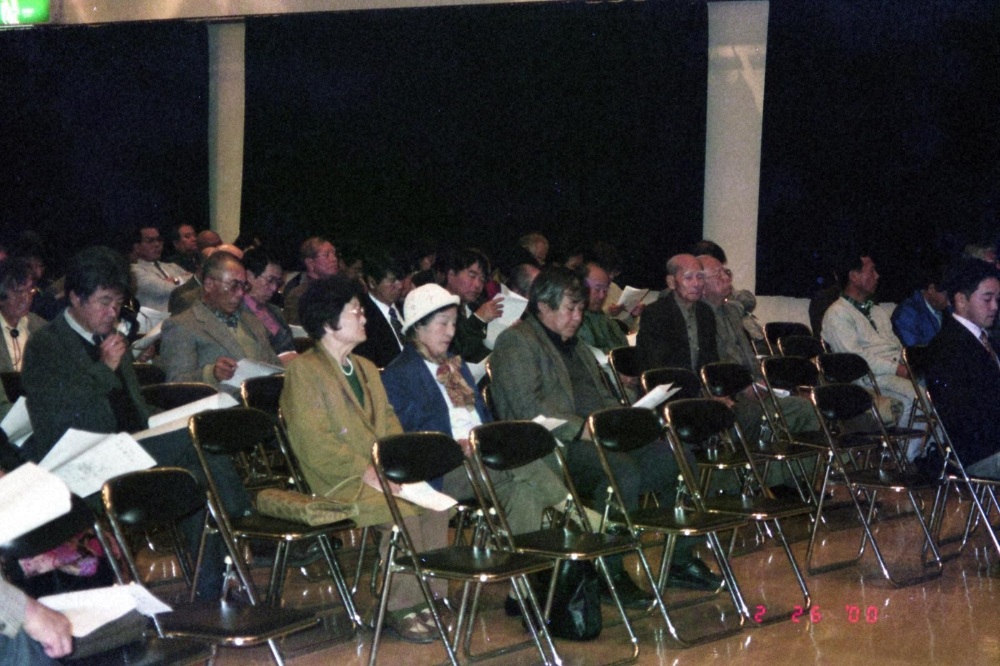

22年前の今日、2004年11月21日。任天堂が送り出した携帯型ゲーム機「ニンテンドーDS」が、日本に先駆けて北米で発売されました。日本国内での発売は11日後の12月2日。二つの液晶画面とタッチスクリーンという前例のない姿をしたこの機械は、やがて世代を超えて広がり、世界中で1億5000万台以上を売り上げる大ヒット商品となっていきます。

## ゲーム離れの危機から生まれた「第3の柱」

2000年代初頭の家庭用ゲーム市場は、映像技術のめざましい進化とともに、より複雑で高度な操作を要求する作品が増加していました。その結果、熱心な愛好家以外の人々が敬遠する、いわゆる「ゲーム離れ」が深刻な課題となっていました。

任天堂が2003年ごろから掲げた目標は「ゲーム人口の拡大」でした。当時、同社は携帯ゲーム機として「ゲームボーイアドバンス」を展開中でしたが、新たに開発されたDSはその後継機という位置づけではありませんでした。据え置き型の「ニンテンドー ゲームキューブ」、携帯機のゲームボーイアドバンスに並ぶ「第3の柱」として、白紙の状態から新しい娯楽を目指して開発がスタートしたのです。

## 山内溥のこだわりが生んだ上下2画面とタッチ操作

ニンテンドーDSの最大の特徴は、本体を開いたときに現れる上下二つの液晶画面でした。この設計は、当時の任天堂相談役であった山内溥前社長の「2画面にしてくれ」という強い要望から生まれたものでした。かつての「ゲーム&ウオッチ マルチスクリーン」を思わせる外見ながら、中身は最先端の技術が詰め込まれていました。

下側の画面には透明のアナログタッチスクリーンが組み込まれ、付属の専用タッチペンや指先で触れるだけで直感的に操作できる仕組みが整えられました。さらに本体中央にはマイクが内蔵され、声を吹き込んだり息を吹きかけたりする動作も遊びの一部になりました。従来の十字ボタンやボタン操作に不慣れな人でも、画面に直接触れるだけで遊べる環境が整えられたのです。

*Consumer electronics store, Yonge Street — 写真: Toronto History / CC BY 2.0*

## 世界先行発売の北米から始まった大熱狂

2004年9月21日、任天堂は発売日と価格を公表しました。北米では11月21日に149.99ドル、日本では12月2日に1万5000円という設定でした。世界で最初に発売された米国では、発売からわずか1か月で出荷台数が100万台を突破する好調なスタートを切ります。

日本でも発売直後から大きな注目を集め、日米あわせた累計出荷台数は2004年末の時点ですでに280万台に達しました。従来のゲームファンだけでなく、それまで携帯ゲーム機を触ったことがなかった層まで巻き込み、各地の店頭で予約や当日販売分を求めて長蛇の列が作られることになりました。

*ルミネリニューアルオープン03 — 写真: chigamu / CC BY (Japan Search)*

## 店頭から本体が消えた──記録的な品切れとお詫び

年が明けた2005年末から2006年初めにかけて、日本国内の盛り上がりは過熱の一途をたどりました。クリスマス商戦やお年玉商戦が重なり、家電量販店や玩具店の店頭から本体が完全に姿を消す事態が相次ぎました。2005年12月の第4週から翌年1月の第1週までのわずかな期間だけで、100万台の売り上げを記録しています。

あまりの需要の高さに工場の生産が追いつかず、任天堂は2006年1月5日に品不足に関する異例のお詫びを発表しました。国内での累計販売台数は発売から20か月で1000万台を突破。これは従来のゲームボーイアドバンスの30か月、プレイステーション2の32か月を大きく塗り替える、当時の国内ゲーム機史上最短記録となりました。

*世界遺産講演会 — 写真: 南城市教育委員会 / CC BY (Japan Search)*

## 大人もシニアも巻き込んだ文化現象

ニンテンドーDSの爆発的な普及を支えたのは、それまでのゲームの枠にとどまらない多彩なソフトウェア群でした。文字を書いたり計算を解いたりする「脳を鍛える大人のDSトレーニング」をはじめとするシリーズは、普段ゲームをしない大人や高齢者の心をつかみ、通勤電車やリビングでペンを走らせる光景が日常のものとなりました。

さらに、本体同士が無線でつながる「すれちがい通信」機能も大きな話題を呼びました。鞄にDSを入れて街を歩くだけで、見知らぬ誰かとデータが交換される仕組みは、外出の新しい楽しみ方として定着しました。ゲームは子ども部屋にこもって遊ぶものという従来のイメージを、DSは見事に塗り替えたのです。

## いまも息づく直感的なインターフェイスの記憶

その後、本体を薄型・軽量化した「ニンテンドーDS Lite」やカメラを搭載した「ニンテンドーDSi」などのバリエーションが登場し、シリーズの世界累計販売台数は2009年3月に家庭用ゲーム機史上最速ペースで1億台を突破、最終的には1億5000万台を超える世界的ヒットハードとなりました。

現在ではスマートフォンをはじめ、画面に直接触れて操作するスタイルが社会の当たり前になっています。しかし、その手触りや楽しさを世界中のあらゆる世代に広げたのは、まぎれもなく2004年に登場したこの小さな2画面のゲーム機でした。手に入らない本体を探して街を歩いた記憶や、カチリと音を立ててカードを差し込んだ手の感触は、いまも色あせることなく残っています。

### 参考資料

- <https://ja.wikipedia.org/wiki/%E4%BB%BB%E5%A4%A9%E5%A0%82>
- <https://commons.wikimedia.org/wiki/File:DS_Yamanote_-_Flickr_-_Matt_Watts.jpg>
- <https://www.flickr.com/photos/48096488@N03/19284148618>
- <https://jmapps.ne.jp/chigasaki_history/det.html?data_id=355>
- <https://nanjo-archive.jp/document/?detail=35268&genre=6>
