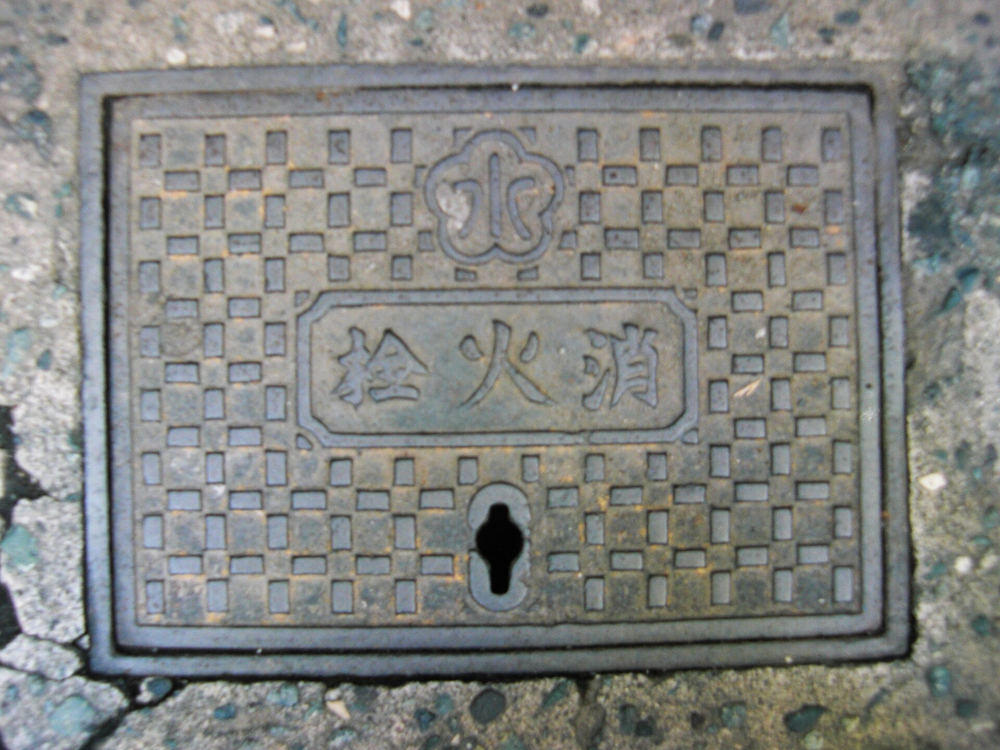
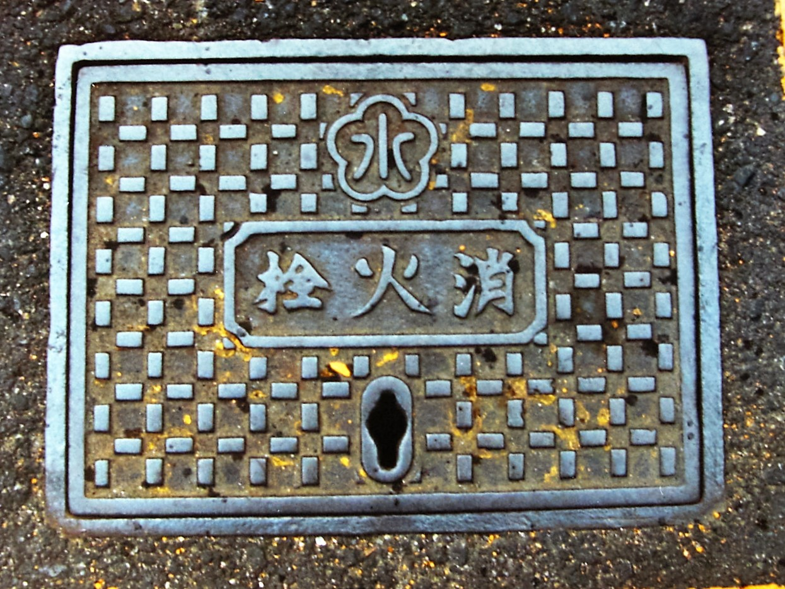
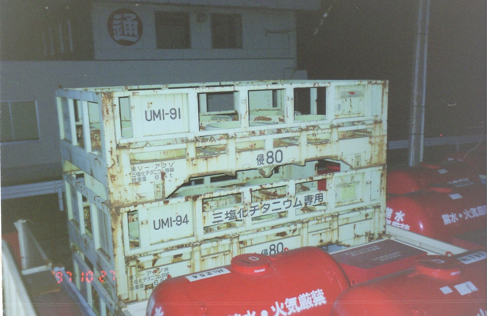

29年前の今日、1997年11月22日。日本の四大証券会社の一角を占めていた山一証券が、自主再建を断念しました。負債総額は約3兆5100億円に達し、2000億円を超える巨額の損失隠しが表面化しての劇的な幕引きでした。日本経済の屋台骨を揺るがした破綻劇の軌跡を振り返ります。

## 老舗証券を追い詰めた「2000億円超」の損失隠し

山一証券は、長年にわたり日本の株式市場を牽引してきた大手証券会社でした。しかし、バブル崩壊後の市場低迷の中で、顧客への利回り保証や損失補填を目的とした不透明な取引を繰り返し、巨額の含み損を抱え込んでいました。

それらの損失は表に出されることなく、関連会社などの帳簿外へと隠され続けました。その額は2000億円を超える規模にまで膨張しており、会社の屋台骨を内側から致命的に蝕んでいたのです。

## 週刊東洋経済の特報と揺らぐ市場の信頼

隠蔽されていた闇に光が当たったのは、1997年4月のことでした。経済誌『週刊東洋経済』が山一証券による不正取引の実態をスクープしたのです。この綿密な調査報道は大きな反響を呼び、雑誌ジャーナリズム賞を受賞することになりました。

報道をきっかけに市場や監督官庁の追及は厳しさを増し、山一証券に対する市場の信頼は失墜していきました。資金調達環境の悪化が急速に進み、再建計画の策定は極めて困難な局面を迎えていきました。

*Fire.hydrant.cover.in.odawara.city — 写真: 栗原 岳 / CC BY-SA 4.0*

## 1997年夏、アジア通貨危機の激震が直撃

国内での不正追及に追い打ちをかけたのが、国際的な金融環境の激変でした。1997年7月2日、タイが通貨バーツのペッグ制を断念したことを発端に、いわゆる「トムヤムクン危機」と呼ばれるアジア通貨危機が勃発します。

資本逃避の波は東南アジア全域に広がり、やがて韓国や日本の金融市場にも深刻な影響を及ぼしました。通貨下落や株安が連鎖し、金融機関同士が相互に警戒を強める信用収縮が発生したことで、山一証券の資金繰りは決定的な危機に直面しました。

*Fire.hydrant.cover.in.odawara.city.2 — 写真: 栗原 岳 / CC BY-SA 4.0*

## 11月22日の自主再建断念と業務停止発表

自力での資金調達や再建の道が完全に閉ざされた山一証券は、1997年11月22日、ついに自主再建の断念へと追い込まれました。このニュースは日本国内外の経済界に走る激震となって駆け巡りました。

週明けの11月24日、山一証券は正式に業務停止を発表しました。店頭には預託資産の引き出しや状況の確認を求める大勢の顧客が押し寄せ、日本の戦後金融史上でも類を見ない大混乱が現実のものとなりました。

*UM1-91----① 【東ソー・アクゾ】Containers of Japan Rail — 写真: Gazouya-japan / CC BY-SA 4.0*

## 国会聴聞会で明かされた違法取引と3人の関与

業務停止の後、経営破綻の真相究明のため国会の聴聞会が開かれました。証言台に立った山一証券の行平次雄会長は、会社が行っていた一連の取引が違法なものであった事実を公の場で認めました。

行平会長は、この不正な取り決めを事前に知っていたのは、自身と三木淳夫前社長、そしてもう1人の役員を含むわずか3人だけであったと証言しました。一方で、違法取引に関与していた顧客企業10社の具体的な社名については、最後まで証言を拒絶しました。

## 1999年6月の破産宣告と歴史の教訓

自主廃業に向けた整理作業が進められた後、山一証券は1999年6月2日、東京地方裁判所から破産宣告を受けました。負債総額約3兆5100億円という巨大な負債を抱えた老舗企業の消滅でした。

この破綻劇を契機に、アジア各国や日本の金融市場では監督体制の抜本的な見直しや透明性の確保が強く求められるようになりました。1997年の激動は、金融システムにおける信用の重みと監査の重要性を今に伝える教訓として残されています。

### 参考資料

- <https://ja.wikipedia.org/wiki/11%E6%9C%8822%E6%97%A5>
- <https://commons.wikimedia.org/wiki/File:Fujieda.st.brick.house.jpg>
- <https://commons.wikimedia.org/wiki/File:Fire.hydrant.cover.in.odawara.city.jpg>
- <https://commons.wikimedia.org/wiki/File:Fire.hydrant.cover.in.odawara.city.2.jpg>
- <https://commons.wikimedia.org/wiki/File:UM1-91----%E2%91%A0_%E3%80%90%E6%9D%B1%E3%82%BD%E3%83%BC%E3%83%BB%E3%82%A2%E3%82%AF%E3%82%BE%E3%80%91Containers_of_Japan_Rail.jpg>
