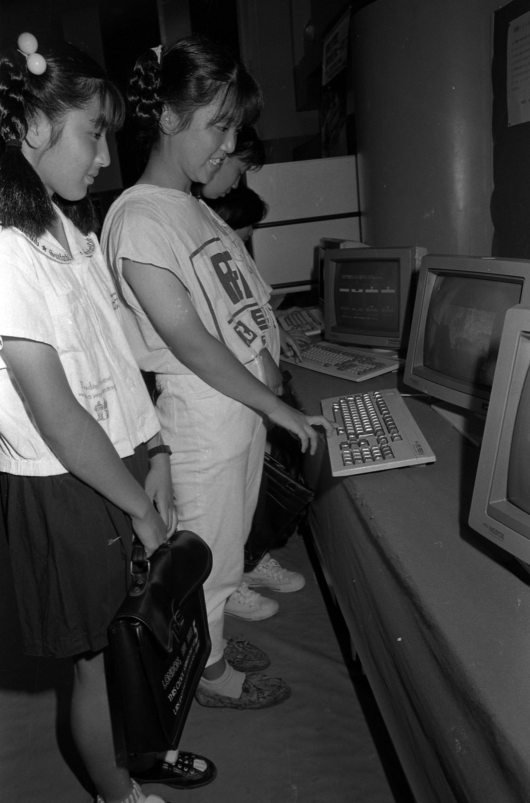
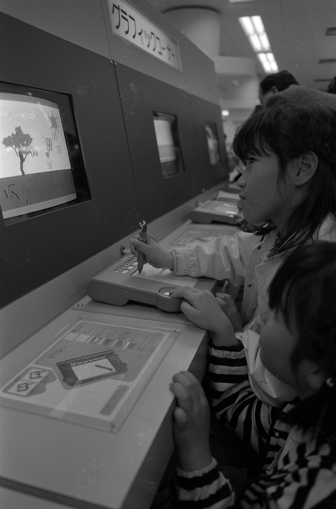
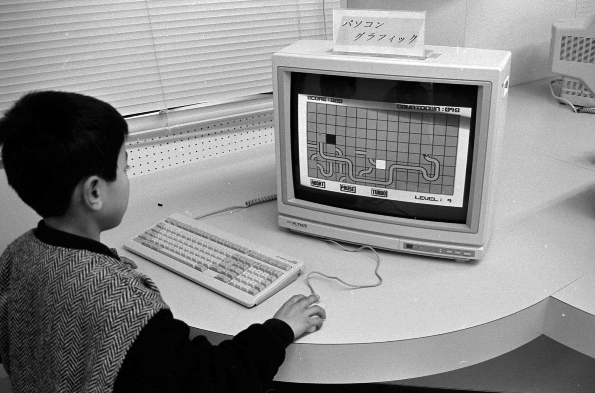

32年前の今日、1994年11月22日。セガ・エンタープライゼスが、新型の家庭用ゲーム機「セガサターン」を日本で発売しました。本体価格は4万4800円。16ビット機の時代から次世代の32ビット機への移行期において、日本のゲームファンを大いに沸かせた一台でした。

## なぜ「土星」だったのか。名前に込められた理由

「セガサターン」という特徴的な名称は、セガが開発・発売した第6番目のコンシューマ向けゲームハードであったことに由来します。太陽系の第6惑星である土星（サターン）にちなみ、プロジェクトの開発コードネームからそのまま製品名へと採用されました。

それまでのカートリッジ式ロムカセットから大容量のCD-ROM媒体へと舵を切り、ゲームの表現力を劇的に高める使命を帯びて世に送り出されたマシンでした。

## 1994年11月22日、灰色の本体が店頭へ

発売初日に店頭に並んだ初期型モデル（HST-0001）は、落ち着いた灰色の本体デザインが特徴でした。前面にはインテリジェント倍速CD-ROMドライブを備え、ディスクのコピーチェック用として外周部に特殊な領域「サターンリング」が設けられていました。

従来のロムカートリッジが高価格化していた当時、製造コストを抑えられるCD-ROMの採用は大きな変革でした。音楽CDの再生やフォトCDの閲覧機能も備えており、単なる玩具にとどまらない最先端のマルチメディア機器として家庭に迎え入れられました。

*児童館コスモス 夏休み特別イベント「地球を守る科学技術」 — 写真: ndl / CC BY (Japan Search)*

## 日立製CPUを2基搭載。9つのプロセッサが連携する設計

ハードウェアの内部構造は、当時の家庭用機器としては異例なほど豪勢でした。心臓部となるメインCPUには、日立製作所が開発した32ビットマイコン「SH-2」を2基並列で搭載。動作周波数を28.6メガヘルツに高め、演算精度を向上させていました。

さらに、サウンド処理用のチップやCD-ROMドライブ制御用のマイコンなど、本体全体で合計9個ものプロセッサを組み込んだ分散処理構造を採用しました。マシン全体の処理能力は800MIPSにおよび、並列処理によって圧倒的なグラフィックと音響の再現を目指しました。

*児童館 コスモスコンピュータ導入 — 写真: ndl / CC BY (Japan Search)*

## 最高水準の2次元描画とアーケード移植の強み

描画処理は「VDP1」と「VDP2」という2基のビデオディスプレイプロセッサが担当しました。特に背景画面を受け持つVDP2は、拡大縮小や回転が可能な独立背景を5面も合成表示できる強力なもので、当時の業務用ゲーム基板に匹敵する性能を誇りました。

これにより、ゲームセンターで大人気を博していたアーケード作品が、家庭でも驚くべき再現度で遊べるようになりました。本体上部にはカートリッジスロットが用意され、データ保存用の「パワーメモリー」や、のちに発売された「拡張RAMカートリッジ」を装着することで、さらに高度なゲーム体験を可能にしました。

*12/28 児童館コスモス コンピューターコーナー — 写真: ndl / CC BY (Japan Search)*

## 他社製互換機と、セガ史上国内最高のヒット記録

セガサターンはセガ本体からの発売にとどまらず、開発に参画した電機メーカー各社からも互換機が登場しました。日本ビクターからは「Vサターン」、日立製作所からは「Hiサターン」がそれぞれ発売され、独自の付加価値を競い合いました。

ソニー・コンピュータエンタテインメントの「プレイステーション」や任天堂のハードと激しい市場競争を繰り広げるなか、セガサターンは日本国内で絶大な支持を獲得。互換モデルを含めたシリーズ累計出荷台数は700万台を突破し、日本市場においてセガが販売した家庭用ゲーム機の中で史上最高の販売実績を打ち立てました。

## 2007年のサポート終了と、今も語り継がれる足跡

時代の移り変わりとともに後継機へとバトンを渡したセガサターンは、2007年9月28日のサービスセンター到着受付分をもって、本体の有償修理サポートを終了しました。

しかし、2Dグラフィックの極致を極めたハードウェアの個性や、次世代の座をかけてライバル機と真っ向からぶつかり合った熱い時代背景は、今なお色あせることはありません。1994年のこの日に始まった挑戦は、日本のデジタルエンターテインメント史を大きく動かした重要な転換点でした。

### 参考資料

- <https://ja.wikipedia.org/wiki/%E3%82%BB%E3%82%AC%E3%82%B5%E3%82%BF%E3%83%BC%E3%83%B3>
- <https://commons.wikimedia.org/wiki/File:Mats_Sundin_and_Stefan_Lampinen.jpg>
- <https://adeac.jp/koshigaya-city-digital-archives/catalog/mp237517-200020>
- <https://adeac.jp/koshigaya-city-digital-archives/catalog/mp234854-200020>
- <https://adeac.jp/koshigaya-city-digital-archives/catalog/mp232701-200020>
