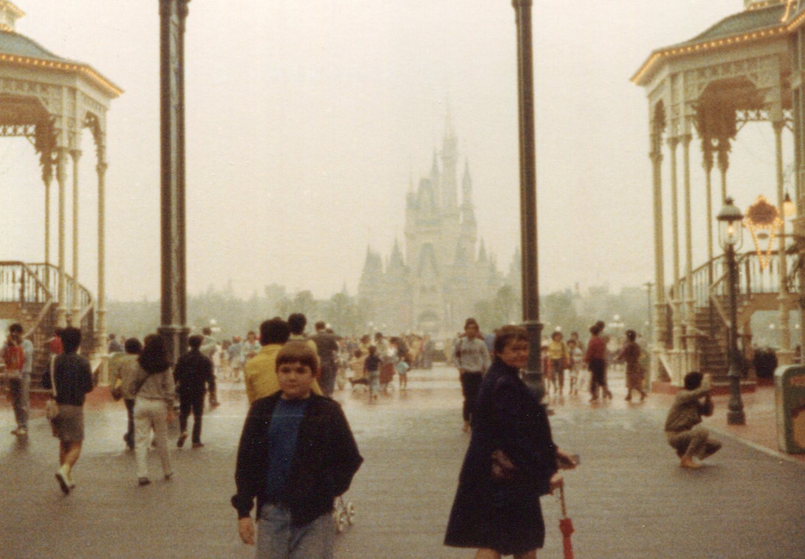
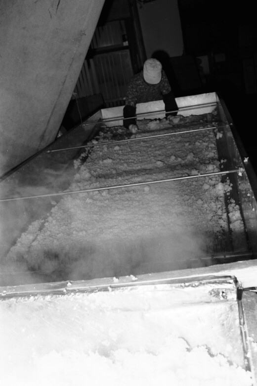
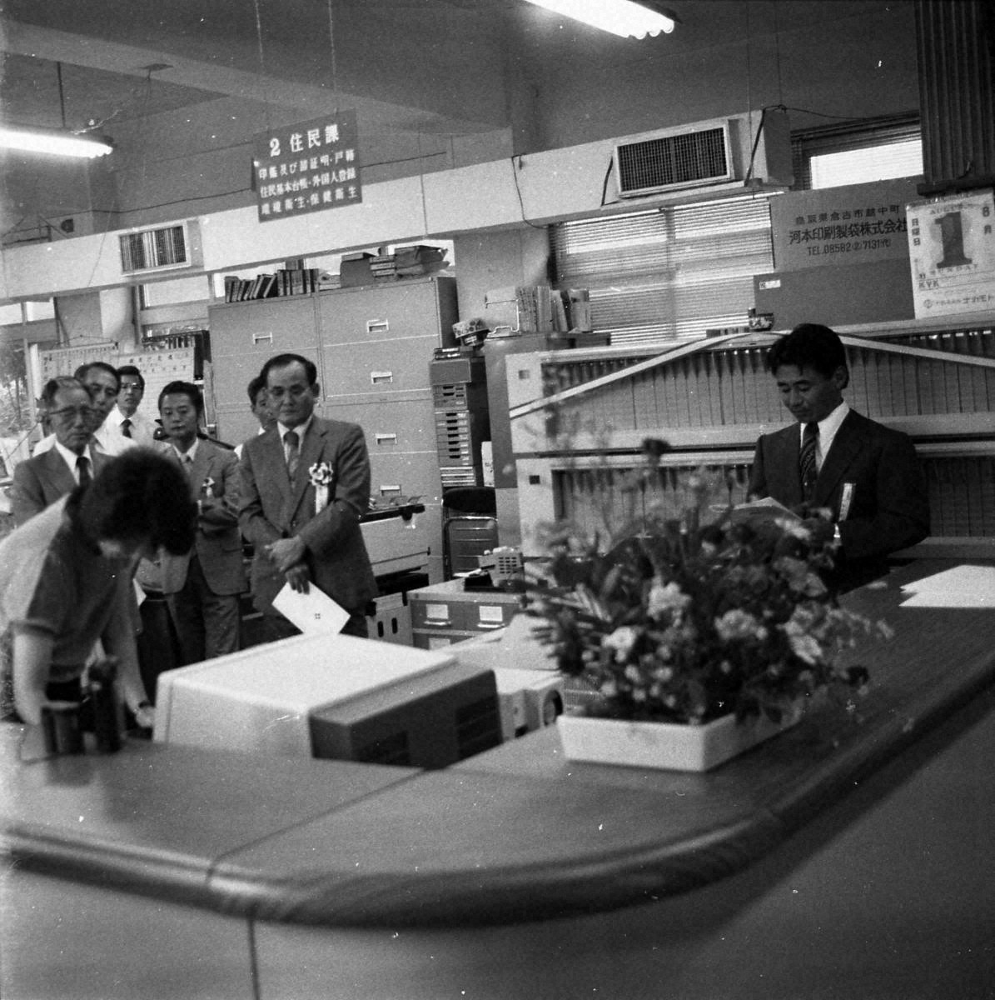

43年前の今日、1983年11月22日。静岡県掛川市のレクリエーション施設「ヤマハレクリェーションつま恋」の飲食施設「満水亭（たまりてい）」で、大規模なLPガス爆発事故が発生しました。鉄骨平屋建ての店舗が全壊し、死者14人、負傷者27人を出す大惨事となり、国内のLPガス事故として最大の人的被害となりました。

## 季節の模様替えに潜んでいた重大な過誤

事故が起きた満水亭は、夏季はバーベキューハウス、冬季は畳敷きの和風レストランとして鍋物を提供する店舗でした。夏は屋外のガス貯蔵庫に置かれた500キログラム入りボンベ4本から地下配管を経て各テーブル床下のガス栓へ供給し、冬は畳の上に2キログラム入りの小型ボンベを置いていました。

事故前の11月13日、夏から冬への模様替え作業が行われました。その際、作業員が調理器具を繋ぐ末端のガス栓を閉めずに器具を撤去したため、99箇所中31箇所ものガス栓が開いたまま放置されました。工事期間中は元栓が締められていたため、この重大なミスには誰も気づきませんでした。

## 初営業日の昼、一気に充満した大量のガス

11月22日は、模様替えを終えて迎えた初営業日でした。12時過ぎ、厨房で湯沸かし器を使うために屋外の元栓が開かれました。

その瞬間、床下に開いたまま残されていた31箇所のガス栓から、LPガスが一気に店内に噴出しました。漏れたガスの量は、爆発の時点で1日の平均使用量の2倍に達していました。

湯沸かし器は点火せず、異臭が店内に立ち込めました。客の中には異臭に気づいてたばこを控えたり、火を使わずに仕出し弁当を食べたりして警戒する人もいました。

*Tokyo Disneyland Opening Year — 写真: Funcjeff / CC0*

## 鳴り響く警報器と遅れた初動対応

店内にあった4機のガス漏れ警報器のうち、2機は整備不良で作動しませんでしたが、残る2機が鳴り始めました。

従業員は責任者へ電話で連絡し、責任者も事務所へ報告しました。しかし、客を店外へ避難誘導することや、屋外の元栓を急いで閉めに行くといった対処は取られませんでした。

現場では小型ボンベや湯沸かし器の確認が行われ、さらにサービスカウンターの警報器も鳴り響いたため、食堂課からの連絡を受けた施設課員が満水亭に駆けつけました。

*西田酒造店「喜久泉」の酒仕込み — 写真: 山内 / CC BY-SA (Japan Search)*

## 12時48分の爆発と全壊した鉄骨平屋

施設課員が到着した直後の12時48分、店内に充満していたガスに引火し、2度の激しい爆発が起きました。着火源はサービスセンター内の製氷機などの電気器具の可能性が高いとみられています。

約1,000平方メートルの鉄骨平屋建ての建屋は全壊し、隣接するプールの窓ガラスも全損しました。12時50分に元栓が止められ、13時55分に消防隊により鎮火しましたが、客や従業員ら14人が死亡、27人が重軽傷を負いました。現場には就職内定者の研修準備中だった東洋工業（現・マツダ）の社員らも居合わせ、のちにサッカー指導者となる松本育夫さんも重傷を負いました。

*コンピューター始動式 — 写真: 南城市教育委員会 / CC BY (Japan Search)*

## 安全軽視の無届け工事と問われた責任

満水亭では1977年の開店以来、ガス管の増設を繰り返しながらも県知事への届け出を怠っていました。事故9か月前の2月にガス納入業者が配管検査を申し出た際も、店舗側の協力が得られず十分な点検が行われませんでした。緊急遮断装置もなく、経費節約のために従業員だけで工事を行っていた実態も判明しました。

この事故で料理長ら従業員5人が逮捕・起訴され、1984年に全員に執行猶予付きの有罪判決が下されました。親会社の日本楽器製造（現・ヤマハ）とヤマハ発動機はCM放送などの広告活動を自粛し、ラジオ番組『コッキーポップ』の提供表示をカットして公共広告機構のCMに差し替えました。また、12月5日から中尾孝義選手や郭源治投手らを擁して予定されていた中日ドラゴンズの自主キャンプも、宿舎をつま恋から磐田市内のホテルへ変更しました。

## マイコンメーター導入など安全基準の刷新

通産省（当時）は事故後に「つま恋LPガス事故対策委員会」を設置し、翌年4月に報告書を取りまとめました。

日本LPガス連合会は、都市ガス用に開発されたばかりのマイコンメーターをプロパンガスにも導入することを決定し、1987年から置き換えを進めました。さらに、家庭用などのガス栓には過流出を自動で防ぐヒューズコックの導入が強く促されました。

現在の家庭や飲食店で当たり前となっている安全対策の多くは、この事故を機に整備されたものです。尊い犠牲のうえに築かれた教訓は、今も私たちの暮らしの安全を支え続けています。

### 参考資料

- <https://ja.wikipedia.org/wiki/%E9%9D%99%E5%B2%A1%E7%9C%8C>
- <https://commons.wikimedia.org/wiki/File:Aerial_photograph_of_Shizuoka_city_Mount_Yatsu.jpg>
- <https://commons.wikimedia.org/wiki/File:Tokyo_Disneyland_Opening_Year.jpg>
- <https://kenshi-archives.pref.aomori.lg.jp/il/meta_pub/G0000004pic_A45-tousei-00-064-05>
- <https://nanjo-archive.jp/document/?detail=11314&genre=6>
