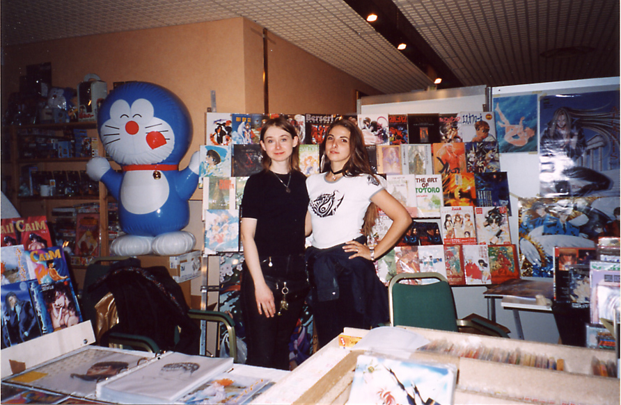
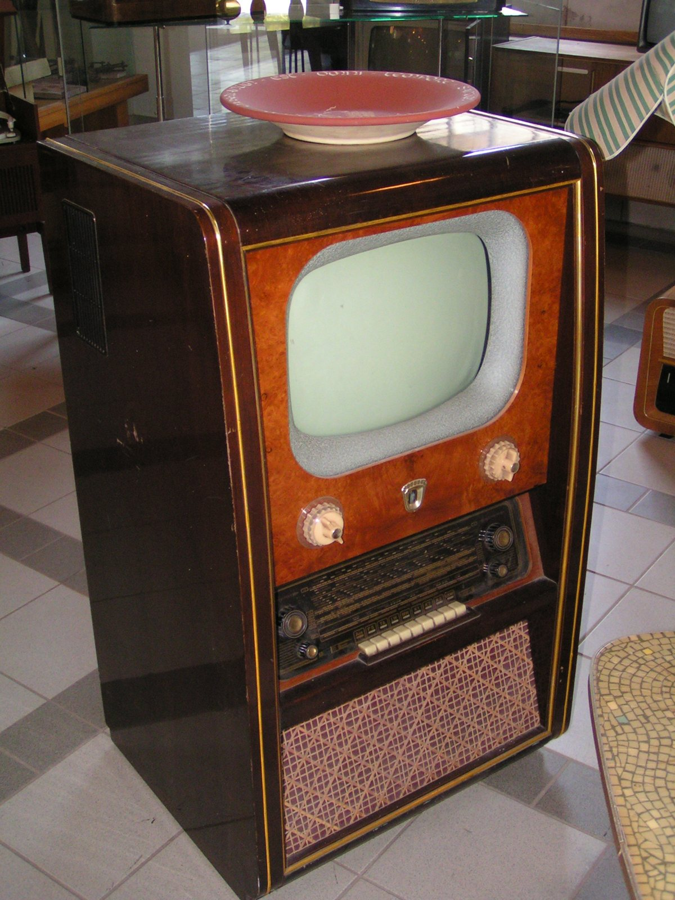
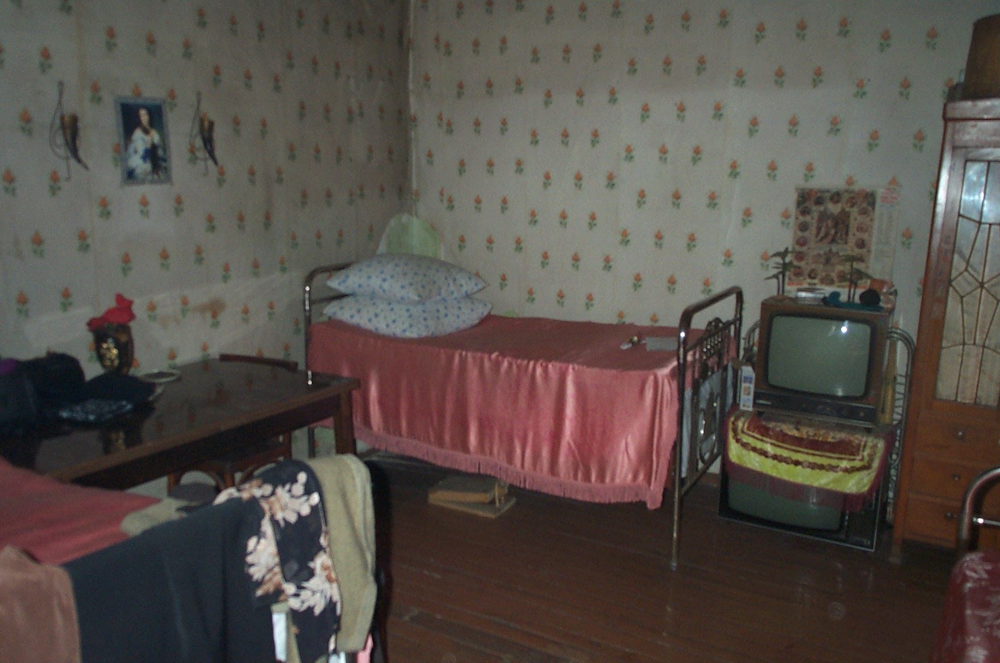

22年前の今日、2004年11月22日。テレビアニメ『ドラえもん』の声を26年間にわたって務めてきた大山のぶ代さんをはじめとするレギュラー声優陣が、2005年3月をもって交代することが公表されました。夕方や夜のテレビの前で毎週当たり前のように聞いていた「あの声」が変わるというニュースは、日本全国の幅広い世代に大きな驚きを与えました。

## 突然報じられた「声優陣一新」のニュース

2004年11月22日付の朝日新聞紙面で、アニメ『ドラえもん』の声優陣が一新される決定が初めて公表されました。ドラえもん役の大山のぶ代さんだけでなく、のび太役の小原乃梨子さん、しずか役の野村道子さん、ジャイアン役のたてかべ和也さん、スネ夫役の肝付兼太さんのレギュラー5人全員が同時に卒業するという内容でした。

さらに映画版で数々の名作を送り出してきた芝山努監督ら制作スタッフも交代することが明らかになり、長年親しまれてきた体制が完全に幕を下ろすことが伝えられました。テレビアニメ放送と映画公開が25周年を迎えた節目の決断でした。

## 1979年に始まった第2作アニメの躍進

テレビ朝日系列でのアニメ『ドラえもん』は、1979年4月2日に放送を開始しました。当初は夕方の帯番組としてスタートし、1981年10月からは金曜夜7時の全国ネット枠へと移動します。子どもたちが週末を迎える金曜の夜、家族そろって見る定番番組として瞬く間に定着していきました。

視聴率も右肩上がりに上昇し、1983年2月11日には関東地区で歴代最高となる31.2%を記録しました。主題歌『ドラえもんのうた』のシングルレコードは1987年時点で150万枚を売り上げるなど、単なる子ども向けアニメの枠を超えた国民的人気作品へと成長していったのです。

*事件当時の写真ではありません · 2003年 — 写真: AleP. Original uploader was Alepyr at it.wikipedia / CC BY 3.0*

## 原作にはなかった名セリフとアドリブ

大山のぶ代さんたちが演じたドラえもんたちには、アニメ独自の設定や表現が数多くありました。「こんにちは、ぼくドラえもんです」という有名な決まり文句や、ドラえもんがのび太を「のび太くん」と呼ぶ呼び方は、原作漫画にはなく、大山さんたち声優陣が現場で考案したものでした。

のび太の「ドラえもん、大変だよ」、しずかの「のび太さんのエッチ!!」、スネ夫の「のび太のくせに生意気だぞ！」といった定番のセリフも、声優陣のアドリブから生まれたものです。キャラクターに命を吹き込み、家族のような温もりを作り上げたのは、まさにこのキャスト陣の深い愛情と工夫でした。

*Fernseher — 写真: Stefan Kühn / CC BY-SA 3.0*

## 映画シリーズを支え続けた芝山努監督

テレビシリーズとともに人気を牽引したのが、毎春公開される劇場版映画でした。1983年の大長編第4作から2004年の第25作『のび太のワンニャン時空伝』まで、実に22作品にわたって監督を務めたのが芝山努さんでした。

緻密な絵コンテと繊細な演出で知られた芝山監督は、子どもだけでなく大人の胸にも深く響く冒険活劇を作り続けました。1998年度には『のび太の南海大冒険』で毎日映画コンクールアニメーション映画賞を受賞するなど、映画ドラえもんの黄金期を築き上げた立役者でした。

*Raffi Kojian-AM2001-05546 246 — 写真: Raffi Kojian / CC BY 4.0*

## 病をきっかけに固めた勇退の意志

大山さんはかつて「ドラえもんは80歳までやる」と語るほど作品に情熱を注いでいましたが、2001年に直腸がんを患って長期入院を余儀なくされました。この入院をきっかけに体調を考慮し、ドラえもん役からの降板を決意したといいます。

周囲の説得を受けて当時は続投したものの、話し合いを重ねた結果、放送25周年の区切りとなる2005年春にメインキャスト全員で揃ってバトンを渡す道が選ばれました。誰か一人だけが代わるのではなく、四半世紀を共に走り抜けた5人が揃って卒業することになったのです。

## 全1787話の完走と未来への継承

2005年3月18日、特番『ドラえもん オールキャラ夢の大集合スペシャル』をもって、1979年から続いた第2作第1期の放送は終了しました。通常放送の全1787話と特番の30話を合わせ、総計全1817話に及ぶ大記録でした。

翌月の2005年4月15日からは新しい声優陣による第2期がスタートし、作品は現代の子どもたちへと受け継がれていきました。大山さんたちが吹き込んだ温かい言葉の数々は、今も新しい世代へと形を変えて息づいています。

### 参考資料

- <https://ja.wikipedia.org/wiki/%E3%83%89%E3%83%A9%E3%81%88%E3%82%82%E3%82%93_(1979%E5%B9%B4%E3%81%AE%E3%83%86%E3%83%AC%E3%83%93%E3%82%A2%E3%83%8B%E3%83%A1)>
- <https://commons.wikimedia.org/wiki/File:Dokodemo_Doraemon_%E3%81%A9%E3%81%93%E3%81%A7%E3%82%82%E3%83%89%E3%83%A9%E3%81%88%E3%82%82%E3%82%93_(5893969894).jpg>
- <https://commons.wikimedia.org/wiki/File:Le_peruggine_alla_fiera_fumetti_di_Milano_Quark_Hotel_2003.jpg>
- <https://commons.wikimedia.org/wiki/File:Fernseher.jpg>
- <https://commons.wikimedia.org/wiki/File:Raffi_Kojian-AM2001-05546_246.jpg>
