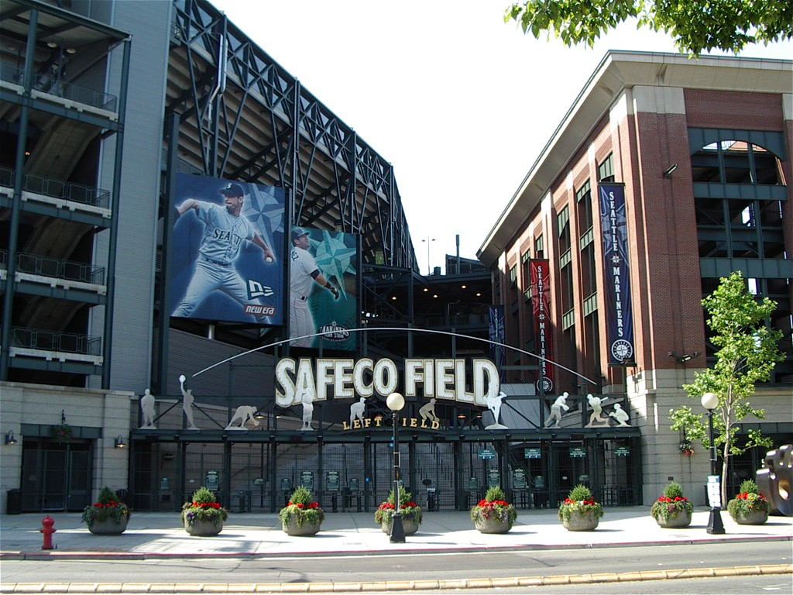
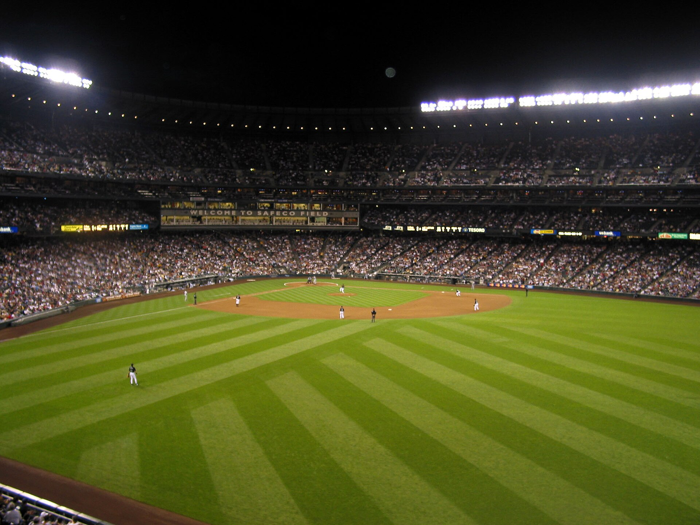
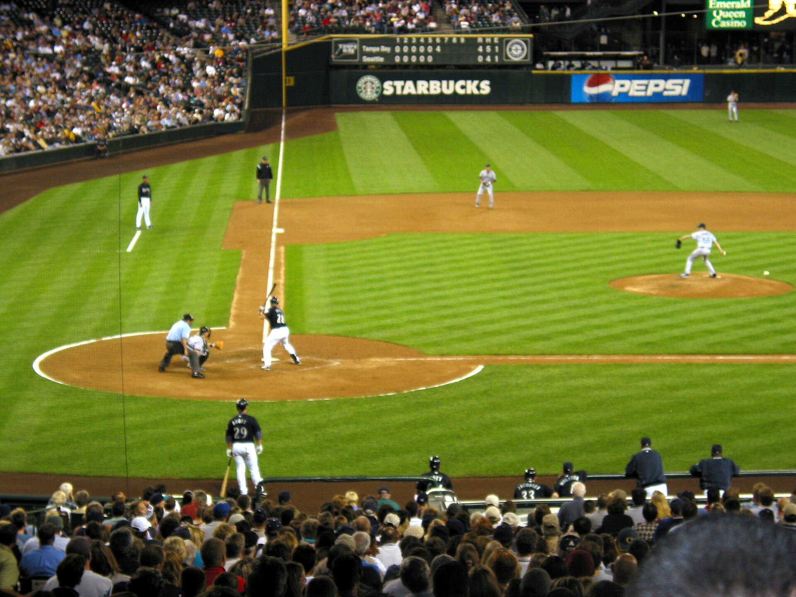

21年前の今日、2005年11月22日。福岡ソフトバンクホークスの城島健司選手が、米大リーグのシアトル・マリナーズと3年契約を結びました。言葉の壁や独特のリードが求められる捕手というポジションにおいて、日本人選手がメジャー契約を結ぶのは史上初の出来事でした。長年「日本人には不可能」と語られてきた壁を破り、海を渡った瞬間でした。

## 憧れの王貞治監督との出会いと捕手へのこだわり

城島選手は4歳の時、テレビで王貞治選手の引退セレモニーを見てプロ野球選手に憧れを抱きました。別府大学附属高校時代には強肩を見込まれて捕手となり、「打って守って走れる捕手」を自らの宿命と定めます。高校通算70本塁打を記録し、1994年のドラフト会議で福岡ダイエーホークスから1位指名を受けました。

当初は大学進学を表明していましたが、ダイエーの監督に就任した憧れの王監督から直接説得を受け、プロ入りを決断しました。この強行指名を機に、アマチュア選手を保護するためのプロ志望届制度が作られることになりました。

## 捕手失格の酷評から正捕手への道

プロに入団した当初、城島選手は一線級投手の鋭い変化球に対応できず、ワンバウンドの投球を体で止めることもできませんでした。工藤公康投手のカーブが捕球できず怒られる日々が続き、達川光男コーチや野村克也氏らから「捕手に向いていない」と酷評を受けました。一時は王監督が一塁手へのコンバートを試み、一軍公式戦で一塁を守ったこともありました。

それでも城島選手は捕手を諦めず、工藤投手や武田一浩投手、若菜嘉晴コーチの指導を貪欲に吸収しました。1997年には21歳45日でオールスターファン投票の捕手部門1位に選出され、打率3割8厘を記録。1999年には工藤投手と最優秀バッテリー賞を受賞し、球団初のリーグ優勝と日本一に大きく貢献しました。

*Seattle Safeco Field 01 — 写真: Mikano / CC BY-SA 3.0*

## パ・リーグMVP獲得と捕手歴代最高打率の樹立

2003年、城島選手は「子どもたちに夢を与えるスーパーキャッチャーになりたい」と宣言します。その言葉通り、打率3割3分、34本塁打、119打点の猛打を振るい、捕手としては野村克也氏以来30年ぶりとなるパ・リーグMVPを受賞しました。チームメイトの松中信彦選手、井口資仁選手、ペドロ・バルデス選手とともに、史上初となる同一チーム4人の100打点カルテットを形成しました。

2004年には出場939試合目で通算1000安打を達成し、アテネ五輪で銅メダルを獲得。この年の打率3割3分8厘は捕手のパ・リーグ記録となりました。2005年には怪我に見舞われながらも通算4000打数に到達し、捕手として歴代1位となる通算打率2割9分9厘を記録しました。

*LongShot — 写真: Paul Schultz from Kenmore, USA / CC BY 2.0*

## 2005年11月22日、シアトル・マリナーズと3年契約

日本球界の頂点に立った城島選手は、さらなる高みを目指して代理人にアラン・ニーロ氏を立て、海外FA権を行使しました。投手との英語でのコミュニケーションやサイン交換の緻密さから、日本人捕手のメジャー挑戦は極めて難しいと見られていました。

しかし2005年11月22日、シアトル・マリナーズと3年総額1650万ドルで契約合意に至ります。すでにイチロー選手が看板選手として活躍していた球団に、日本を代表する正捕手が加わることになり、日米の野球界に大きな話題を呼びました。

*Windup — 写真: Paul Schultz from Kenmore, USA / CC BY 2.0*

## メジャー史上初の日本人捕手として残した衝撃

2006年4月3日、ロサンゼルス・エンゼルスとの開幕戦に「7番・捕手」で先発出場を果たし、MLB史上初の日本人捕手となりました。第2打席でバートロ・コローン投手からメジャー初安打となる本塁打を放つと、翌日も本塁打を放ち、デビューから2試合連続本塁打を記録しました。

慣れない英語で投手陣とコミュニケーションを図りながら打棒を奮い、この年は18本塁打、76打点、打率2割9分1厘をマーク。シーズン最終戦では、バック・ロジャース氏が持っていたア・リーグ新人捕手の最多安打記録を44年ぶりに更新する146安打を達成し、全米のメディアから高い称賛を浴びました。

## 日米通算18年の偉業とホークスへの帰還

2007年には守備率9割9分8厘、盗塁阻止率4割6分5厘で両リーグトップを記録するなど守備でも存在感を示しました。2009年の第2回WBCでは日本代表の正捕手として金メダル獲得に貢献。城島選手はNPBとMLBを合わせて18年間プレーし、通算1785安打、292本塁打、1006打点という輝かしい成績を残しました。

引退後はタレント活動などを経て、2020年に福岡ソフトバンクホークスの球団会長付特別アドバイザーに就任。2024年11月には、2025年1月から新設される球団チーフベースボールオフィサーに就任することが発表されました。捕手というポジションの常識を覆し、太平洋を越えて挑戦したその背中は、今も日本野球の歴史に深く刻まれています。

### 参考資料

- <https://ja.wikipedia.org/wiki/%E3%82%A4%E3%83%81%E3%83%AD%E3%83%BC>
- <https://commons.wikimedia.org/wiki/File:Dedication_of_Edgar_Martinez_Drive,_2005_(51501029245).jpg>
- <https://commons.wikimedia.org/wiki/File:Seattle_Safeco_Field_01.jpg>
- <https://commons.wikimedia.org/wiki/File:LongShot.jpg>
- <https://commons.wikimedia.org/wiki/File:Windup.jpg>
