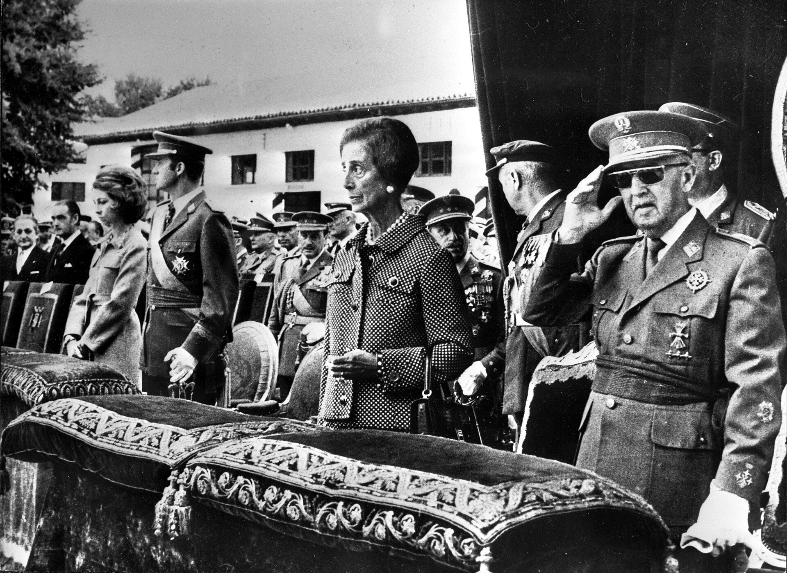
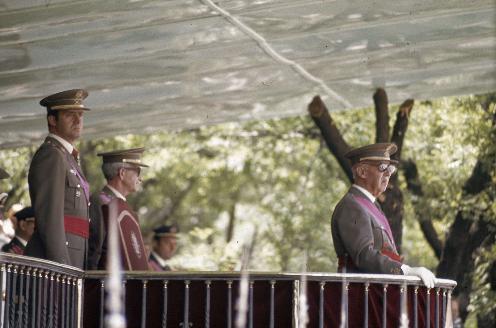
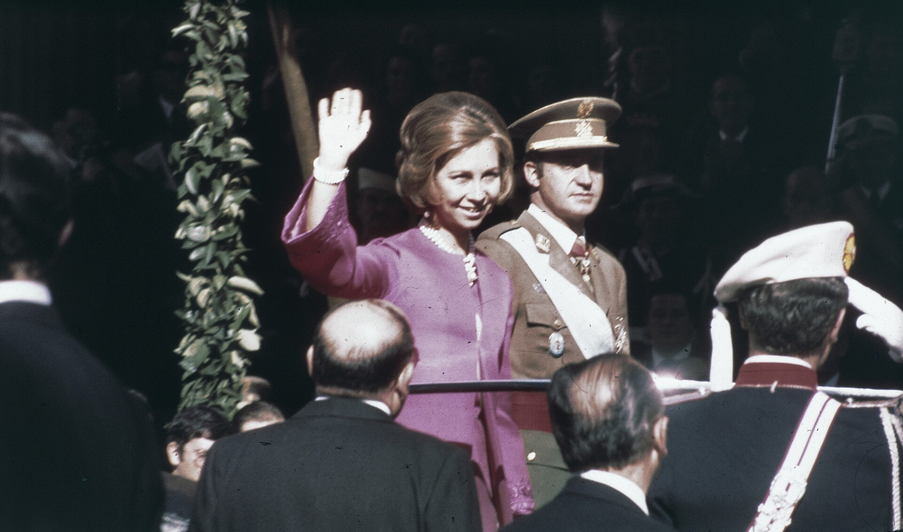

51年前の今日、1975年11月22日。スペインでフアン・カルロス1世が新たな国王に即位し、王政復古が実現しました。長期にわたる独裁体制を敷いたフランシスコ・フランコ総統の死からわずか2日後、国は緊迫した空気のなかで新たな元首を迎えました。

## フランコ総統の死去と王政復古の決定

1975年11月20日、フランシスコ・フランコ総統が死去しました。フランコは1936年に総統就任を宣言して以来、スペインの最高指導者として君臨してきました。自らの個人的な独裁体制が死後にそのまま存続することは難しいと考えたフランコは、最終的に王政の復活を選択します。

1947年に制定された王位継承法により、スペインの政体は「王国」と定義され、フランコには将来の国王を指名する権限が与えられていました。フランコは前国王アルフォンソ13世の孫にあたるフアン・カルロス王子に着目し、1969年7月22日に将来のスペイン国王に指名する法案を議会へ提出していました。

## 独裁者の庇護から即位へ

フアン・カルロスは1938年、亡命先のローマで生まれました。第二次世界大戦後の1948年にスペインへ戻り、サン・セバスティアンでの初等教育や陸軍での訓練、マドリード大学での学びを通じ、将来の国家指導者としての教育を受けて育ちました。

フランコの庇護下で育ったことから、国内外の多くの人々は、新国王がフランコの築いた権威主義体制をそのまま引き継ぐのではないかと予想していました。しかし1975年11月22日、議会で宣誓を行って即位したフアン・カルロス1世が選んだ道は、その大方の予想とは全く異なるものでした。

*Franco met vrouw Dona Carmen Polo (rechts) links opvolger Prins Juan Carlos met (no frame) — 写真: Fotograaf Onbekend / Anefo / CC0*

## 予想を覆した民主化への歩み

即位したフアン・カルロス1世は、フランコ体制の権威主義を受け継ぐのではなく、西ヨーロッパ諸国の立憲君主制を模範とした民主化の推進を決意します。フランコの葬儀に参列したチリのアウグスト・ピノチェト大統領を速やかに帰国させるなど、体制刷新への強い姿勢を初期から内外に示しました。

1977年には、スペインで41年ぶりとなる自由な総選挙が実施されました。さらに翌1978年には新憲法が国民の承認を受け、国王の政治的権限は儀礼的なものへと限定され、平和的な立憲君主制への移行が達成されました。

*Generaal Franco (rechts) en Prins Juan Carlos, Bestanddeelnr 254-9762 — 写真: Anefo / CC0*

## 民主主義の危機を救った決断

民主化への移行期において、最大の試練となったのが1981年2月23日に発生したクーデター未遂事件（23-F）でした。アントニオ・テヘーロ中佐が率いる約200人の兵士が議会を占拠し、アドルフォ・スアレス首相をはじめとする閣僚や議員350人を人質に取りました。

国王親政の復活を求める反乱軍に対し、フアン・カルロス1世はこの要求を断固として拒絶しました。直ちに全軍の指揮官へクーデターに同調しないよう通達し、テレビ演説を通じて国民に冷静さを呼びかけました。この毅然とした対応によって翌24日には反乱部隊が投降し、スペインの民主主義は守られました。

*De proclamatie en beëdiging van Prins Juan Carlos tot Koning van Spanje tijdens , Bestanddeelnr 254-9765 — 写真: [onbekend] / CC0*

## 現在へと続く歴史の節目

フアン・カルロス1世はその後も文化や外交の面で活動を続け、1981年のアメリカ訪問時にはニューヨーク近代美術館にあったパブロ・ピカソの傑作『ゲルニカ』の母国返還を要請し、実現に導きました。

長年にわたり在位したフアン・カルロス1世は、2014年6月に息子のフェリペ6世へ王位を譲りました。1975年11月22日に行われた即位は、激動の独裁時代に終止符を打ち、スペインが対立を乗り越えて開かれた民主社会へと歩み出す歴史的な出発点となりました。

### 参考資料

- <https://ja.wikipedia.org/wiki/%E3%83%95%E3%83%A9%E3%83%B3%E3%82%B7%E3%82%B9%E3%82%B3%E3%83%BB%E3%83%95%E3%83%A9%E3%83%B3%E3%82%B3>
- <https://commons.wikimedia.org/wiki/File:Franco_met_vrouw_Dona_Carmen_Polo_(rechts)_links_opvolger_Prins_Juan_Carlos_met.jpg>
- <https://commons.wikimedia.org/wiki/File:Franco_met_vrouw_Dona_Carmen_Polo_(rechts)_links_opvolger_Prins_Juan_Carlos_met_(no_frame).jpg>
- <https://commons.wikimedia.org/wiki/File:Generaal_Franco_(rechts)_en_Prins_Juan_Carlos,_Bestanddeelnr_254-9762.jpg>
- <https://commons.wikimedia.org/wiki/File:De_proclamatie_en_be%C3%ABdiging_van_Prins_Juan_Carlos_tot_Koning_van_Spanje_tijdens_,_Bestanddeelnr_254-9765.jpg>
