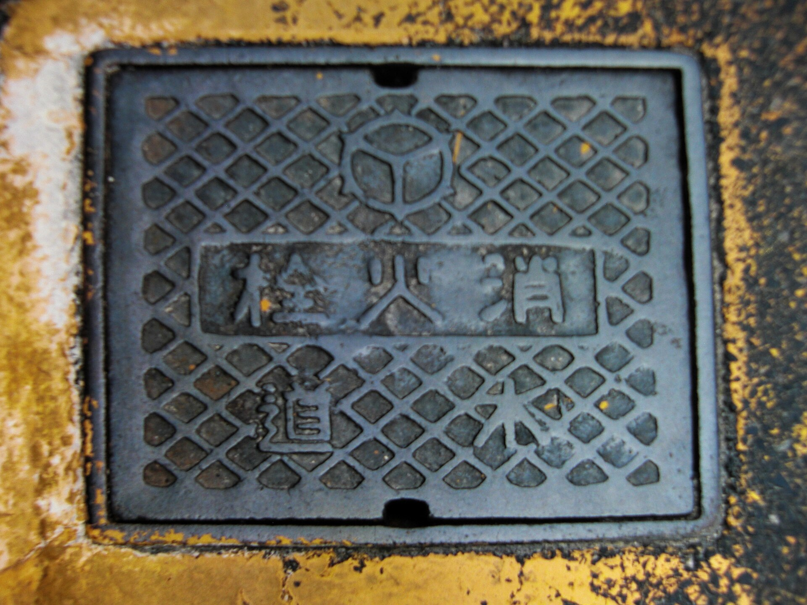
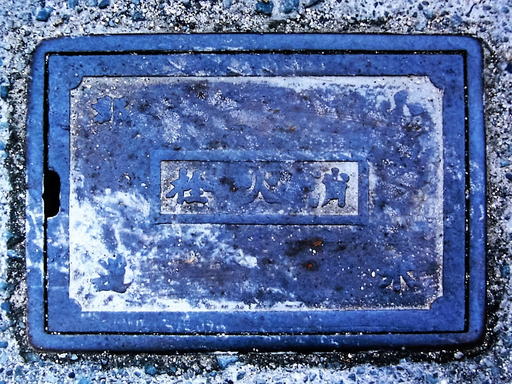
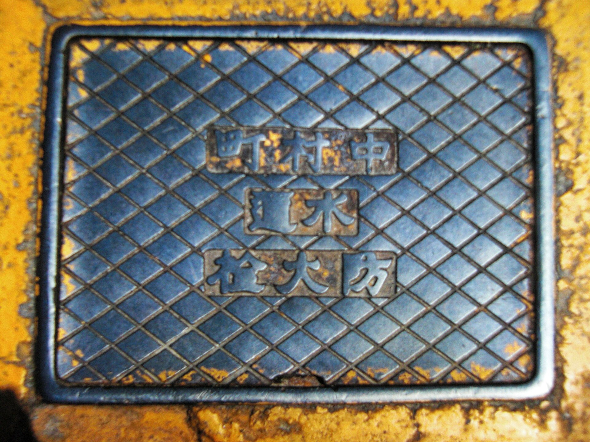

30年前の今日、1996年11月23日。玩具メーカーのバンダイから、キーチェーン付きの携帯液晶ゲーム「たまごっち」が正式に発売されました。高さ53ミリの手のひらサイズに3つのボタンと白黒液晶を備えたこの小さな玩具は、やがて日本中の店頭から姿を消し、連日ニュースを賑わす空前の社会現象を巻き起こすことになります。

## 「卵型の玩具は売れる」女子高生狙いの企画から誕生

たまごっちの原案は、1995年6月にウィズの横井昭裕氏がバンダイの本郷武一氏に提出した企画書から始まりました。動物好きだった横井氏の「ペットを育てるゲームを作りたい」という思いが発端でした。当初は持ち歩きやすさを考えて腕時計型でベルトを付ける予定でしたが、安価な電子部品で作ると本体がかさばってしまうため、キーチェーン型へと設計が改められました。

「卵型の玩具は売れる」という直感からデザインは愛らしい卵形に決まり、名前も「たまご」と「ウオッチ（腕時計）」を組み合わせて「たまごっち」と命名されました。ターゲットは当時の流行発信地であった女子高校生に絞り込まれました。

## エサやりとフン掃除、放っておくと「死」を迎える衝撃

たまごっちの画期的な点は、ゲーム内の時間と現実の時間が連動していたことでした。画面の中のキャラクターは時間とともにお腹を空かせ、フンをし、夜になれば眠ります。3つのボタンを操作してエサを与えたり、フンを掃除したり、遊んで機嫌を取ったりしながら育てていきます。

こまめにコミュニケーションを取っていれば元気に育ちますが、世話を怠ると病気になり、最悪の場合は画面の中で死んでしまいます。育ち方によって「おやじっち」や「にょろっち」など様々な姿に変身する面白さもあり、単なるデジタル時計の枠を超えた「本物の命を預かっているような感覚」が多くの利用者を夢中にさせました。

*Fire.hydrant.cover.in.matsue.city — 写真: 栗原 岳 (Gaku Kurihara) / CC BY-SA 4.0*

## 50個の抽選に4000人、徹夜組が続出した熱狂の現場

1996年10月の東京と大阪でのテストセールスを経て、11月23日に全国発売がスタートしました。当初バンダイは初回生産を6万個と見込んでいましたが、反響を受けて100万個まで増産を決めます。しかし、いざ発売されると需要は供給をはるかに上回り、瞬く間に全国的な品薄状態に陥りました。

ブームの背景には、当時絶大な人気を誇っていた安室奈美恵さんが音楽番組「HEY!HEY!HEY!」で紹介したことや、ドラマ『踊る大捜査線』の劇中で登場したことなどがありました。店頭には入荷の噂を聞きつけた人々が深夜から長蛇の列を作り、ある店舗ではわずか50個の販売枠に対して4000枚もの抽選整理券が配られるほどでした。

*Fire.hydrant.cover.in.ogori.yamaguchi.city — 写真: 栗原 岳 (Gaku Kurihara) / CC BY-SA 4.0*

## 1日5000件の問い合わせと「たまごっち託児所」の出現

過熱する人気は様々な社会現象を生み出しました。バンダイには商品の在庫や入荷日を尋ねる電話が1日に5000件も殺到し、開設されたばかりの公式ウェブサイトにも1日1万件以上のアクセスが集中しました。バンダイやウィズの社員ですら自社製品を入手できない事態が続きました。

街中では「たまごっちを持っていること」そのものがステータスとなり、複数のたまごっちを同時に持ち歩く人が現れました。仕事や授業で世話ができない人のために預かって育てる「たまごっち託児所」という新ビジネスまで登場します。さらに「白いデザインは希少価値が高い」という噂が広まり、1個十数万円で転売されるケースや、類似品・模倣品が出回って裁判に発展する事態も起きました。

*Fire.hydrant.cover.in.nakamura.city — 写真: 栗原 岳 (Gaku Kurihara) / CC BY-SA 4.0*

## 世界30カ国への波及と、大増産の果てに残った教訓

たまごっちの勢いは海を越え、アメリカやアジアなど世界30カ国で発売されました。アメリカの人気医療ドラマ『ER』の劇中にも登場し、1997年には「仮想ペットの養育に数百万時間もの労働時間を費やさせた」功績として、ノーベル賞のパロディであるイグノーベル賞の経済学賞を受賞しました。

しかし1998年に入ると、急激な熱狂は一転して沈静化に向かいます。品薄を解消しようと大増産を続けていたバンダイの手元には膨大な不良在庫が残り、1999年3月期には約250万個の在庫を処分。60億円の特別損失を計上し、45億円の最終赤字に追い込まれるという手痛い教訓も残しました。

## 初代4000万個の伝説から今へ続く育成ゲームの歴史

第1期のたまごっちシリーズは、日本国内で2000万個、海外で2000万個の累計4000万個を売り上げました。ブームの終焉によって一時は棚から姿を消したものの、2004年には赤外線通信機能を搭載した第2期シリーズとして小学生を中心に復活。その後もカラー液晶画面の導入など時代に合わせた進化を続けました。

ボタン3つで小さな命と向き合ったあの体験は、その後のデジタル育成ゲームやコミュニケーション玩具の道を切り拓きました。発売日に開店前の店舗に並んだ記憶や、学校や仕事の合間にこっそりポケットの中でボタンを押した思い出は、今も多くの人々の胸に鮮明に残っています。

### 参考資料

- <https://ja.wikipedia.org/wiki/11%E6%9C%8823%E6%97%A5>
- <https://commons.wikimedia.org/wiki/File:Fire.hydrant.cover.in.iida.city.jpg>
- <https://commons.wikimedia.org/wiki/File:Fire.hydrant.cover.in.matsue.city.jpg>
- <https://commons.wikimedia.org/wiki/File:Fire.hydrant.cover.in.ogori.yamaguchi.city.jpg>
- <https://commons.wikimedia.org/wiki/File:Fire.hydrant.cover.in.nakamura.city.jpg>
