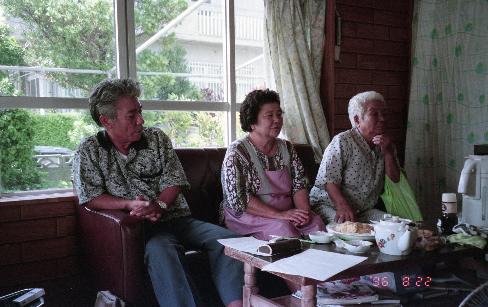
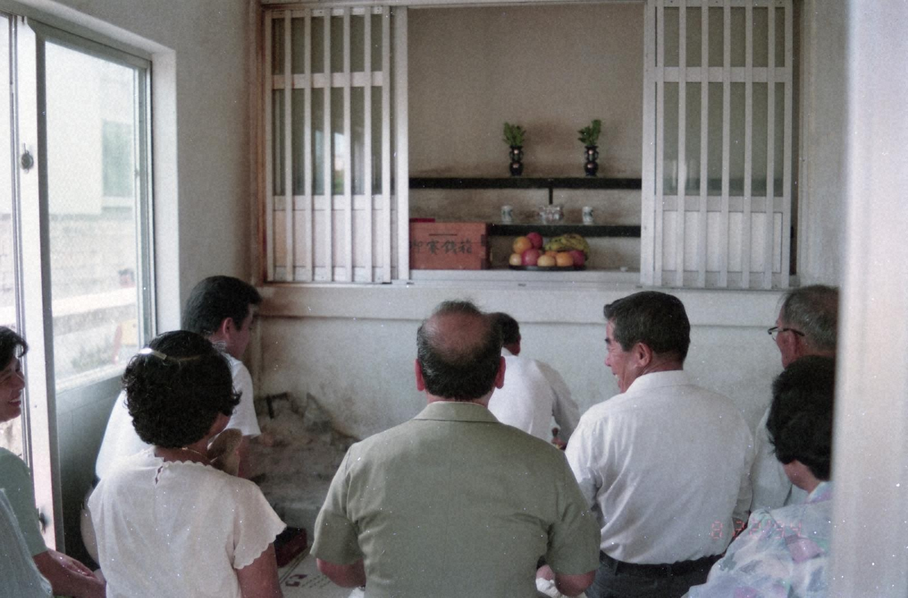
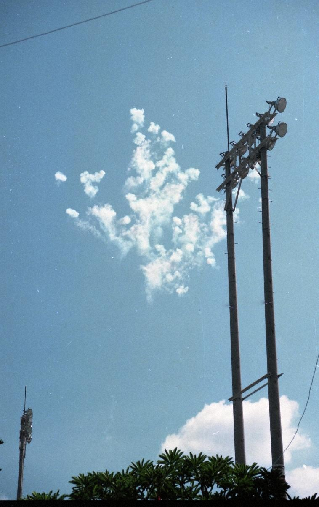

34年前の今日、1992年11月23日。滋賀県の琵琶湖畔から、ヘリウム風船を多数くくりつけたゴンドラ「ファンタジー号」が、アメリカを目指して空へと飛び立ちました。

名目上は地上とロープでつないだ係留飛行実験のはずでした。しかし、乗っていた男性は周囲の制止を振り切って自らロープを外し、太平洋の彼方へと姿を消しました。のちに「風船おじさん」の呼び名でワイドショーを席巻したこの出来事は、日本中に大きな衝撃を与えました。

## 借金返済と風船への執着　繰り返された騒動

ファンタジー号に乗っていたのは、東京都出身のピアノ調律師で実業家の鈴木嘉和さん（当時52歳）でした。鈴木さんは1984年に音楽教材会社を立ち上げましたが、経営難から1990年に多額の負債を抱えて倒産していました。債権者に対し、鈴木さんはビニール風船を付けたゴンドラで太平洋を横断し、その話題性で借金を返済すると語っていました。

鈴木さんが世間の注目を集めたのは、これが初めてではありませんでした。1989年7月には、出店していた横浜博覧会の客足の悪さに抗議し、マスコットキャラクターの着ぐるみを着て高さ30メートルの鉄塔に7時間にわたり立て籠もる騒動を起こしていました。その際も、抗議後に自費でヘリウム風船による係留式ゴンドラ「空中散歩」を会場に設置し、約2500人を乗せるなど、以前から風船を使った演出に強いこだわりを持っていました。

## 多摩川河川敷からの前哨戦と大田区民家への不時着

太平洋横断に向けた鈴木さんの挑戦は、1992年4月17日にも実行されていました。東京都府中市の多摩川河川敷から、警察の制止を無視してヘリウム風船を付けた椅子に乗り、千葉県の九十九里浜を目指して飛び立ったのです。

この飛行では、重りとして積んでいた砂袋が外れて高度5,600メートルまで急上昇してしまいました。鈴木さんは持っていた100円ライターの火で風船をあぶって切り離し、東京都大田区の民家の屋根に不時着しました。民家の瓦を壊しテレビアンテナを曲げる被害を出したものの、鈴木さん自身は左手の怪我程度で生還しました。警察に謝罪しながらも「次はハワイを目指す」と語り、風船での飛行をあきらめることはありませんでした。

*町史関係資料 — 写真: 南城市教育委員会 / CC BY (Japan Search)*

## 1992年11月23日　琵琶湖畔での強行出発

そして迎えた1992年11月23日、滋賀県近江八幡市の琵琶湖畔に、26個のヘリウム風船を装着した強化プラスチック製ゴンドラ「ファンタジー号」が姿を現しました。集まったのは、鈴木さんから協力を求められた同志社大学の教授と学生7人、新聞社の通信局長、密着取材を続けていたテレビ局のクルー、そして鈴木さんの支持者たちでした。

この日の予定は、高度200メートルから300メートルまで上昇する係留実験でした。運輸省（現・国土交通省）は装備不足などを理由に安全性を疑問視し、ロープをつないだ実験飛行のみを受理していたからです。しかし鈴木さんは事前に、家族へ「大騒ぎになって家にマスコミが押し寄せるから」とホテルを手配し、アメリカ土産の希望を書いたメモをポケットに忍ばせていました。

午後4時20分頃、一度着地したファンタジー号の係留ロープを、鈴木さんは突然外しました。「行ってきます」と告げる鈴木さんに、教授が「どこへ行くんだ」と叫ぶと、「アメリカですよ」と返答。重りの焼酎瓶を地上へ投げ落とし、アメリカ・ネバダ州サンド・マウンテンを目指してぐんぐんと夕空へ舞い上がっていきました。呆気にとられた見物人の中から、手を振る者は一人もいませんでした。

*知名のヌーバレー（1994年） — 写真: 南城市教育委員会 / CC BY (Japan Search)*

## 太平洋上からの通話と海上保安庁による最後の確認

飛び立った直後、テレビ局が鈴木さんの携帯電話に連絡を入れると、「ヘリウムが少し漏れているが、大丈夫だ」と答えが返ってきました。ホテルで待機していた家族のもとにも夜10時以降、ほぼ1時間おきに鈴木さんから電話が入りました。風船の様子がおかしいことや、思うように高度が上がらないこと、海に出たことなどが語られていました。

しかし、飛行3日目となった11月25日、事態は急変します。SOS信号が発信され、これを受信した第三管区海上保安本部の捜索機が、宮城県金華山沖の太平洋上でファンタジー号を目撃しました。乗組員に向けて手を振る鈴木さんの姿が確認されましたが、これが鈴木さんの生前最後の姿となりました。その後、ファンタジー号は連絡を絶ち、広大な太平洋のどこかへと消え去りました。

*さしきまつり — 写真: 南城市教育委員会 / CC BY (Japan Search)*

## ワイドショーを席巻した「風船おじさん」と今に残る記憶

事件後、テレビのワイドショーはこの前代未聞の飛行計画を連日トップニュースで報じました。「風船おじさん」という呼び名が定着し、無謀な挑戦に対する厳しい批判が巻き起こる一方で、その奇抜な行動に強い関心を寄せる人々も多くいました。

鈴木さんの消息は現在に至るまでつかめておらず、ファンタジー号の残骸も発見されていません。のちに法的な失踪宣告が確定し、家族の手によって当時の葛藤を綴った手記も出版されました。昭和から平成へと時代が移り変わったあの頃、日本中を騒然とさせた無謀な飛行計画は、今も消えない記憶として語り継がれています。

### 参考資料

- <https://ja.wikipedia.org/wiki/11%E6%9C%8823%E6%97%A5>
- <https://www.flickr.com/photos/126057645@N04/16416429595>
- <https://nanjo-archive.jp/document/?detail=11199&genre=6>
- <https://nanjo-archive.jp/document/?detail=30650&genre=6>
- <https://nanjo-archive.jp/document/?detail=7467&genre=6>
