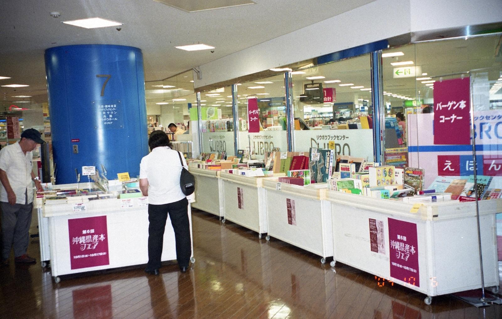
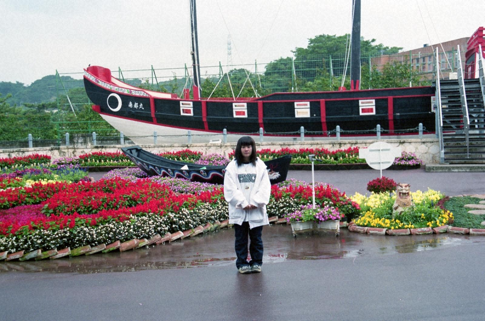
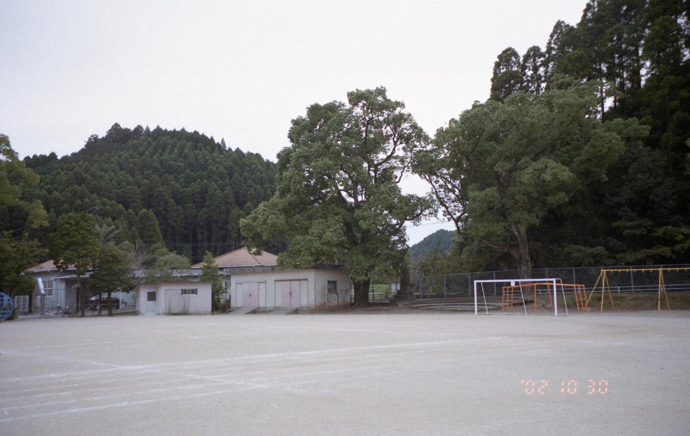

24年前の今日、2002年11月23日。サッカーのJリーグでジュビロ磐田が第2ステージの優勝を決めました。春の第1ステージに続く優勝により、Jリーグ史上初めてチャンピオンシップを行わずに年間王者を決める「完全優勝」という偉業が達成されました。

## 2ステージ制が生んだ難関の頂点

当時のJリーグは、1年を第1ステージ（前期）と第2ステージ（後期）に分ける2ステージ制を採用していました。それぞれのステージで優勝した2チームが、年末に「Jリーグチャンピオンシップ」と呼ばれる直接対決を行い、年間王者を決定するシステムでした。どちらか一方のステージを制しても、もう一方のステージで他チームが優勝すれば年間王者は決まらない仕組みであり、両方のステージを同一のクラブが制覇することは極めて難しい挑戦とされていました。

## ヤマハ発動機から黄金期への歩み

ジュビロ磐田の前身は、1972年に創部されたヤマハ発動機サッカー部です。1992年にJリーグ準会員となり、1993年のジャパンフットボールリーグ1部で準優勝を果たして1994年からJリーグに参入しました。元日本代表監督のハンス・オフト氏の招聘や、元イタリア代表のスキラッチ選手、ブラジル代表キャプテンのドゥンガ選手らの加入を経て急速に力をつけ、中山雅史選手や名波浩選手、藤田俊哉選手らを中心とする華麗なパスサッカーを確立していきました。

*県産本フェア — 写真: 南城市教育委員会 / CC BY (Japan Search)*

## 他を寄せ付けない2002年の快進撃

2002年のジュビロ磐田は、開幕から圧倒的な力を見せました。春の第1ステージを制してチャンピオンシップへの出場権を早々に手中に収めると、秋の第2ステージでも勢いを落とすことなく勝ち点を積み重ねていきました。年間通算成績は26勝3敗1分、リーグ戦に限ればわずか1敗1分という異次元の強さを誇り、対戦相手を全く寄せ付けない盤石の試合運びを続けました。

*子ども会活動発表会 — 写真: 南城市教育委員会 / CC BY (Japan Search)*

## エース高原直泰と豪華な布陣

この年の攻撃陣を牽引したのが、27試合に出場して26得点を挙げたFWの高原直泰選手でした。高原選手は見事に得点王と最優秀選手賞（MVP）の2冠を獲得しました。さらに中盤から前線には、2002年日韓ワールドカップの日本代表にも選出された中山雅史選手、福西崇史選手、服部年宏選手が名を連ね、名波浩選手や藤田俊哉選手、DFの田中誠選手や鈴木秀人選手が攻守の屋台骨を強固に支えていました。

*大分県での学童疎開調査 — 写真: 南城市教育委員会 / CC BY (Japan Search)*

## 11月23日、前人未到の完全優勝決定

迎えた2002年11月23日、ジュビロ磐田は第2ステージの優勝を確定させました。前後期制覇による完全優勝は、Jリーグが始まって以来初めての快挙でした。チャンピオンシップの開催そのものを不要とし、文句なしの年間王者として頂点に立った瞬間でした。シーズン終了後に発表された年間ベストイレブンには、田中誠、鈴木秀人、名波浩、福西崇史、藤田俊哉、中山雅史、高原直泰の7選手が同一クラブから選出され、史上最多タイの記録として歴史に刻まれました。

## 世界へ羽ばたいたエースと残された記録

この歴史的な完全優勝を果たした直後、エースの高原直泰選手はドイツ・ブンデスリーガのハンブルガーSVへの移籍を果たしました。磐田が誇る高い組織力と個の技術が融合したサッカーは、国内外から高い評価を受けました。1997年から続いた黄金時代を象徴する2002年の完全優勝は、今もJリーグの歴史を語る上で欠かせない伝説のシーズンとして語り継がれています。

### 参考資料

- <https://ja.wikipedia.org/wiki/11%E6%9C%8823%E6%97%A5>
- <https://commons.wikimedia.org/wiki/File:Jubilo-Iwata_Vs_Yokohama-F.Marinos_2003.JPG>
- <https://nanjo-archive.jp/document/?detail=9197&genre=6>
- <https://nanjo-archive.jp/document/?detail=10230&genre=6>
- <https://nanjo-archive.jp/document/?detail=8854&genre=6>
