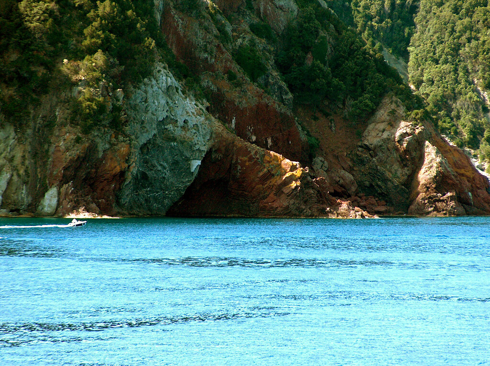
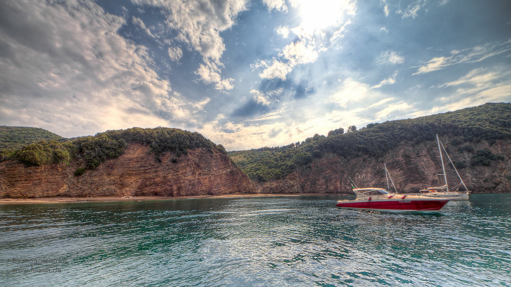
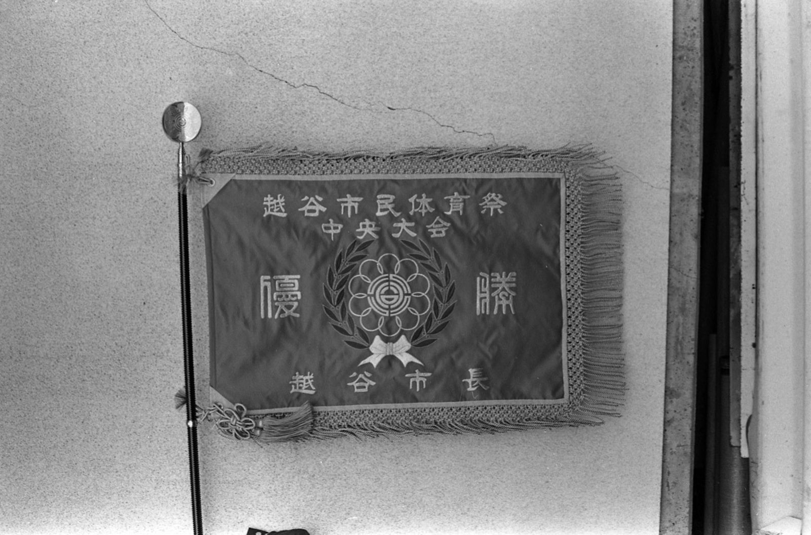

50年前の今日、1976年11月23日。フランスのダイバー、ジャック・マイヨールがイタリアのエルバ島沖で、呼吸装置を使わない素潜りで水深100メートルに達しました。人類史上初めてのことでした。当時49歳だった彼の達成は、人間の身体能力の常識を覆す快挙でした。

## 常識を覆した深海への挑戦

人工的な呼吸装置を一切つけず、ひと息の空気だけで海の奥深くへと潜るフリーダイビングの世界。当時は、水深100メートルの水圧に生身の人間が耐えることは医学的・生理学的に不可能と考えられていました。

しかし、マイヨールはその壁に挑み続けました。彼はイタリア出身のダイバー、エンツォ・マイオルカと激しい記録合戦を繰り広げ、1966年にハバナで水深60メートルを記録するなど、世界のトップとして深海へ迫っていきました。

## 原点は日本の海とイルカとの出会い

マイヨールの海への憧れの原点は、実は日本にありました。幼少期、上海と長崎を結ぶ航路を利用して家族で来日し、避暑地として滞在していた佐賀県唐津市の虹の松原前の海で潜ることを覚えました。

唐津市の屋形石にある七ツ釜で初めて野生のイルカと出会った経験が、のちの人生の土台となります。その後、アメリカのマイアミ水族館でイルカの調教を担当した際、イルカの滑らかな泳ぎや息を長く保つ方法を学び、独自の潜水哲学を築き上げていきました。

*Elba's cave — 写真: Renzo Ferrante / CC BY 2.0*

## 1976年11月23日、エルバ島沖での大記録

1976年11月23日、イタリアのエルバ島沖で公式記録への挑戦が行われました。マイヨールが取り入れたのは、心身を深くリラックスさせるヨーガや禅の呼吸法でした。

おもりをつけた器具につかまり、海中へとまっすぐ降下したマイヨールは、ついに前人未到の水深100メートル（101メートル）の深海に到達しました。潜水中の彼の脈拍は、通常時の毎分60回から毎分26回前後にまで低下し、海洋哺乳類に見られる潜水反射が人間にも起きることが医師たちの計測によって実証されたのです。

*Isola Elba anchor bay — 写真: magnetismus / CC BY 2.0*

## 映画『グラン・ブルー』と日本への深い愛情

この偉業から年月を経た1988年、リュック・ベッソン監督によってマイヨールとマイオルカの人生をモデルにした映画『グラン・ブルー』が製作・公開されました。息を呑むような深い青の映像と過酷なダイビングの世界は世界中で大反響を呼び、フリーダイビングという競技の存在を広く知らしめました。

大の親日家だったマイヨールは、晩年も千葉県館山市坂田に別荘を構え、日本の海を愛し続けました。1983年には55歳で水深105メートルを達成し、引退後も人間とイルカの共存を世界に訴え続けました。

*市民体育祭の優勝旗 — 写真: ndl / CC BY (Japan Search)*

## 今に受け継がれる海洋への哲学

マイヨールは2001年12月22日に74歳で亡くなり、その遺骨は彼が愛したトスカーナ州の沿岸に散骨されました。

彼が残した「人間の中のイルカ」という思想や、自然と調和しながら極限に挑む精神は、今も多くのダイバーや海洋愛好家に受け継がれています。50年前に彼が切り拓いた100メートルの深海は、私たちが海の豊かさと命の可能性を見つめ直す原点となっています。

### 参考資料

- <https://ja.wikipedia.org/wiki/11%E6%9C%8823%E6%97%A5>
- <https://commons.wikimedia.org/wiki/File:Navigazione_Toscana_Isola_d%27Elba_2N.jpg>
- <https://www.flickr.com/photos/36313666@N00/1054397018>
- <https://www.flickr.com/photos/64550890@N06/6214126777>
- <https://adeac.jp/koshigaya-city-digital-archives/catalog/mp171829-200020>
