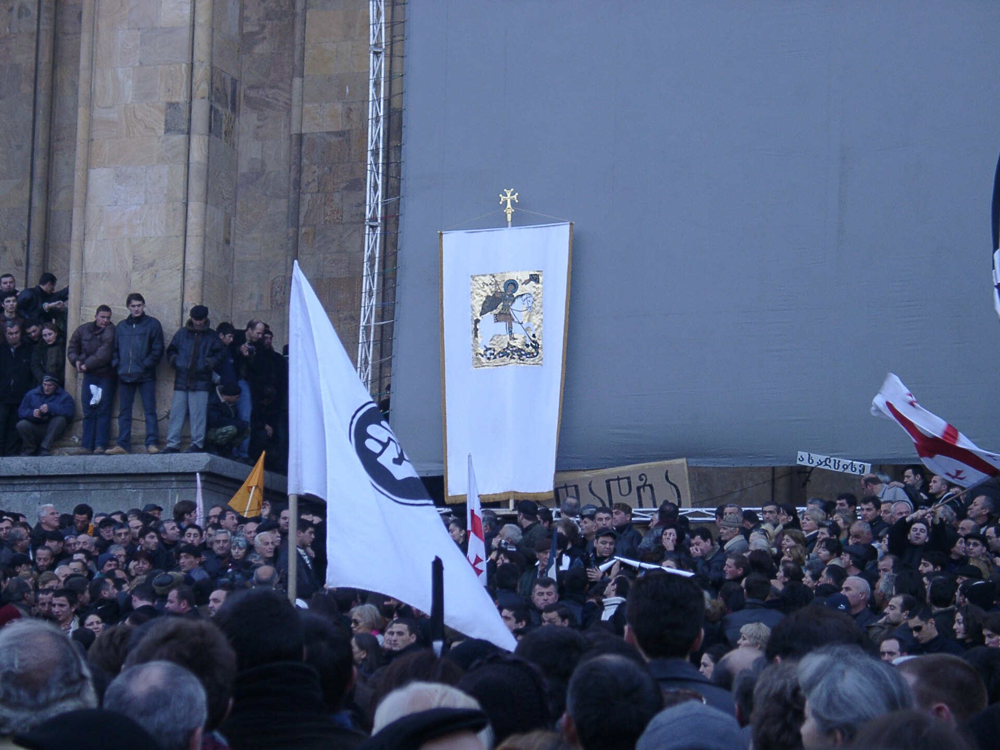
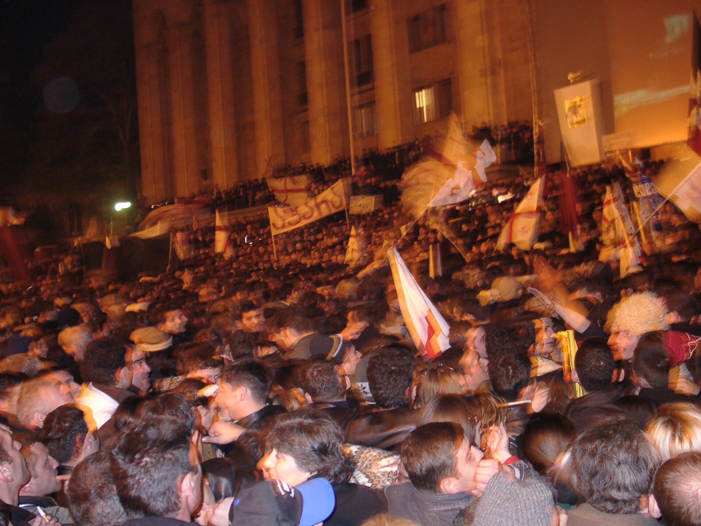
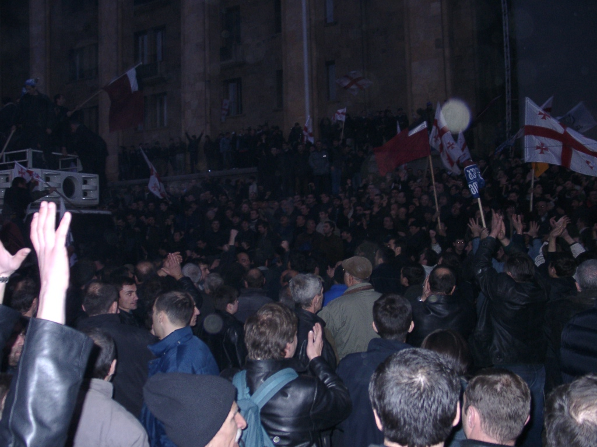

23年前の今日、2003年11月23日。旧ソ連の外務大臣として東西冷戦終結の一翼を担ったグルジア（現ジョージア）のエドゥアルド・シェワルナゼ大統領が、民衆の抗議運動によって大統領辞任に追い込まれました。手に赤いバラを持った市民たちが議会を占拠したこの無血の政変は、のちに「バラ革命」と呼ばれ、世界の注目を集めました。

## 冷戦終結の立役者から母国の指導者へ

エドゥアルド・シェワルナゼ氏は、ソビエト連邦時代にゴルバチョフ書記長のもとで外務大臣を務め、ペレストロイカや新思考外交を支えた国際的な指導者でした。東西冷戦の終結やドイツ再統一に深く関わり、世界的な知名度を誇っていました。

ソ連崩壊後の1992年、内戦と民族紛争で極度の混乱に陥っていた祖国グルジアに迎えられ、最高指導者として国家の再建に着手します。1995年には大統領に就任し、親欧米路線を取りながら市場経済化を推し進めました。

## 政権への失望と深まる社会不安

しかし、政権の後期になると国内情勢は再び暗転します。分離・独立を掲げる地域との紛争や難民問題に加え、政府内の汚職が蔓延し、経済は停滞しました。

国民の生活では電力やガスの供給不安が常態化し、インフレや失業が深刻な影を落としていました。漸進的な手法を取るシェワルナゼ政権の姿勢は次第に国民の民意から乖離し、社会全体に不満と閉塞感が渦巻いていました。

*OP02 — 写真: Zaraza / CC BY-SA 3.0*

## 選挙不正と手にバラを持った議会占拠

危機が爆発したのが、2003年11月2日に行われた議会選挙でした。政府による著しい不正操作があったとして国内外の監視団体から非難が集中し、野党を率いるミヘイル・サアカシュヴィリ氏らが市民に抗議行動と非暴力不服従を呼びかけました。

抗議が頂点に達したのが11月22日でした。新議会の開会式でシェワルナゼ大統領が演説を始めると、サアカシュヴィリ氏ら支持者が手にバラを持って議事堂へ乱入しました。大統領は護衛に守られながら議場から避難を余儀なくされました。武器の代わりにバラを掲げて平和的に抵抗したことから、この運動は「バラ革命」と名付けられました。

*OP20 — 写真: Zaraza / CC BY-SA 3.0*

## 11月23日の退陣と街を埋めた歓声

シェワルナゼ大統領は国家非常事態宣言を発令し、治安部隊や警察を動員しようと試みました。しかし、軍の高官らは政権への支持を拒絶し、民衆への発砲や鎮圧を拒みました。

11月23日の夕方、ロシアのイワノフ外相の仲介のもと、シェワルナゼ大統領は野党指導者たちと会談しました。事態の収拾がつかないことを悟った大統領は辞任を決断し、テレビを通じて職を辞することを発表しました。首都トビリシでは10万人を超える市民が歓声を上げ、花火が打ち上げられて勝利を祝いました。

*Gamarjveba49 — 写真: Zaraza / CC BY-SA 3.0*

## 日本との関わりと「ジョージア」への改称

日本にとってシェワルナゼ氏は、ソ連外相時代の1986年1月にソ連外相として10年ぶりに来日した人物であり、1999年にはグルジア大統領として来日していました。

なお、当時はロシア語由来の「グルジア」と呼ばれていたこの国は、2015年に日本政府が公式な国名呼称を英語に基づく「ジョージア」へと改称しました。外交や歴史の舞台で馴染み深かった「グルジア」の名は、こうした変遷を経て日本の記憶に刻まれています。

## 祖国に留まり続けた元大統領の晩年

退陣後、ドイツ統一への尽力を評価していたドイツ政府から亡命の受け入れが申し出されましたが、シェワルナゼ氏はこれに感謝しつつも断り、家族とともにトビリシ郊外の自宅に留まりました。

その後、病気療養を経て2014年7月に86歳で死去しました。かつての盟友ゴルバチョフ氏をはじめ、世界各国から追悼が寄せられました。暴力を使わずに民衆の力で体制を変えた「バラ革命」は、その後のウクライナなど旧ソ連諸国の民主化運動に大きな影響を与え、今も現代史の劇的な転換点として語り継がれています。

### 参考資料

- <https://ja.wikipedia.org/wiki/11%E6%9C%8823%E6%97%A5>
- <https://commons.wikimedia.org/wiki/File:Cleopatra_and_Elena_Obraztsova,_Russian_Mezzo-Sopranist_(wearing_Cleopatra_design),_Eduard_Shevardnadze,_former_Soviet_Foreign_Minister,_in_Washington,_DC.jpg>
- <https://commons.wikimedia.org/wiki/File:OP02.JPG>
- <https://commons.wikimedia.org/wiki/File:OP20.JPG>
- <https://commons.wikimedia.org/wiki/File:Gamarjveba49.JPG>
