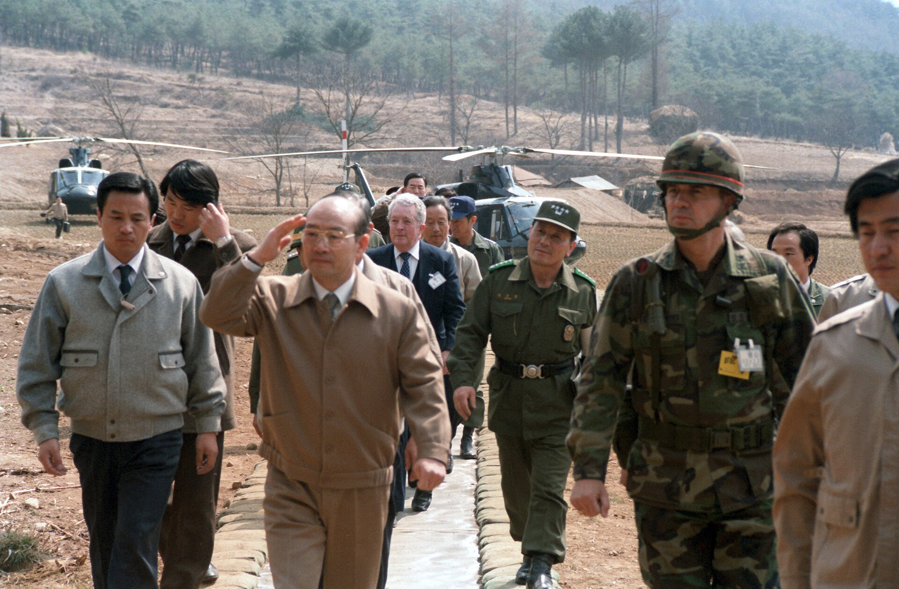
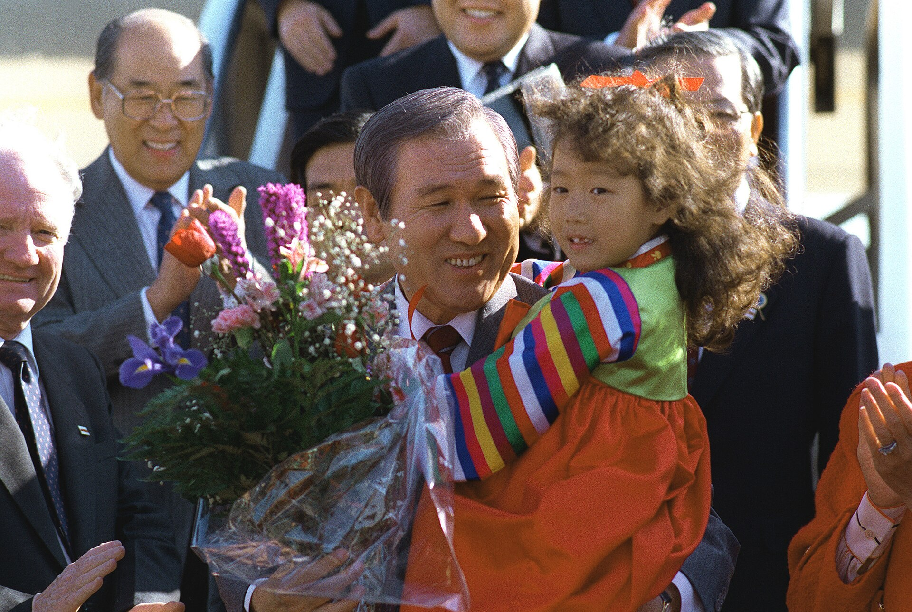
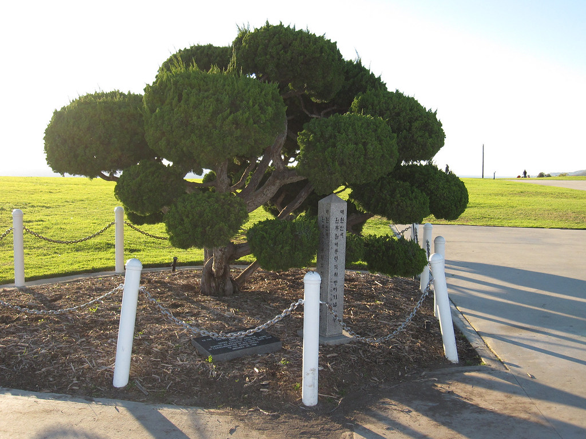

38年前の今日、1988年11月23日。韓国の全斗換前大統領がテレビ演説を行い、親族の不正を謝罪して全財産を国家に返還すると発表しました。最高権力者の座を退いた人物が、自らの非を認めて表舞台から去るという発表は、韓国内外に大きな衝撃を与えました。経済成長と強権支配の狭間で揺れた時代の象徴的な転換点となった一日でした。

## 軍事クーデターから大統領就任へ

全斗換は1931年1月18日、日本統治下の慶尚南道陜川郡に生まれました。1955年に韓国陸軍士官学校を卒業し、軍人としての道を歩み始めます。当時の韓国は、1961年以来軍事独裁を敷いていた朴正煕大統領が統治していました。

しかし1979年に朴正煕大統領が暗殺されると、全斗換は権力の中枢へと進出します。同年12月12日に軍事クーデターを主導して実権を掌握しました。さらに翌1980年5月17日には軍事クーデターによって非常戒厳令を全国に拡大し、光州事件を武力で鎮圧しました。反対派を抑え込むため、「浄化教育」を名目とした収容施設を設けるなど、強権的な統治体制を固めていきました。

1981年3月3日、全斗換は「第五共和国」を発足させ、第5代大統領に就任しました。新憲法下でも大統領には広範な行政権が集中し、強固な独裁体制が敷かれました。

## 高度経済成長の光と強権政治の影

全斗換政権下の韓国は、極めて高い経済成長を達成しました。1982年から1987年にかけての実質経済成長率は年平均9.2パーセントに達し、急速な近代化が進みました。また、1980年から1988年の消費者物価上昇率は年平均4.7パーセントに抑えられ、経済の安定化にも成功しています。

1986年には、韓国経済として史上初となる貿易黒字を記録しました。こうした目覚ましい経済的成功は政権の成果として誇示されました。しかし、その繁栄は厳しい言論統制や労働運動の抑圧、治安機関による暴力を伴うものでした。国民の間では、経済的豊かさとともに自由と民主化を求める声が次第に高まっていきました。

*事件当時の写真ではありません · 1985年 — 写真: AL CHANG / Public domain*

## 民主化闘争と退任への道

1987年、韓国全土で「6月抗争」と呼ばれる大規模な民主化運動が巻き起こりました。学生や市民による連日の抗議行動に直面した全斗換政権は、ついに妥協を余儀なくされます。全斗換は同年12月の大統領選挙を自由で開かれた直接選挙として実施することを受け入れました。

1987年12月の大統領選挙では、全斗換の親友であり軍時代からの盟友であった盧泰愚が当選しました。盧泰愚は1990年代にかけて全斗換政権の多くの政策を引き継ぎましたが、国民の関心は過去の軍事政権が犯した不正の追及へと向かっていきました。大統領退任後の全斗換とその一族をめぐる不正蓄財や汚職の疑惑が、次々と社会問題化していったのです。

*Roh Tae-woo - cropped, 1988-October-21 — 写真: Unknown authorUnknown author / Public domain*

## 1988年11月23日の謝罪と隠棲の決断

退任から数か月が過ぎた1988年秋、国会や世論による真相究明の圧力は頂点に達しました。政権下で親族が関与した利権介入や不正資金づくりに対する追及は、現職の盧泰愚政権にとっても無視できない重荷となっていました。

追い詰められた全斗換は、1988年11月23日に国民に向けた談話を発表しました。自身と一族が犯した不正と国民を失望させた責任を公式に謝罪したのです。全斗換は所有する全財産を国に返還することを誓い、すべての公職から離れて隠棲生活に入ると表明しました。かつて国家の頂点に君臨した軍事指導者が、国民の前で頭を下げて財産を差し出す光景は、権力の盛者必衰を強く印象づけました。

*Tree planted by President Chun Doo-hwan — 写真: InSapphoWeTrust / CC BY-SA 2.0*

## 法廷での断罪と恩赦、残された課題

全斗換の隠棲によっても、過去の清算が終わることはありませんでした。1996年、ソウル高等法院は全斗換に対し、1979年の軍事クーデターや非常戒厳令の全国拡大、光州事件の武力弾圧、さらには内乱罪や反逆罪などの容疑で有罪判決を下しました。この判決は翌1997年4月に大法院で確定します。

しかし同年12月、金泳三現大統領は、かつて全斗換政権によって死刑判決を受けた経歴を持つ次期大統領の金大中の助言を受け、全斗換と盧泰愚（懲役17年）に対する特別恩赦に踏み切りました。国民的和解を理由とした恩赦でしたが、在任中の不正蓄財に対する巨額の追徴金は、その後も大部分が未納のまま残されました。

## 同じ日付に刻まれた時代の終焉

全斗換は晩年も過去の行動に対する責任を問われ続けました。そして2021年11月23日、全斗換は生涯を閉じました。その命日は、かつて国民に向けて過ちを謝罪し、全財産返還と隠棲を発表した1988年11月23日と同じ11月23日でした。

日本統治下の時代に生まれ、激動の軍事クーデターで権力を握り、経済成長と独裁統治の二面性を残した全斗換。1988年のあの日に表明された謝罪と財産の返還は、韓国現代史が軍事独裁から民主主義へと歩みを進める過程で起きた、象徴的な出来事として今も記憶されています。

### 参考資料

- <https://ja.wikipedia.org/wiki/11%E6%9C%8823%E6%97%A5>
- <https://commons.wikimedia.org/wiki/File:Chun_Doo-hwan,_1985-Mar-22.jpg>
- <https://commons.wikimedia.org/wiki/File:Chun_Doo-hwan_and_Claude_M._Kicklighter,_Chung_ho-yong,_1985-Mar-22.jpg>
- <https://commons.wikimedia.org/wiki/File:Roh_Tae-woo_-_cropped,_1988-October-21.jpg>
- <https://www.flickr.com/photos/56619626@N05/5831454683>
