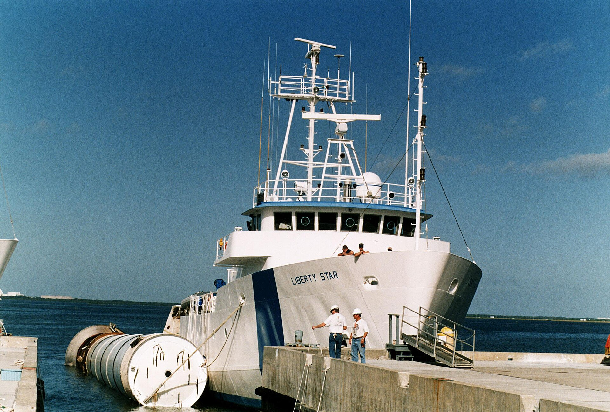
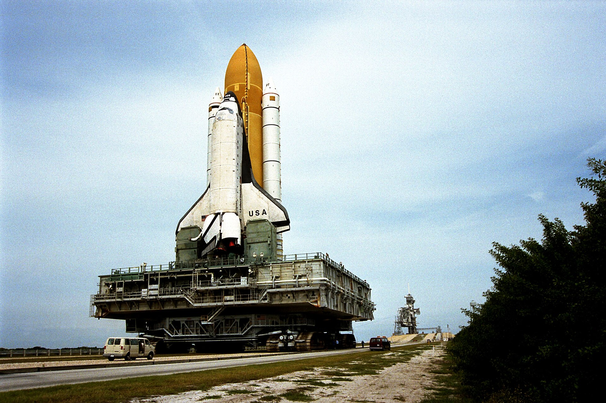
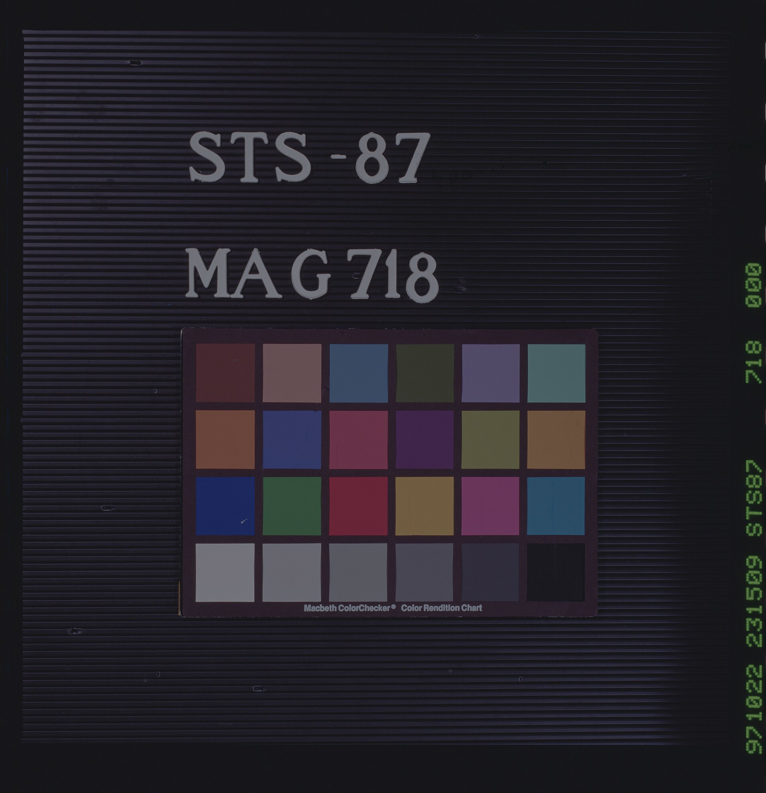

29年前の今日、1997年11月24日。アメリカのスペースシャトル「コロンビア」に搭乗していた土井隆雄宇宙飛行士が、日本人として初めて宇宙空間へと踏み出しました。国際宇宙ステーションの建設を見据えた7時間43分もの船外活動は、日本の宇宙開発史に新たな扉を開く大きな一歩となりました。

## 漆黒の空間へ踏み出した日本人初の船外活動

1997年11月24日、アメリカ航空宇宙局（NASA）のスペースシャトル「コロンビア」のエアロックが開き、宇宙服に身を包んだ土井隆雄飛行士が船外へと姿を現しました。日本人として史上初となる船外活動、いわゆる宇宙遊泳の幕開けでした。テレビ中継を通じて届けられた、青く輝く地球を背景に作業を進める土井飛行士の姿は、日本中の人々に強い感動と驚きを与えました。

## 国際宇宙ステーション建設を見据えた技術試験

この任務の大きな目的は、やがて本格化する国際宇宙ステーション（ISS）の組み立て作業に向けた技術試験を行うことでした。スペースシャトルは、大型の貨物室を備え、人工衛星の展開や修理、宇宙ステーションの資材搬送などを担う再使用型宇宙往還機として運用されていました。土井飛行士は、将来の宇宙ステーション組み立て現場で不可欠となるクレーンや機器の取り扱い、足場の固定や運用手順を細かく検証する役割を託されていたのです。

*Liberty Star with SRB after STS-87 (2) — 写真: NASA / Public domain*

## 弾丸の10倍の速度で飛ぶ過酷な環境と危険性

船外活動は、一見すると優雅な遊泳に見えますが、極めて高い危険を伴う任務です。高度およそ300キロメートルを飛行するスペースシャトルの速度は秒速7.7キロメートルに達し、これは通常の弾丸の約10倍の速さです。宇宙空間では、ペンキのかけらのようなわずかな破片（スペースデブリ）であっても、衝突すれば弾丸並みの破壊力を持ちます。さらに宇宙服の損傷による急激な減圧や無酸素状態、減圧症の危険など、生命を守る宇宙服一枚を隔てた外側は完全な死の世界でした。

*STS-087 shuttle — 写真: NASA / Public domain*

## 7時間43分の作業と「宇宙が呼んでいる」感覚

土井飛行士はこの日、7時間43分という長時間の船外活動を無事にやり遂げました。のちに土井飛行士は、宇宙船の外に出たときの体験について、宇宙が自分たちを呼んでいるような「何とも言いようのない感じ」を抱いたと振り返っています。かつてアフリカの森に住んでいた人類の祖先がサバンナの草原へと降り立ち活動範囲を広げていったように、人類が地球から月や火星へと視野を広げていく過程にある喜びと畏怖が混ざり合った感覚だったと語っています。

*STS087-718-000 - STS-087 - DPLA - 17e46e69041b6cbe4b009a889e1c6a37 — 写真: National Aeronautics and Space Administration. Lyndon B. Joh / Public domain*

## 人類が積み重ねてきた宇宙遊泳の歩み

船外活動の歴史は、1965年3月18日に旧ソ連のアレクセイ・レオーノフ飛行士がボスホート2号から行った約20分間の遊泳から始まりました。同年6月にはアメリカのエドワード・ホワイト飛行士が続き、1984年には命綱なしの有人機動ユニットを使った活動も試みられました。さまざまな困難や宇宙服の改良を重ねながら技術が蓄積され、1997年の土井飛行士による7時間43分の成功へと結びついていきました。

## 日本の宇宙開発の未来へ受け継がれた足跡

土井飛行士が切り拓いた日本人による船外活動の実績は、その後の日本の有人宇宙活動に計り知れない自信と経験をもたらしました。現在も運用が続く国際宇宙ステーションの日本実験棟「きぼう」の組み立てや運用、そして数々の日本人宇宙飛行士によるメンテナンス作業へと、その足跡は確かに受け継がれています。漆黒の宇宙へ初めて踏み出したあの日の挑戦は、今も色あせない記憶として残っています。

### 参考資料

- <https://ja.wikipedia.org/wiki/11%E6%9C%8824%E6%97%A5>
- <https://commons.wikimedia.org/wiki/File:Liberty_Star_with_SRB_after_STS-87.jpg>
- <https://commons.wikimedia.org/wiki/File:Liberty_Star_with_SRB_after_STS-87_(2).jpg>
- <https://commons.wikimedia.org/wiki/File:STS-087_shuttle.jpg>
- <https://commons.wikimedia.org/wiki/File:STS087-718-000_-_STS-087_-_DPLA_-_17e46e69041b6cbe4b009a889e1c6a37.jpg>
