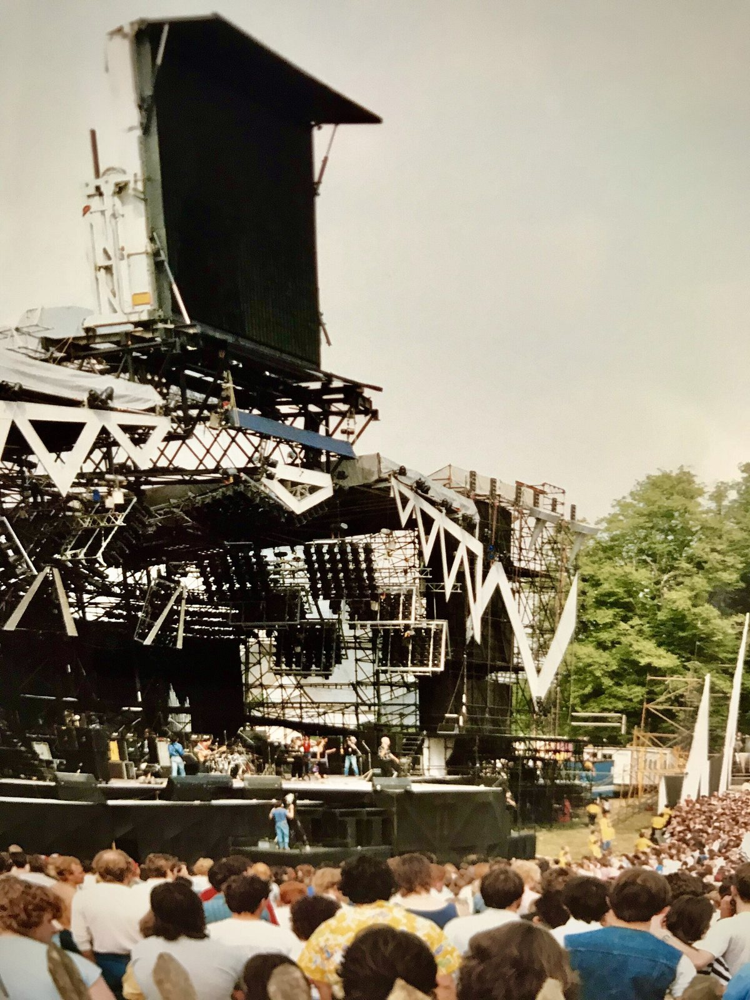
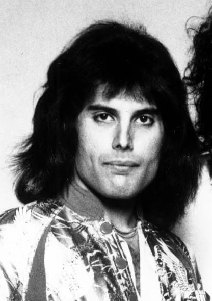
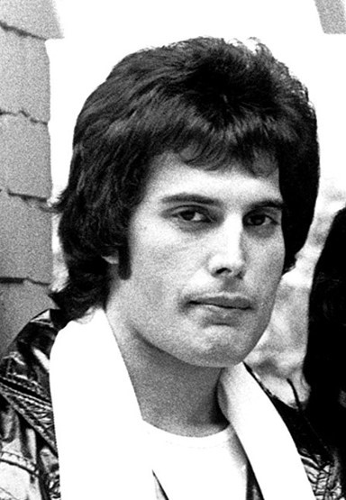

35年前の今日、1991年11月24日。イギリスのロックバンド「クイーン」のフロントマンとして世界的な人気を誇ったフレディ・マーキュリーが、45歳の若さでこの世を去りました。死因はエイズによるニューモシスチス肺炎でした。卓越した歌唱力と類いまれなソングライティング能力でロック界の頂点に立った英雄の突然の死は、世界中の音楽ファンに計り知れない衝撃を与えました。

## ザンジバルからロンドンへ：異才の誕生とクイーン結成

フレディ・マーキュリーは1946年、当時イギリスの保護国だったザンジバル島（現タンザニア）で、パールシーの家庭に生まれました。幼少期の大半をインドの寄宿学校で過ごし、7歳でピアノを習い始めました。ラジオで耳にした楽曲を即座にピアノで再現する特異な才能を早くから発揮していたといいます。

1964年に起きたザンジバル革命の混乱から逃れるため、17歳のときに家族とともにイギリスへ渡りました。カレッジで芸術やグラフィック・デザインを学びながら音楽活動を続け、1970年4月にギタリストのブライアン・メイやドラマーのロジャー・テイラーらがいたバンドに合流します。自ら「クイーン」と命名したバンドで、彼は世界を揺るがす歩みを始めました。

## 名曲の数々とスタジアムを支配した熱狂のステージ

フレディの魅力は、広い声域と多彩なジャンルを融合させる卓越した作曲センスにありました。「ボヘミアン・ラプソディ」「キラー・クイーン」「愛にすべてを」「伝説のチャンピオン」など、クイーンの代表作として今も愛される楽曲の多くを彼自身が作詞・作曲しています。

また、世界中のスタジアムで行われたライブパフォーマンスは圧巻の一言でした。台座のないマイクスタンドを自在に操り、演劇的で華やかな衣装を身にまとって観客を圧倒しました。ギタリストのブライアン・メイが「スタジアムの最後列にいる最後の一人まで、彼とつながっているように感じさせることができた」と語った通り、フレディは生涯でおよそ700回もの公演を行い、1985年の「ライヴエイド」など歴史に残る名演を刻みつけました。

*事件当時の写真ではありません · 1986年 — 写真: Londonmusicinfo / CC BY-SA 4.0*

## 45歳での早すぎる別れと遺された衝撃

精力的な活動を続けていたフレディでしたが、1980年代後半から健康状態をめぐる噂が囁かれるようになります。1986年8月、イングランドのネブワース・ハウスで行われた30万人規模のステージが、クイーンとしてのフレディ最後のコンサートとなりました。

そして1991年11月24日、エイズに伴うニューモシスチス肺炎のため、ロンドンの自宅で息を引き取りました。わずか45歳という若さでした。当代屈指のロックスターの訃報は、病の過酷さと予防の重要性を世界中に痛感させ、エイズへの偏見を取り払う大きな契機ともなりました。

*Freddie Mercury (1975 Elektra publicity photo) — 写真: Koh Hasebe; Distributed by Elektra Records / Public domain*

## 日本文化への深い愛情とファンとの固い絆

フレディは熱心な親日家としても有名でした。1975年の初来日以来、日本のファンが寄せる熱狂的な歓声に深く感謝し、来日公演のステージではMCの多くを日本語で話して会場を沸かせました。

彼の日本愛は音楽にとどまらず、日本の伝統美術に強い関心を寄せていました。伊万里焼の熱心な収集家として知られ、ロンドンの自宅には自ら日本庭園を造らせたほどでした。1986年にはプライベートでお忍び来日を果たし、美術品や骨董品を買い求めています。ソロプロジェクトで発表した楽曲「ラ・ジャポネーズ」の歌詞の大部分を日本語で歌い上げるなど、日本の文化を生涯にわたって慈しんでいました。

*Freddie Mercury (1977 Press Kit Photo) — 写真: Christopher Hopper; distributed by Elektra Records / Public domain*

## 35年を経てもなお世界中で響き続ける歌声

フレディ・マーキュリーが旅立ってから35年の歳月が流れた今も、彼の歌声とクイーンの音楽は色あせるどころか、新たな世代を魅了し続けています。スポーツのスタジアムで響き渡るアンセムとして、また映画やCMを通じて、そのドラマチックなメロディーは日常のあらゆる場面に息づいています。

型破りでありながら誰よりも繊細で、観客を愛し抜いた不世出のボーカリスト。彼が情熱を注ぎ込んで生み出した数々の名曲は、今も私たちの心を強く揺さぶり続けています。

### 参考資料

- <https://ja.wikipedia.org/wiki/%E3%82%A4%E3%82%AE%E3%83%AA%E3%82%B9>
- <https://commons.wikimedia.org/wiki/File:Konzert_Barcelona_1988.jpg>
- <https://commons.wikimedia.org/wiki/File:Belouis_Some_Knebworth_9_August_%2786._Queen_Magic_Tour_jpeg.jpg>
- <https://commons.wikimedia.org/wiki/File:Freddie_Mercury_(1975_Elektra_publicity_photo).jpg>
- <https://commons.wikimedia.org/wiki/File:Freddie_Mercury_(1977_Press_Kit_Photo).jpg>
